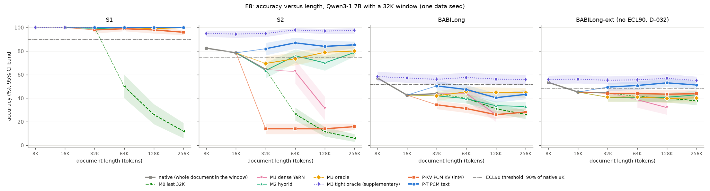
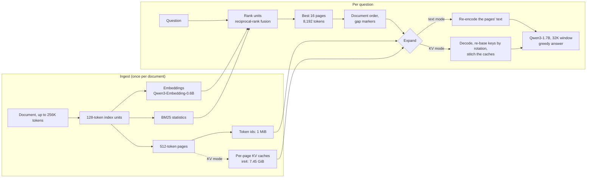
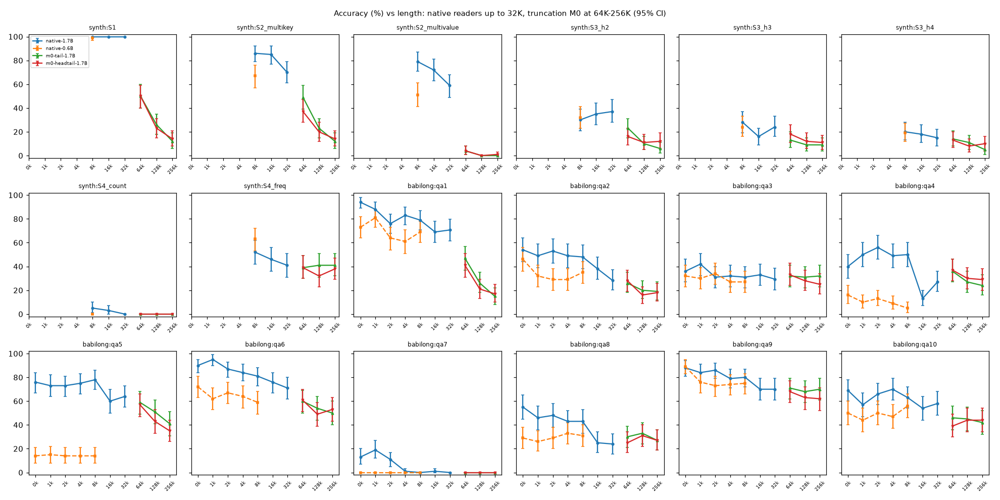
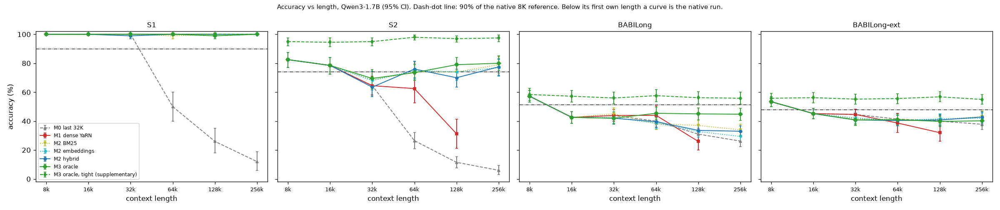
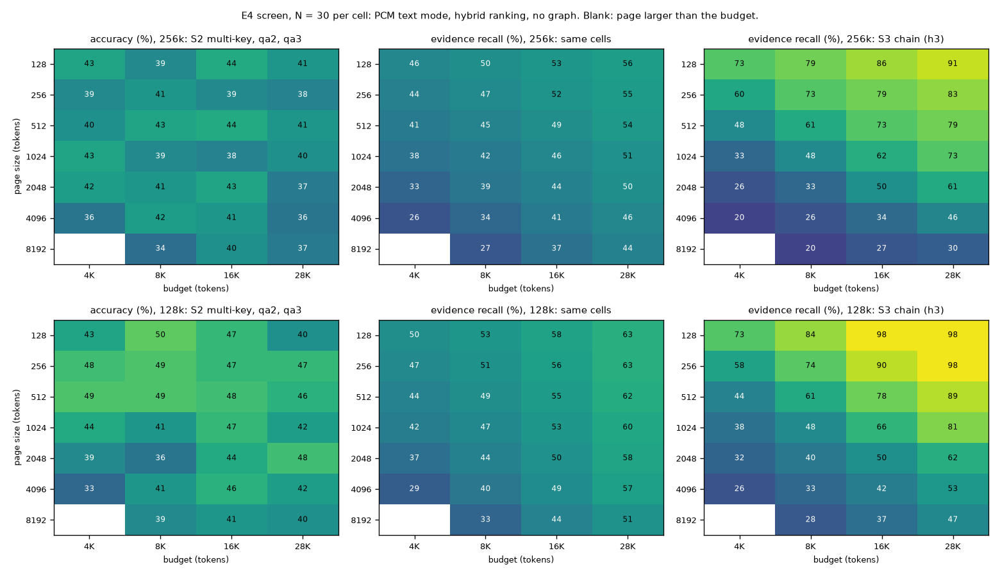
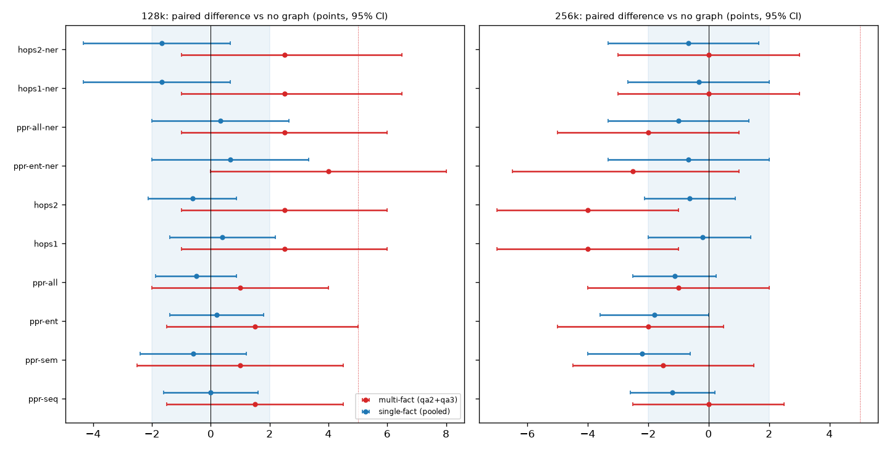
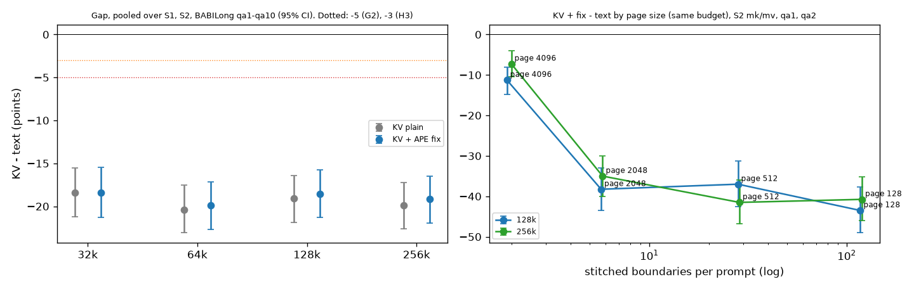
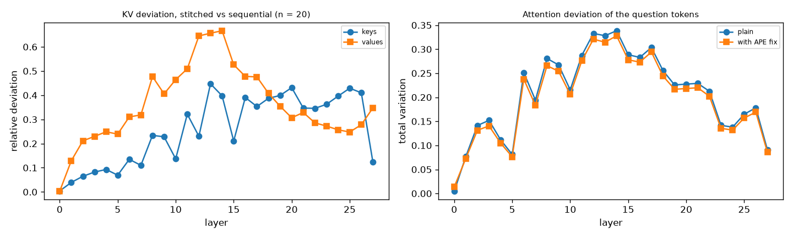
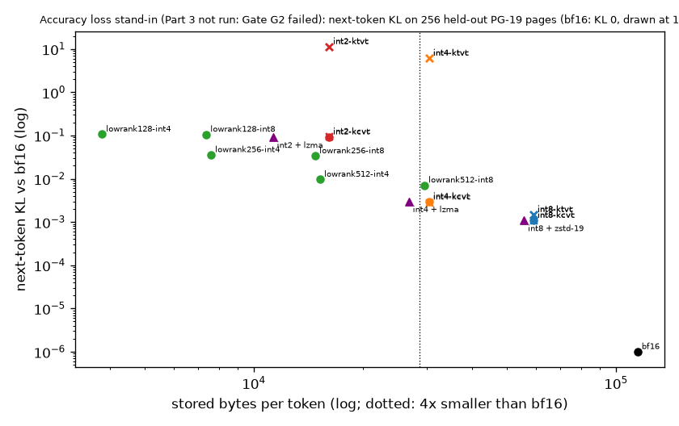
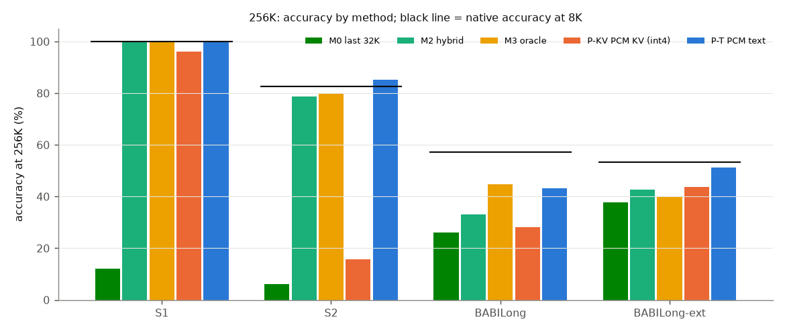

# Paged Context Memory (PCM)

**A case study: can a 1.7B-parameter model with a 32K-token window answer questions over 256K-token documents, on one
24 GB consumer GPU, without retraining it?**

The model never sees more than its native window. The long document is cut into **pages**, an **index** records what
each page holds, a **store** keeps every page, and for each question a **selector** brings the relevant pages back into
the window, in document order. The design borrows from how an operating system pages memory: pages, a page table, a
swap store, page-in on demand.

Every number below comes from a file under `results/` and is explained in the step reports under `reports/`.
Failed hypotheses are reported as failed.

## Results at a glance



*Qwen3-1.7B, one 24 GB GPU, one data seed, 100 examples per task and length (300 at 256K for the synthetic tasks). Bands
are 95% bootstrap intervals. At 8K–16K the whole document fits the window, so every method is the native run (gray).*

| at 256K tokens | truncation (last 32K) | dense YaRN | plain retrieval (28K budget) | **PCM, text mode (8K budget)** | PCM, KV mode (int4 store) |
|---|---|---|---|---|---|
| S1, single needle | 12.0% | does not fit the card | 100.0% | **100.0%** | 96.0% |
| S2, look-alike needles | 6.0% | does not fit (31.2% at 128K) | 78.8% | **85.3%** | 15.8% |
| BABILong qa1–qa5 | 26.2% | does not fit (26.0% at 128K) | 33.0% | **43.2%** | 28.2% |
| BABILong qa6–qa10 | 37.8% | does not fit (32.0% at 128K) | 42.8% | **51.2%** | 43.8% |
| prompt tokens per question | 32,747 | 125,889 at 128K | 29,456 | **8,398** | 8,398 (25 prefilled at query time) |
| seconds per question | 6.8 | 75.3 at 128K | 6.6 | **1.9** | 3.4 |
| peak GPU memory (allocated) | 7.3 GiB | 19.4 GiB at 128K | 9.0 GiB | **7.5 GiB** | 7.5 GiB per question; 14.5 GiB with the whole 256K store on the card |

The model reads 32K tokens natively and scores 100% / 82.5% / 57.2% / 53.4% on these four families at 8K.

**In one paragraph.** With 8,400 tokens of well-chosen pages, text-mode PCM keeps the single-needle and look-alike-needle
tasks at the model's own short-context level all the way to 256K tokens. Over the same examples, dense YaRN falls to 31%
on S2 at 128K and truncation to 6% at 256K. PCM also beats plain retrieval with three times the prompt by 6.5 to 18.5
points at every length on S2 and both BABILong sets. It does **not** keep BABILong at 90% of the model's 8K accuracy. Nothing else does either: the
model itself drops from 57.2% to 42.6% between 8K and 16K tokens. So the headline hypothesis fails as defined. Two of
the three pillars also failed their tests: the relational graph adds nothing, and stitching independently cached pages
costs 19–20 points. Compaction works on fidelity (int4: 3.76× smaller, the same next token 97.4% of the time), but only
inside a mode that does not work.

| Hypothesis | Test | Result |
|---|---|---|
| H1: PCM keeps 90% of short-context accuracy to 256K where dense YaRN does not | ECL90 ≥ 256K on S1, S2 and BABILong | **Fails**: S1 256K, S2 256K, BABILong 8K (dense YaRN: 128K, 16K, 8K) |
| H2: the graph adds ≥ 5 points on multi-fact questions | 10 graph variants, paired against no graph, 128K and 256K | **Fails**: best +4.0 [0.0, +8.0] |
| H3: stitched page caches within 3 points of re-reading the text, with ≥ 10× less prefill | 1,300 paired examples per length | **Fails** on accuracy (−18.4 to −19.9 points); the efficiency part holds (340× less prefill) |
| H4: a codec ≥ 4× smaller at ≤ 1 point of loss | fidelity on 256 held-out pages; accuracy inside KV mode | **Partly**: int4 + lossless 4.26× at next-token KL 0.003; int4 costs −0.2 to −1.6 points against bf16 inside KV mode, which itself fails |
| H5: select-and-expand cannot help aggregation | aggregation tasks | **Not tested**: the model fails them at 8K (counting: 5%) |
| H6: same direction at other model sizes | – | **Not tested** (one model size) |

| Gate | Condition | Result |
|---|---|---|
| G0 floor | ≥ 3 task families workable at 8K | pass (4 families) |
| G1 selection | evidence recall ≥ 0.9 on single-evidence tasks at 256K | pass (1.000) |
| G2 stitching | KV mode within 5 points of text mode | **fail** (−18.4 to −19.9) |
| G3 integration | H1 at 128K, and PCM at 256K inside 24 GB | **fail** (H1 fails on BABILong); the 24 GB part passes |

---

## 1. The question

Small open models advertise a context window (32,768 tokens for Qwen3-1.7B) and degrade well before it. Two common
ways to go further are:

- **stretch the positions** (YaRN) so the whole document fits in one attention pass, at a memory cost that grows with
  the document (the KV cache of a 256K document is 28 GiB in bf16, more than the card);
- **retrieve** a few passages and read only those.

PCM is a retrieval system with three additions, each with its own hypothesis:

| Pillar | What it adds | Hypothesis |
|---|---|---|
| 1. Pages and index | 128-token index units for finding, larger pages for reading; hybrid BM25 + embedding ranking; pages always put back in document order | **H1**: PCM keeps short-context accuracy out to 256K, where dense YaRN does not |
| 2. Relational graph | sequence, semantic and shared-entity edges between units; personalised PageRank or entity hops | **H2**: +5 points on multi-fact questions at ≥ 128K |
| 3a. KV page store | each page's KV cache computed once at ingest, re-based by key rotation and stitched at query time, instead of re-reading the text | **H3**: within 3 points of text mode with ≥ 10× fewer tokens prefilled per question |
| 3b. Compaction | quantization, low rank and lossless coders on the stored caches | **H4**: ≥ 4× smaller at ≤ 1 point of accuracy |
| Limit | select-and-expand cannot help questions that need every page | **H5**: no gain on aggregation tasks |



## 2. Setup

| | |
|---|---|
| Reader | Qwen3-1.7B, chat model, zero-shot, greedy decoding, thinking off. Stated context 32,768 tokens (the config allows 40,960 positions) |
| Index models | Qwen3-Embedding-0.6B (query instruction only); Qwen3-Reranker-0.6B for a baseline variant |
| Hardware | one RTX 3090 (24 GB), 16 GB RAM, Windows 10; PyTorch 2.14.1 (CUDA 12.6), Transformers 5.19.0 |
| Memory geometry | 28 layers × 8 KV heads × 128 dims × 2 (K, V) × 2 bytes = **112 KiB of KV cache per token**; 256K tokens = 28 GiB |
| Tasks | **S1** single needle; **S2** multi-key (one of four look-alike needles) and multi-value (all four values of a key); **BABILong** qa1–qa5 (bAbI facts hidden in PG-19 books; official prompts and scorer) and qa6–qa10 ("BABILong-ext"); **InfiniteBench** passkey, number_string, kv_retrieval, longbook_choice_eng (90K–190K tokens). Synthetic haystacks are PG-19 books; every needle's token offsets are recorded |
| Lengths | 8K, 16K, 32K, 64K, 128K, 256K tokens (measured with the Qwen tokenizer, not nominal) |
| Sample sizes | 100 examples per task and length (300 for the synthetic tasks at 256K in the final comparison); one data seed |
| Statistics | bootstrap 95% intervals (10,000 resamples); methods compared on identical examples with a paired bootstrap |
| Main metric | **ECL90**: the largest length L at which accuracy stays ≥ 90% of the model's own accuracy at 8K at every length up to L (and above a floor of max(30%, 2 × chance)), a variant of RULER's effective context length |

Methods compared:

| ID | Method |
|---|---|
| M0 | truncation: the last 32K tokens |
| M1 | dense attention with training-free YaRN (factor from the measured length; runs to 128K on 24 GB) |
| M2 | plain retrieval: 128-token units, hybrid BM25 + embeddings, 28,672-token budget, document order |
| M3 | oracle: the units holding the gold evidence, padded to the same budget (and a "tight" oracle with one neighbour each side, as a ceiling) |
| P-T | PCM, text mode: 512-token pages, 8,192-token budget, hybrid ranking, no graph |
| P-KV | PCM, KV mode: the same pages from an int4 KV store, re-based and stitched, with the best training-free fix |

## 3. What was done, step by step

Each step had a written plan, ran a 5-example pilot per cell with a time projection, and ended with a report and a
commit. Decisions taken along the way, and every departure from the plan, are in `DEVIATIONS.md` with the reason,
written before the run they affect.

### Step 1: the engine and its invariants (`reports/A1_engine.md`)

KV mode rests on one piece of algebra: Qwen3 caches keys *after* the rotary position embedding, and rotations compose,
so a page's cached keys can be moved to a new position by one more rotation. The test written for it failed as
specified (maximum absolute difference up to 0.027 against a threshold of 0.001 in float32). The cause turned out to be the
library itself: it computes rotary angles in float32, so the model is not exactly translation-invariant. With float64
angles patched in for the test, re-based keys match direct encoding to 1.8 × 10⁻⁷ relative. The relative criterion was
adopted, and every KV result carries that caveat. Two engineering findings mattered later: chunked prefill fragments
the allocator (fixed by trimming its cache between blocks), and prompts are assembled in token space, never by
tokenizing a joined string.

### Step 2: the floor (`reports/A3_floor.md`)

Before testing anything long, the reader was measured inside its own window. At 8K, Qwen3-1.7B scores 100% on S1,
82.5% on S2, 57.2% on BABILong qa1–qa5 and 53.4% on qa6–qa10; it fails the chain and aggregation tasks (S3 26%, S4
28.5%), which were dropped. The reader already degrades inside its window: BABILong falls from 57.2% at 8K to 42.6% at
16K. That single number decides H1 later, because ECL90 needs 90% of the 8K score (51.5%) at every length.



### Step 3: baselines (`reports/A4_baselines.md`)

- **Dense YaRN does not read 128K on this model.** S1 holds (100%), but S2 falls to 31% and BABILong to 26% at 128K,
  where the model copies the haystack instead of answering. It costs 75 s per question and 19.4 GiB, and 256K does not
  fit the card.
- **Plain retrieval holds S1, and S2 from 64K to 256K (70.0–77.5%), but not BABILong (33.0–42.0%).**
- **The most useful finding came from the oracle.** Handed the gold evidence with one neighbouring unit each side
  (0.4K–6.7K tokens), the reader matches its 8K accuracy at every length (S2 94.5–98.0%, BABILong 55.8–58.4%). Padded with its
  own neighbourhood to 28,672 tokens, the *same evidence* loses 11 to 25 points. For this reader, what surrounds the
  evidence costs as much as the evidence that is missed.



### Step 4: pages, budget and the graph (`reports/A5_pillars12.md`)

A screen of 27 page-size × budget settings, then the best three on every task:



- **A short prompt is the win.** 512-token pages with an 8,192-token budget (16 pages) beat plain retrieval with a
  28,672-token budget by **+6.8 to +14.0 points** on S2, BABILong and BABILong-ext at 128K and 256K (all six paired
  intervals exclude zero), while keeping *less* of the evidence. A 16,384-token budget raised evidence recall and still
  lost 3.5–8.2 points.
- **Page size moves recall more than accuracy.** Recall falls steadily as pages grow; accuracy is flat from 128 to 512
  tokens and drops only for pages of 1,024 tokens and more at small budgets.
- **Selection gate passed:** every S1 and S2 needle is inside the kept pages at 256K (recall 1.000).
- **The graph does not help (H2 fails).** No variant (PageRank over sequence, semantic or entity edges; entity hops;
  default or spaCy entities) gains on the multi-fact questions; the best is +4.0 [0.0, +8.0] points at 128K and entity
  hops lose 4.0 at 256K. The graph changes the kept pages in about half the examples, but the pages it brings in are no
  more often evidence: bAbI chains run through common nouns ("where is the football?"), which no entity extractor
  links.



Cost at 256K: about 7.5 s of GPU per document to embed every unit (34K tokens/s), a 4 MiB index, 0.28 s to select,
1.65 s per question.

### Step 5: stitching cached pages (`reports/A6_kv.md`)

KV mode gives the reader exactly the same tokens at the same positions as text mode, but each page was encoded without
seeing the other pages.

- **It fails (H3 and the stitching gate).** With the best training-free fix (an APE-style key temperature and context
  scale, tuned on a separate training split), KV mode is **18.4 to 19.9 points below text mode** at every length
  (1,300 paired examples per length).
- **The failure is task-specific.** Single-needle tasks survive (S1 97–100%, passkey 100%). Tasks that compare needles
  or gather several collapse: S2 multi-key from 87–89% to 26–36%, multi-value to 0–1%.
- **Why:** from the second layer on, a stitched page's hidden states drift from what full encoding gives, by up to
  two-thirds of the value norm in the middle layers; the fix changes attention by only 3–7%.
- **What it would have bought:** 25 tokens prefilled per question instead of 8,400 (340× fewer), and 0.14 s to the first
  token instead of 0.9–1.1 s.




### Step 6: compacting the store (`reports/A7_codecs.md`)

Because stitching failed, codecs were judged on fidelity (next-token agreement with the uncompressed cache on 256
held-out PG-19 pages) rather than task accuracy.

- **int4 with keys quantized per channel and values per token (KIVI)** is 3.76× smaller, next-token KL 0.003, the same
  top token 97.4% of the time; a fast lossless coder on top reaches 4.26× with nothing changed. Quantizing keys per
  token instead destroys the model (KL 6.1).
- Low rank 512 + int4 gives 7.5× at KL 0.0097; int2 gives 7.1× at KL 0.092.
- Lossless coders alone on raw bf16 give 1.28–1.49× (the exponent bytes repeat), above the 1.15× expected.
- A whole 256K document's int4 store is 7.45 GiB and fits on the card beside the model and a 32K window; decoding a
  full budget of pages takes 1.1 s against 5.4 s to recompute it from text.



### Step 7: everything together at 32K–256K (`reports/A8_local.md`)

The final local comparison puts all six methods on the same examples. It reuses earlier rows where the method and the
examples were identical, after checking that the current code rebuilds those prompts exactly (600 of 600 did). It adds
5,600 KV-mode rows with the int4 store, and 300 examples per synthetic task at 256K. All 8,000 new rows ran on one clean
commit, and none failed.



**ECL90**, the largest length at which a method keeps 90% of the model's 8K accuracy:

| method | S1 | S2 | BABILong |
|---|---|---|---|
| truncation (last 32K) | 32K | 16K | 8K |
| dense YaRN | 128K (256K does not fit) | 16K | 8K |
| plain retrieval | 256K | 16K | 8K |
| oracle (gold evidence padded to 28K tokens) | 256K | 16K | 8K |
| **PCM, text mode** | **256K** | **256K** | 8K |
| PCM, KV mode | 256K | 16K | 8K |
| tight oracle (gold evidence ± one unit; a ceiling, not a method) | 256K | 256K | 256K |

- **Against dense YaRN at 128K**, PCM is +55.0 points on S2, +19.0 on BABILong and +24.0 on BABILong qa6–qa10 (paired;
  every interval excludes zero), using 8,400 prompt tokens instead of 125,900.
- **It fits.** With the reader and embedder loaded, every page of a 256K document encoded into an int4 KV store on the
  card (7.4 GiB), and a question answered from it, the whole system peaks at 14.5 GiB allocated and 17.3 GiB reserved. In
  text mode, the default, a question needs 7.5 GiB.
- **Why BABILong fails, from the errors.** Each error was traced to its cause:
  - qa2 ("where is the football?") fails at selection: 90 of 91 errors lost a supporting fact's page, because the facts
    that answer it share no word with the question.
  - qa1 ("where is Sandra?") fails at reading: 24 of 37 errors had the person's last move inside the window. Some
    answered with an older location, others with a word from the surrounding book.
  - S2 errors are never missed pages: every needle is kept. On multi-key, all 38 errors name one of the look-alike
    keys' numbers.
- **KV mode stays a negative result** with the compact store: 18.8 to 20.2 points below text mode on the same 100
  examples per task.

## 4. What this study shows

1. **For a small model, a short prompt matters more than a complete one.** The same evidence scores 11–25 points higher
   alone than inside 28K tokens of its own context, and with 512-token pages an 8K selection budget beat a 16K one
   by 3.5–8.2 points on every family.
   PCM's gains over plain retrieval come from this, not from finding more evidence: it keeps less of it.
2. **"Effective context" is capped by the model's own short-context curve.** This model loses 15 points on BABILong
   between 8K and 16K tokens. No method that hands it more than a few thousand tokens can stay within 90% of its 8K
   score, so an ECL90 defined against 8K cannot pass on that benchmark, whatever happens at 256K.
3. **Selection is solved for distinctive needles, not for chains.** Needles that share words with the question are always
   found (recall 1.000 at 256K). Facts linked to the question only through other facts are not, and a graph over
   embeddings, adjacency and shared entities did not find them either.
4. **Independently encoded page caches do not compose for this model without training.** Re-basing by rotation is
   exact, but each page's hidden states lack the other pages. Telling look-alike items apart across pages, or gathering
   them, breaks (S2 multi-key 26–36%, multi-value 0–1%), while single facts survive.
5. **The memory problem is solved; the accuracy problem is not.** A 256K document's KV store compacts from 28 GiB to
   7.4 GiB and decodes in about a second, but that only matters once stitched caches answer as well as re-read text.

**Limitations.** One model (Qwen3-1.7B), zero-shot. One data seed. Dense YaRN rests on 40 examples per task (30 for some
families) because each one takes over a minute. Most tasks are synthetic or semi-synthetic. BABILong's dataset does not
mark which facts an answer needs, so many of its errors have an undetermined cause. Every component has prior art
(TurboRAG, CacheBlend and APE for stitched caches; KIVI and KVTC for compaction; HippoRAG for graph retrieval; RULER and
BABILong for evaluation). The contribution here is the integrated system, the ablations, and measurements on a small
model on consumer hardware, not a new mechanism.

## 5. How the work was run

- **Plan first, then data.** Hypotheses, gates and thresholds were written before any run. Every departure from the
  plan, and every reading rule fixed after a pilot, is in `DEVIATIONS.md` (53 entries), dated before the rows it
  governs.
- **Nothing tuned on test data.** The one tuned setting (the KV fix's temperature and scale) used a separate synthetic
  training split with disjoint seeds, names and values.
- **Paired and reproducible.** Fixed seeds, greedy decoding, append-only result files with the git commit and package
  versions on every row, method configurations hashed, and stored answers reused only for byte-identical prompts.
- **Built for an unstable GPU.** Every run is resumable from its last finished example. A lost device exits with a
  distinct status and is never recorded as a wrong answer.
- **Results that look too good are treated as bugs until explained.** Two such cases (the tight oracle above the native
  score; BM25 above the oracle on one task) are explained in `reports/A4_baselines.md`.

## 6. Reproducing

```text
uv venv .venv --python 3.11
uv pip install --python .venv torch==2.14.1 --index-url https://download.pytorch.org/whl/cu126
uv pip install --python .venv -r requirements.lock.txt
python scripts/fetch_assets.py                 # models and datasets into the Hugging Face cache
python scripts/make_data.py --synth            # synthetic tasks (seed 0); add --lengths 256k --n 300 for the final cells
python -m pytest --reader reader               # engine invariants, tasks, index, KV mode, codecs
python scripts/run_a4.py --exp E3_retrieval --pilot   # every run script pilots first and prints its projected time
python scripts/a8_summary.py                   # rebuilds every table and figure of the final comparison from results/
```

Each step's run script (`scripts/run_a3.py` … `scripts/run_a8.py`) and summary script (`scripts/a3_summary.py` …
`scripts/a8_summary.py`) reproduces that step's report from the raw rows in `results/<experiment>/runs.jsonl`.
Weights, datasets and KV stores are never committed.

## 7. Repository layout

```text
pcm/            library code
  models.py     reader loading (YaRN through rope_parameters), chat segments in token space
  prefill.py    chunked prefill (blocks of at most 2,048 tokens), greedy generation, additive attention bias
  chunking.py   128-token index units snapped to sentence ends; pages as runs of units
  index/        embeddings, BM25, reciprocal-rank fusion, reranker, graph, page selection, per-document index cache
  store/        KV cache adapter and re-basing (kv.py), page store, codecs
  expand.py     text expansion with gap markers; KV layout and stitching
  tasks/        synthetic tasks, BABILong, InfiniteBench (official prompts and scorers), PG-19 streaming
  eval/         runner (resumable, paired, crash-aware), metrics (bootstrap, ECL90, evidence recall), KV fidelity
configs/        one YAML per experiment; pcm_text.yaml and pcm_kv.yaml fix the two PCM modes
scripts/        data generation, one run script and one summary script per step
tests/          pytest: engine invariants, tasks, index, pages and graph, KV mode, codecs, run scripts
results/        <experiment>/runs.jsonl and env.json; <step>/summary.json, tables.md, figures/
reports/        one report per step (A0_setup.md … A8_local.md)
DEVIATIONS.md   every departure from the plan, with its reason, before the run it affects
```
