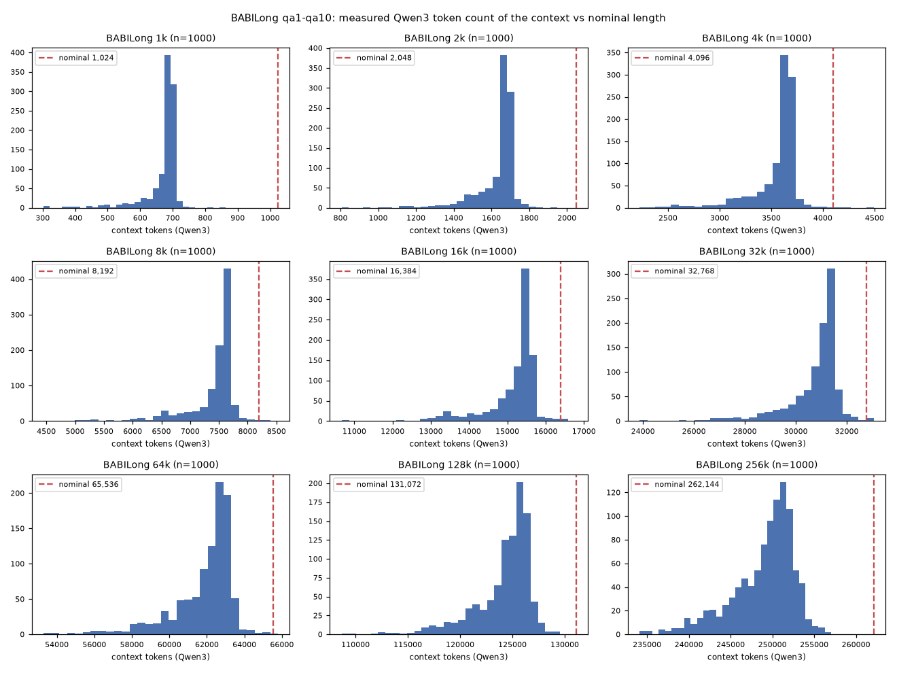
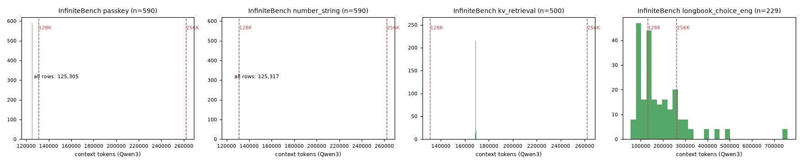

# A2 — Tasks and evaluation harness

Date: 2026-11-14. Machine: local workstation (RTX 3090, 24 GB). No experiment was run.
Following the prompt, the only model runs were two tiny harness tests, one per reader.

This step builds everything the experiments from A3 onward read and score: the synthetic tasks
S1 to S4, loaders for BABILong and InfiniteBench on their official prompts and scorers, the
metrics of section 5.4 of the specification, and a resumable runner that writes one durable line
per example. It also measures how long the benchmark inputs really are in Qwen3 tokens. Several
later decisions depend on those lengths.

Every number below is read from a file under `results/A2_tasks/`:

| File | Written by | Code commit |
|---|---|---|
| `synth_manifest.jsonl` (one line per synthetic example, no text) | `scripts/make_data.py --synth` | `37e893d`; 32k cells `0b39c33` (D-021) |
| `verify_synth.json` (stored examples regenerated and compared) | `scripts/make_data.py --verify` | `760be1c` |
| `lengths_babilong.jsonl`, `lengths_infbench.jsonl` | `scripts/make_data.py --benchmarks` | `37e893d` |
| `sizes.json` | `scripts/make_data.py --sizes` | `760be1c` |
| `summary.json`, `examples.json`, `figures/*.png` | `scripts/a2_summary.py` | `760be1c` |
| `pytest_cpu.xml`, `pytest_gpu_reader.xml`, `pytest_gpu_reader_dev.xml`, `tests_env.json` | pytest | `760be1c` |

All of these commits had no uncommitted code. Between `37e893d` and `760be1c` the
generator changed only for the 32k cells (D-021). The other changes were documentation, the
summary script and the verify mode. `verify_synth.json` checks this: with the code of `760be1c`,
4 examples of each of the 48 stored files (192 in all) were regenerated, and all 192 are
identical to the stored ones.

## 1. Outcome

| Item | Result |
|---|---|
| Decision on T2, left open after A1 | Relative criterion accepted (D-017; section 2) |
| Synthetic test sets, seed 0: 8 tasks x 6 lengths x 100 | 4,800 examples, every one within 1% of its target length |
| Evidence depth stratification (S1 to S3) | exactly 10 examples per decile in every cell |
| BABILong qa1 to qa10, 0k to 256k, Qwen3 token lengths | 10,000 rows measured; facts located with precision of at least 0.998 |
| InfiniteBench passkey, number_string, kv_retrieval, longbook_choice_eng | 1,909 rows measured; evidence located in every row of the three retrieval tasks |
| Official prompts and scorers reproduced exactly | yes (tests compare against the official functions) |
| Tests | 80 CPU tests: 70 passed, 10 skipped (GPU-only), 0 failed. Tiny native GPU test: passed on both readers |

Three findings matter for the next prompts (section 8 has the full list):

1. **No InfiniteBench sample fits the native window.** passkey and number_string are 125,305 and
   125,317 tokens in every row, kv_retrieval 168,652 to 169,498, longbook_choice_eng 69,657 to
   745,586. E0 (A3) cannot run InfiniteBench natively; it enters only through truncation (E1) and
   the long-context methods.
2. **BABILong's nominal lengths overstate Qwen3 tokens by about 5%.** The "256k" split has a median
   of 249,960.5 context tokens (maximum 257,017). The "32k" split mostly fits the window (992 of 1,000
   prompts); "64k" and longer never do.
3. **4 longbook_choice_eng samples exceed what YaRN can reach.** Their prompts are longer than
   16 x 40,960 = 655,360 tokens (the longest is 745,712). Dense YaRN (M1) cannot be run on them at
   any factor the specification allows.

## 2. Decision on T2 (left open after A1)

The owner delegated the choice. Re-basing is now accepted on the relative criterion recorded in
D-017: per layer, the maximum difference divided by the tensor's largest magnitude below 1e-3 (A1
observed at most 2.7e-4); logits within 1e-2 with the same top-1 token (observed 1.4e-4); and the
float64 run below 1e-6 relative (observed 7.3e-7). The absolute 1e-3 bound cannot be met by any
correct implementation: A1 measured differences of 1e-3 to 5e-3 in cached keys and values between
two mathematically identical computations.

The literal T2 test stays in the suite and keeps failing. Every KV report carries the caveat
that these thresholds were set after the A1 results were seen, and that the float64 margin on
Qwen3-1.7B is small.

## 3. The tasks, one example each

Every example has the same fields: id, task, measured context length in tokens, context, question,
answers, and an evidence list with character offsets, token offsets, hop index and depth decile.
Synthetic examples also list their distractors and the PG-19 books the haystack came from. The
excerpts below come from `examples.json`; `<< >>` marks the evidence. Synthetic examples are
index 3 of seed 0 at 8k, which puts them in decile 3.

**S1, single needle** (8,176 tokens). Question: *What is the special magic number for
dappled-thicket mentioned in the text? Answer with the number only.* Answer: 1486621.
> ...with his ammunition holsters and chamber, on foot. <<The special magic number for dappled-thicket is: 1486621.>> The sticks, which are seven feet in length...

**S2 multi-key** (8,176 tokens). Four needles of identical form. The three distractor keys each
share exactly one word with the gold key: ivory-quarry, pallid-ferret and pallid-marlin
against the gold pallid-quarry. Question: the magic number for pallid-quarry. Answer: 4673032.
Scored correct only if no distractor value appears in the answer.

**S2 multi-value** (8,176 tokens). Four sentences *One of the special magic numbers for
crimson-tundra is: ...*, at deciles 3, 4, 6 and 8. Question: all the numbers for crimson-tundra.
Correct only if all four appear.

**S3 chain, 3 hops** (8,176 tokens). Gold chain *VAR ICXWN = VAR GBDSE.* (hop 0, decile 9),
*VAR GBDSE = VAR JRHGA.* (hop 1, decile 4), *VAR JRHGA = 4131627.* (hop 2, decile 3). There are
three distractor chains of the same length, such as *VAR KNEKM = 3056982.* Question: *What is the
numeric value of VAR ICXWN?* Answer: 4131627. Only the hop-0 statement shares a word with the
question, and the text contains four number assignments, so the answer cannot be read off without
following the chain.

**S4 count** (8,176 tokens). The sentence *The bell of the ochre-pelican tower rang once.* appears
8 times, spread uniformly. Question: how many times the bell rang. Answer: 8.

**S4 most frequent** (8,176 tokens). 12 sentences *The signal word is ...* name 5 candidate words;
mandolin is the most frequent. Answer: mandolin. Naming any other candidate as well counts as
wrong.

**BABILong qa1** (row 0 of 8k, 7,284 tokens). Question: *Where is Mary?* Target: bathroom.
Located facts: 4, for example
> ...so don't frisk about more than you can help at present;" and Mr. <<John travelled to the hallway.>> Schermerhorn left the camp...

(The fact sits inside "Mr. Schermerhorn": BABILong inserts facts between sentences as the NLTK
sentence splitter cut them.)

**BABILong qa2 to qa5** (8k, row 0): qa2 *Where is the football?* (kitchen, 20 facts); qa3
*Where was the football before the garden?* (kitchen, 30 facts); qa4 *What is the bathroom east
of?* (bedroom, 2 facts); qa5 *Who did Fred give the football to?* (Jeff, 8 facts).

**InfiniteBench**: passkey (*The pass key is 71432. Remember it. 71432 is the pass key.* among
repeated filler, 125,305 tokens); number_string (a 10-digit sequence, 125,317 tokens);
kv_retrieval (a JSON object of UUID pairs, 169,035 tokens; question: the value of one key);
longbook_choice_eng (a novel, 266,658 tokens; four options; no evidence span).

The prompt wrappers, measured in Qwen3 tokens (chat markup + system + instruction + question,
everything but the context): synthetic 79 to 90, BABILong qa1 to qa5 163 to 291 (they carry the
official few-shot examples), InfiniteBench 56 to 108. All prompts are built with thinking off
(an empty think block after the assistant header).

## 4. Synthetic test sets (S1 to S4)

**How an example is built.** Each PG-19 validation and test book (150 books, 14.2M tokens) is
tokenized once and cached together with the character offset of every token. The book order is a
permutation fixed by (split, seed), so each seed draws on a different book mix. An example starts
at a paragraph of a randomly chosen book and continues through the following books until the
token budget is reached. Needle sentences are inserted at sentence ends. The final context is
tokenized again, and the example is accepted only if all three checks pass:

- the length is within tolerance;
- the designated evidence lies in its decile;
- every needle string (key, value, variable name, marker word) occurs exactly as often as
  intended. Needle strings are checked absent from the haystack before insertion.

Otherwise the example is rebuilt, deterministically. Every example is a pure function of
(split, task, length, seed, index). The design choices the specification leaves open are listed
in D-018 and D-021.

**Lengths.** Measured context tokens over all 8 tasks, 100 examples per task and length:

| Length | Target | Measured range | Largest shortfall |
|---|---|---|---|
| 8k | 8,192 | 8,174 – 8,176 | 0.21% |
| 16k | 16,384 | 16,348 – 16,352 | 0.20% |
| 32k | 32,768 | 32,540 – 32,543 | 0.69% (deliberate, D-021) |
| 64k | 65,536 | 65,400 – 65,405 | 0.20% |
| 128k | 131,072 | 130,800 – 130,810 | 0.20% |
| 256k | 262,144 | 261,606 – 261,620 | 0.20% |

All 4,800 examples are within 1% and none is above its target. The 32k cell is held at 32,608
tokens or fewer, so that the longest wrapper (90 tokens) and the longest answer (48) also fit
inside the 32,768-token window. A first version of the 32k sets did not fit; it was replaced
before any run used it (D-021).

**Depth.** In every S1, S2 and S3 cell each decile holds exactly 10 examples. S4 has no decile:
its markers are spread over the whole text. In S3 the gold statements lie in distinct deciles.

**S4 grows with length**, as intended for H5. S4 count has 4 to 8 bells at 8k (median 6) and 128
to 256 at 256k (median 178.5). S4 most-frequent has 10 to 14 markers at 8k and 320 to 447 at 256k.

**Book mix.** Each cell starts its 100 examples in 67 to 79 different books. At 256k an example
spans a median of 4 to 5 books (at most 9).

**Rebuilds.** The mean number of build attempts is 1.0 for most cells and at most 1.77 (S4
most-frequent at 256k, where many candidate marker words occur in the haystack and are redrawn).

**Train split.** The same generator with `split="train"` uses seeds of 1000 and above and
disjoint key words, value range (5,000,000 to 9,999,999 against 1,000,000 to 4,999,999 for
test), variable-name letters (N to Z against A to M) and marker words. Tests check the
disjointness. It draws on the same PG-19 pool (D-018). Train sets are not materialised yet.

## 5. BABILong

Rows are read from the local copy of `RMT-team/babilong`. The prompt is built with the official
`get_formatted_input` and `DEFAULT_PROMPTS` (instruction, few-shot examples, post prompt) inside the
chat template, and scored with the official `compare_answers` and `TASK_LABELS` (D-019).

Measured Qwen3 tokens, qa1 to qa10 together (1,000 rows per length):

| Length | Nominal | Context min | Median | Max | Median / nominal | Prompt max | Prompts within 32,768 | YaRN factor for the longest prompt |
|---|---|---|---|---|---|---|---|---|
| 1k | 1,024 | 303 | 690 | 862 | 0.6738 | 1,072 | 1,000 | none needed |
| 2k | 2,048 | 806 | 1,673 | 1,950 | 0.8169 | 2,174 | 1,000 | none needed |
| 4k | 4,096 | 2,225 | 3,638 | 4,494 | 0.8882 | 4,721 | 1,000 | none needed |
| 8k | 8,192 | 4,453 | 7,573.5 | 8,527 | 0.9245 | 8,751 | 1,000 | none needed |
| 16k | 16,384 | 10,667 | 15,419.5 | 16,792 | 0.9411 | 17,017 | 1,000 | none needed |
| 32k | 32,768 | 23,866 | 31,107 | 33,067 | 0.9493 | 33,312 | 992 | none needed |
| 64k | 65,536 | 53,297 | 62,394 | 65,789 | 0.9521 | 66,013 | 0 | 2 |
| 128k | 131,072 | 108,670 | 124,966.5 | 129,531 | 0.9534 | 129,822 | 0 | 4 |
| 256k | 262,144 | 234,103 | 249,960.5 | 257,017 | 0.9535 | 257,219 | 0 | 8 |

What this means:

- BABILong's lengths were counted with a different tokenizer. In Qwen3 tokens the splits run about
  5% short at 32k and above, and much shorter at 1k to 4k (the facts are a larger share there). A
  curve plotted against the nominal names overstates reach by about 5%. Reports should give
  measured tokens beside the names.
- At 32k, 8 of 1,000 prompts exceed 32,768 tokens, all of them below the model's 40,960 positions.
  A3 has to decide whether those 8 rows run natively or are skipped. The runner skips them by
  default (`max_prompt_tokens`, status "skipped"), and never truncates silently.
- Dense YaRN (M1) needs factor 2 at 64k and 4 at 128k. 256k needs factor 8, because 257,219 >
  4 x 40,960 = 163,840.
- The "0k" split (12 to 891 tokens, no haystack) holds only the facts. It defines the fact
  vocabulary below.

**Fact locator.** A sentence counts as a fact if every word belongs to the vocabulary of the
task's 0k split (with at least two words; D-019). Where row i at a length has the same question
and target as row i at 0k, the 0k row holds exactly its facts, which gives a ground truth.
Agreement over all lengths 0k to 256k:

| Task | Located | Of which are 0k facts | Share | Rows checkable | Recall against the 0k row | Rows found exactly |
|---|---|---|---|---|---|---|
| qa1 | 5,733 | 5,733 | 1.000 | 1,000 | 0.992 | 953 |
| qa2 | 15,919 | 15,917 | 0.9999 | 970 | 0.995 | 884 |
| qa3 | 51,234 | 51,230 | 0.9999 | 790 | 0.996 | 672 |
| qa4 | 1,984 | 1,984 | 1.000 | 1,000 | 0.992 | 984 |
| qa5 | 18,376 | 18,376 | 1.000 | 982 | 0.993 | 883 |
| qa6 | 6,336 | 6,336 | 1.000 | 1,000 | 0.993 | 956 |
| qa7 | 8,287 | 8,287 | 1.000 | 1,000 | 0.994 | 947 |
| qa8 | 9,364 | 9,364 | 1.000 | 1,000 | 0.994 | 944 |
| qa9 | 5,997 | 5,994 | 0.9995 | 1,000 | 0.992 | 951 |
| qa10 | 6,463 | 6,453 | 0.998 | 1,000 | 0.993 | 947 |

At most 10 located sentences per task are not 0k facts: most likely PG-19 sentences made only of
bAbI words. About 0.5 to 0.8% of the facts are missed. The miss inspected (qa6, 64k) follows an
index list with no sentence break before it, so the sentence it falls in contains other words.
The other misses were not inspected one by one. The checkable rows fall
short of 1,000 in three tasks: some rows hold a different bAbI sample than row i at 0k (qa2: 30
rows at 1k; qa3: 98 rows at 1k and 14 at each longer length; qa5: 10 at 1k and 1 at each longer length). Their
facts are still located, but cannot be checked this way. Evidence recall on BABILong (A4, A5)
therefore counts against located facts, which miss a little under 1%.

## 6. InfiniteBench

Files are read one line at a time. The prompt is the official chat-model path (`create_msgs` of
`src/eval_utils.py`, with the chat template set named in `configs/a2_tasks.yaml`), without the
official 128K middle truncation: truncation is a method (M0), not part of the data. Labels,
scorers and `max_new_tokens` are the official ones (D-019).

| Task | Rows | Context min | Median | Max | Prompt max | > 128K tokens | > 256K tokens | Within 32,768 | YaRN factor for the longest prompt | Rows with evidence |
|---|---|---|---|---|---|---|---|---|---|---|
| passkey | 590 | 125,305 | 125,305 | 125,305 | 125,364 | 0 | 0 | 0 | 4 | 590 |
| number_string | 590 | 125,317 | 125,317 | 125,317 | 125,373 | 0 | 0 | 0 | 4 | 590 |
| kv_retrieval | 500 | 168,652 | 169,086 | 169,498 | 169,582 | 500 | 0 | 0 | 8 | 500 |
| longbook_choice_eng | 229 | 69,657 | 148,532 | 745,586 | 745,712 | 150 | 44 | 0 | beyond 16 | 0 (none defined) |

What this means:

- No row fits the native window, so InfiniteBench gives no native reference. A3's instruction to
  run the InfiniteBench retrieval tasks natively "at every length where the sample fits" selects
  no rows.
- passkey and number_string have one length each, so they give one point per method, not a curve.
  The needle depth is spread evenly: 60 rows in every decile except decile 5, which has 50.
- kv_retrieval contexts are random UUIDs: 200,011 characters become about 169K tokens, roughly
  1.2 characters per token.
- longbook_choice_eng has 4 rows whose prompts exceed 655,360 tokens, beyond YaRN factor 16. The
  longest context is 3,171,853 characters, far more than the 1.1M characters noted at A0.

## 7. Sizes on disk

| Data | Size |
|---|---|
| Synthetic test sets, seed 0 (`data/synth/`) | 1.63 GiB in all: 8k 27.9 MiB, 16k 54.4, 32k 106.2, 64k 213.1, 128k 422.8, 256k 845.7 |
| BABILong qa1 to qa10, 0k to 256k (hub cache) | 1.91 GiB; the 256k files alone 984.6 MiB |
| InfiniteBench, four tasks (hub cache) | 806.4 MiB (passkey 264.4, number_string 264.5, kv_retrieval 100.2, longbook_choice_eng 177.3) |
| PG-19 validation and test (hub cache) | 34.0 MiB of parquet (10.3 + 23.7) |
| PG-19 token cache (`data/cache/pg19/`) | 109.6 MiB |
| Measured-length caches (`data/meta/`) | BABILong 21.7 MiB, InfiniteBench 0.5 MiB |

Everything under `data/` is git-ignored and rebuilt by `scripts/make_data.py`. The synthetic data
is regenerated exactly (`--verify` checks this). Seeds 1 and 2 cost about 1.6 GiB each. Raising the 256k cells to
the 300 examples of the final comparisons (section 5.2) adds about 1.65 GiB per seed (twice the
845.7 MiB of the 256k sets). Both are generated when a prompt needs them.

## 8. The harness

**Metrics** (`pcm/eval/metrics.py`):

- Scorers for the synthetic tasks (rules in D-018); BABILong and InfiniteBench use their official
  scorers.
- Percentile bootstrap CI of a mean, and a paired bootstrap of a difference on the same
  examples: 10,000 resamples, seed 0.
- ECL90 as defined in section 5.4: the largest grid length up to which every length has accuracy
  at least 90% of the native-8K reference and above max(30%, 2 x chance). A length that was not
  measured ends the scan. A tolerance of 1e-9 absorbs float rounding (0.9 x 0.8 =
  0.7200000000000001 in float arithmetic).
- Evidence recall and precision at budget, over evidence items and over index units.
- Accuracy by depth decile.

**Runner** (`pcm/eval/runner.py`):

- `run(method_config, task, length, n, seed, exp)` appends one line per example to
  `results/<exp>/runs.jsonl`. Each line holds the prediction, score, timings (time to first token,
  decode, total), peak VRAM allocated and reserved, the expanded token ranges, selected pages,
  evidence recall, status and code commit.
- The row id is a hash of the method config plus the example id, so the same command resumes.
- An error or out-of-memory on one example becomes a "failed" row, retried only on request.
- A prompt longer than the method allows becomes a "skipped" row.
- A lost GPU writes `interrupted_<hash>.json` and exits with status 75, leaving no row.
- Uncommitted code is refused unless `allow_dirty` is set.
- Pilot mode runs 5 examples and prints seconds per example, peak VRAM and the projected time for
  the cell.
- Methods built so far: `native` (whole prompt, prefill in blocks of 2,048, greedy, thinking off)
  and `echo_answer` (answers with the gold label; tests only, never a result). A3 adds truncation.

**Report script** (`scripts/report.py`) reads `runs.jsonl`, keeps the last row per id, and writes
accuracy tables with CIs, status counts, evidence recall, seconds per example, peak VRAM, ECL90
against a reference method, decile tables and curves. It also lists the code commits of the rows
and flags more than one. It was exercised on a throwaway run of the echo method.

**Tests** (`pytest_cpu.xml`: 80 tests, 70 passed, 10 skipped, 0 failed):

- generators: deterministic per seed, a different book mix per seed, evidence offsets pointing at
  the evidence text (characters and tokens), lengths within tolerance, deciles, needles absent from
  the haystack and occurring exactly as intended, S3 and S4 answers consistent, train vocabularies
  disjoint, the 32k cell leaving room for the prompt;
- BABILong and InfiniteBench prompts equal to the official functions' output, official scorers on
  hand-written cases, the fact locator on qa1 and qa4, evidence spans;
- scorers on hand-written cases, bootstrap, paired bootstrap, ECL90 on toy curves, evidence recall,
  depth deciles;
- runner rows, resume, pilot, failures, lost GPU (exit 75), refusal of uncommitted code.

The 10 skipped are GPU tests (nine from A1 and the native harness test), which run separately.
`pytest_gpu_reader_dev.xml` and `pytest_gpu_reader.xml` hold the native harness test on each
reader: two S1 examples of about 1K tokens, a third skipped for exceeding a small limit. Both
passed. The test checks the plumbing (prediction, timings, peak VRAM, evidence recall), not
accuracy.

**Engine code touched** (D-020):

- `pcm/models.py` gained `chat_segments`. `build_chat` now calls it, and its output was checked
  identical to the old one.
- `pcm.prefill.generate_greedy` gained an optional `timings` dict for time to first token. The
  default path is unchanged.
- The A1 GPU suites were not rerun, so their recorded results stay on commit `9274708`.

## 9. What was built

| File | What it does |
|---|---|
| `configs/a2_tasks.yaml` | every task, prompt, scoring and metric parameter |
| `pcm/tasks/synth.py` | S1 to S4 generators, PG-19 book cache, train split |
| `pcm/tasks/babilong.py` | loader, official prompt and scorer, fact locator, cached lengths |
| `pcm/tasks/infbench.py` | loader, official prompt and scorer, evidence spans, cached lengths |
| `pcm/tasks/official.py` | loads the official code from `third_party/` unedited (added outside the folder tree) |
| `pcm/tasks/common.py` | tokenizer, offsets, hashing (added outside the folder tree) |
| `pcm/eval/metrics.py`, `pcm/eval/runner.py` | section 8 |
| `scripts/make_data.py` | materialise synthetic sets, measure benchmarks, sizes, verify |
| `scripts/report.py` | tables and curves from `runs.jsonl` |
| `scripts/a2_summary.py` | the numbers, figures and examples of this report (added outside the folder tree) |
| `tests/test_synth.py`, `test_benchmarks.py`, `test_metrics.py`, `test_runner.py` | section 8 |

## 10. What is uncertain, and what the next prompts need to decide

- **InfiniteBench has no native reference** (section 6). G0 (A3) cannot count InfiniteBench as a
  passing family at 8K or below: its shortest sample is 69,657 tokens.
- **BABILong 32k:** 8 of 1,000 prompts are over 32,768 tokens. They are skipped unless A3 allows
  positions up to 40,960 for the native runs.
- **longbook_choice_eng:** 4 rows are beyond YaRN factor 16 and 44 are beyond 256K. M1 has to
  exclude them, and the comparison set must be stated.
- **Synthetic design choices** (D-018) shape every synthetic number: distractor chains in S3, the
  stricter scoring of S2 multi-key, S3 and S4 most-frequent, and S4 counts that grow with length.
  They were fixed before any model saw the data. They are still choices, and a different design
  would give different absolute accuracies.
- **Train split haystack:** train examples use the same PG-19 books as the test sets (never the
  same needles). A reader trained on them (A3b) will have seen the test haystacks' text.
- **Fact locator:** it misses a little under 1% of BABILong facts, so evidence recall on BABILong
  is measured against slightly incomplete evidence.
- **InfiniteBench's template-set identifier.** The official chat-path prompts are selected by the
  key InfiniteBench uses for them, which is the name of a commercial chat model. It appears once,
  as a configuration value in `configs/a2_tasks.yaml`. It is a third-party identifier, not an
  attribution, but it is the one place a tracked file names an AI model. The owner may prefer
  another way to select those prompts.
