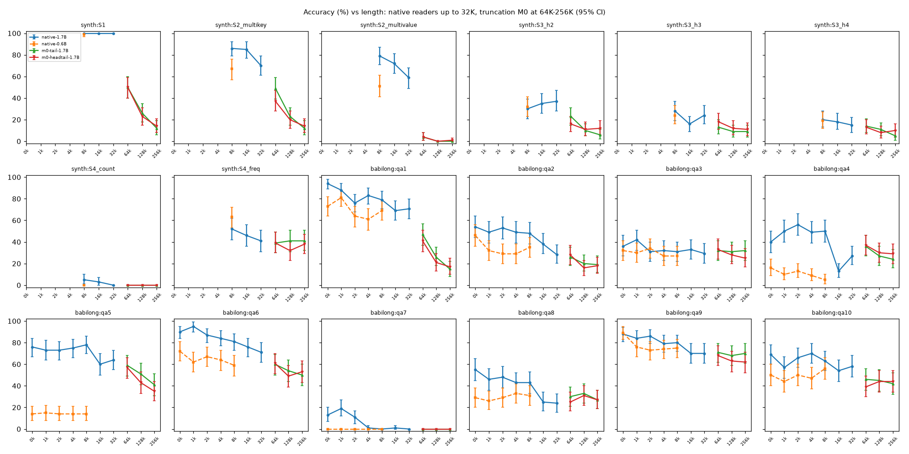
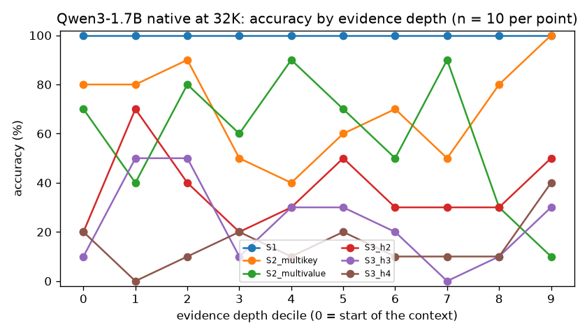

# A3 — Floor check (E0) and truncation baseline (E1), Gate G0

Dates: 2026-11-14 to 2026-11-16. Machine: local workstation (RTX 3090, 24 GB).
Readers: Qwen3-1.7B (primary) and Qwen3-0.6B. Greedy decoding, thinking off.

This step asks two questions:

- **E0, the floor:** what can the reader do inside its own 32,768-token window, with no long-context
  method at all? Its accuracy at 8K is the reference every later method is measured against (ECL90),
  and Gate G0 decides which task families go on.
- **E1, truncation (method M0):** what happens when a longer input is simply cut to fit the window?
  It is the weakest baseline every later method has to beat.

Every number below is read from a file under `results/`:

| File | What it holds |
|---|---|
| `results/E0_floor/runs.jsonl` | one row per E0 example: 15,250 rows |
| `results/E1_truncation/runs.jsonl` | one row per E1 example: 12,200 rows |
| `results/A3_floor/summary.json`, `figures/` | everything in this report, computed from the two files above by `scripts/a3_summary.py` |
| `results/A3_floor/sampling_confidence.json` | the check behind section 6 (`scripts/a3_sampling_check.py`) |

**Code commits.** All rows were measured on clean commits:

| Commit | Rows | Notes |
|---|---|---|
| `2502764` | 20 | first E0 pilot |
| `db85c90` | 15,810 | E0, and the E1 pilot |
| `207e80e` | 11,020 | rest of E1 |
| `6db01c5` | 600 | answer-budget rerun of section 9.3 |

Between the first three commits the code that generates and scores answers did not change; only
analysis functions were added. `6db01c5` adds the answer-budget option, and its 600 rows were all
run on it.

## 1. Outcome

| Question | Answer |
|---|---|
| Gate G0 | **Passes** on Qwen3-1.7B at 8K: 4 families of 6 (S1, S2, BABILong, BABILong-ext); S3 and S4 fail |
| A3b, task-adapted reader | Not needed (it runs only if G0 fails) |
| Qwen3-1.7B better than Qwen3-0.6B by more than the CI on the retained families? | On S2, BABILong and BABILong-ext yes; on S1 no, because both readers are at the ceiling. The owner decided to keep Qwen3-1.7B as primary (D-029) |
| Model-card sampling vs greedy (50 examples) | No difference: identical answer text on all 50 |
| Truncation M0 beyond the window | Accuracy falls with the share of the input that is kept (about 1/2, 1/4, 1/8 at 64K, 128K, 256K). When the evidence is kept, the reader answers as well as natively |
| ECL90 of "native up to 32K, M0 beyond" | S1 32K, S2 16K, BABILong 8K; S3, S4 and BABILong-ext none |
| Run health | 27,450 rows: 27,442 answered, 8 skipped (prompt does not fit the window), none failed. No GPU loss |

Four results change how later steps should be read (section 11):

1. **The H1 bar is high.** On BABILong qa1–qa5 the native reader already falls from 57.2% at 8K to
   42.6% at 16K, inside its own window. ECL90 at 256K requires at least 51.5%.
2. **BABILong-ext can never have an ECL90.** Under the specification's floor ("the higher of 30% and
   twice chance") its floor is 73.3%, above its own 8K reference of 53.4%.
3. **Two scoring problems were found and are handled openly:**
   - the official BABILong scorer cannot credit the answer "none" in qa7 (D-028);
   - the official InfiniteBench answer budgets cut Qwen3's answers before the value (D-030).
4. **S3 and S4 fail the floor.** The multi-hop family (H2) and the aggregation family (H5) are not
   among the retained families.

## 2. What was run

**E0: native reader, no PCM** (configs/a3_floor.yaml):

- **Qwen3-1.7B:** S1–S4 (8 tasks) at 8K, 16K, 32K; BABILong qa1–qa10 at 0K, 1K, 2K, 4K, 8K, 16K, 32K.
- **Qwen3-0.6B:** the same tasks at 8K and below, on the same examples (synthetic at 8K; BABILong
  0K–8K).
- **N:** 100 per cell.
- **Sampling check:** 50 examples at 8K re-run with the model card's non-thinking sampling settings
  (D-025).
- **Window rule:** a sample runs natively only if prompt plus answer fits in 32,768 tokens. The rest
  are recorded as skipped (D-023). That happened on 8 BABILong 32k rows: qa8 4, qa1, qa2, qa3 and
  qa7 one each.
- **InfiniteBench:** not in E0, because none of its samples fits (shortest prompt 69,757 tokens;
  D-022, corrected by D-031).

**E1, method M0: Qwen3-1.7B on a truncated context that fills the window.**

- **Two variants:** the last tokens ("last 32K"), and the first half plus last half of the room
  ("first 16K + last 16K").
- **Room:** 32,768 minus the prompt wrapper and the answer budget, about 32.6K context tokens.
- **Cells:** S1–S4 and BABILong qa1–qa10 at 64K, 128K, 256K. InfiniteBench passkey, number_string,
  kv_retrieval and longbook_choice_eng on 100 evenly spaced rows per task (D-022). N = 100 per cell.
- **InfiniteBench retrieval, extra run:** passkey, number_string and kv_retrieval were run again with
  larger answer budgets (section 9.3; D-030).

**Measured lengths.**
- Synthetic contexts: 8,176, 16,352 and 32,543 tokens at 8K, 16K and 32K (means).
- BABILong contexts: 7,369–7,447, 15,204–15,210 and 30,684–30,746 tokens at 8k, 16k and 32k (means
  of qa1, qa2, qa3).
- M0 prompts: 32,640 to 32,762 tokens.

## 3. Gate G0

Rule, as fixed before the results were read (D-024 corrected by D-027):

- **Length:** the gate is read at 8K, where ECL90's reference is measured.
- **Task threshold:** 50% if the task's chance is 0, else the lower of 50% and twice chance.
- **Family:** passes when the mean of its tasks' accuracies reaches the mean of their thresholds.
- **Gate:** passes with at least 3 families.

| Family (tasks) | Qwen3-1.7B at 8K | Threshold | Result | Tasks below their own threshold |
|---|---|---|---|---|
| S1 needle | 100.0% | 50.0% | pass | none |
| S2 multi-key, multi-value | 82.5% | 50.0% | pass | none |
| S3 chains of 2, 3, 4 hops | 26.0% | 50.0% | **fail** | all three (30, 28, 20%) |
| S4 count, most frequent | 28.5% | 45.0% | **fail** | count (5%) |
| BABILong qa1–qa5 | 57.2% | 32.4% | pass | qa3 (31% against 33.3%) |
| BABILong-ext qa6–qa10 | 53.4% | 50.0% | pass | qa7 (0%, see section 7), qa8 (43%) |

**Gate G0 passes: 4 families of 6.** Under the gate's rule (section 5.5), A4 continues with S1, S2,
BABILong and BABILong-ext, and S3 and S4 drop out. A3b is not run.

For comparison, Qwen3-0.6B alone would fail the gate: only S1 (99.0%) and S2 (59.0%) pass. Its
BABILong family scores 30.0% against a threshold of 32.4%, and BABILong-ext 44.2% against 50%.

**Reference accuracies for ECL90** (native Qwen3-1.7B at 8K):

| Family | Reference | 90% of it | ECL90 floor |
|---|---|---|---|
| S1 | 100.0% | 90.0% | 30.0% |
| S2 | 82.5% | 74.25% | 30.0% |
| BABILong qa1–qa5 | 57.2% | 51.48% | 32.4% |
| BABILong-ext | 53.4% | 48.06% | 73.3% (above the reference: no ECL90 possible) |

Per task (same order as section 4): S1 100, S2 multi-key 86, S2 multi-value 79, qa1 79, qa2 48,
qa3 31, qa4 50, qa5 78, qa6 81, qa7 0, qa8 43, qa9 80, qa10 63.

## 4. Accuracy inside the window (E0)

Accuracy in %, with 95% bootstrap CI (10,000 resamples), n = 100 per cell unless noted.

| Task | 1.7B at 8K | 1.7B at 16K | 1.7B at 32K | 0.6B at 8K |
|---|---|---|---|---|
| S1 needle | 100 [100, 100] | 100 [100, 100] | 100 [100, 100] | 99 [97, 100] |
| S2 multi-key | 86 [79, 92] | 85 [77, 92] | 70 [61, 79] | 67 [57, 76] |
| S2 multi-value | 79 [71, 87] | 72 [63, 81] | 59 [49, 68] | 51 [41, 61] |
| S3, 2 hops | 30 [21, 39] | 35 [26, 44] | 37 [28, 47] | 32 [23, 41] |
| S3, 3 hops | 28 [19, 37] | 16 [9, 23] | 24 [16, 33] | 24 [16, 33] |
| S3, 4 hops | 20 [13, 28] | 18 [11, 26] | 15 [8, 22] | 19 [12, 27] |
| S4 count | 5 [1, 10] | 3 [0, 7] | 0 [0, 0] | 0 [0, 0] |
| S4 most frequent | 52 [42, 62] | 46 [36, 56] | 41 [31, 51] | 63 [53, 72] |
| BABILong qa1 | 79 [71, 87] | 69 [60, 78] | 71 [62, 80] (n=99) | 69 [60, 78] |
| qa2 | 48 [38, 58] | 38 [29, 48] | 28 [20, 37] (n=99) | 35 [26, 44] |
| qa3 | 31 [22, 40] | 33 [24, 42] | 29 [20, 38] (n=99) | 27 [18, 36] |
| qa4 | 50 [40, 60] | 13 [7, 20] | 27 [19, 36] | 5 [1, 10] |
| qa5 | 78 [70, 86] | 60 [50, 70] | 64 [55, 73] | 14 [8, 21] |
| qa6 | 81 [73, 88] | 76 [67, 84] | 71 [62, 80] | 59 [49, 68] |
| qa7 (official scorer) | 0 [0, 0] | 1 [0, 3] | 0 [0, 0] (n=99) | 0 [0, 0] |
| qa8 | 43 [33, 53] | 25 [17, 34] | 24 [16, 32] (n=96) | 31 [22, 40] |
| qa9 | 80 [72, 87] | 70 [61, 79] | 70 [61, 79] | 75 [66, 83] |
| qa10 | 63 [54, 72] | 54 [44, 64] | 58 [48, 68] | 56 [46, 66] |

BABILong at its short lengths (Qwen3-1.7B / Qwen3-0.6B):

| Task | 0K | 1K | 2K | 4K |
|---|---|---|---|---|
| qa1 | 94 / 73 | 88 / 81 | 76 / 64 | 83 / 61 |
| qa2 | 54 / 46 | 49 / 32 | 53 / 29 | 49 / 29 |
| qa3 | 36 / 32 | 42 / 30 | 31 / 34 | 32 / 27 |
| qa4 | 40 / 16 | 50 / 10 | 56 / 13 | 49 / 9 |
| qa5 | 76 / 14 | 73 / 15 | 73 / 14 | 75 / 14 |
| qa6 | 90 / 72 | 95 / 62 | 87 / 67 | 84 / 64 |
| qa7 | 13 / 0 | 19 / 0 | 11 / 0 | 1 / 0 |
| qa8 | 55 / 29 | 46 / 26 | 48 / 29 | 43 / 33 |
| qa9 | 88 / 89 | 84 / 76 | 86 / 73 | 79 / 74 |
| qa10 | 69 / 50 | 57 / 44 | 66 / 50 | 70 / 47 |

The CIs of these cells are in `summary.json`; with n = 100 they are about ±9 to ±10 points around
50%.

What these tables say:

- **The reader degrades inside its own window.** On BABILong qa1–qa5 the family mean is 57.2% at
  8K, 42.6% at 16K and 43.9% at 32K. S2 falls from 82.5% to 64.5% between 8K and 32K. Only the
  single needle (S1) holds at 100%.
- **qa4 dips to 13% at 16K.** 65 of its 100 answers there name only the location the question
  itself mentions ("What is the bathroom east of?" answered "bathroom"). The official scorer never
  accepts those.
- **Multi-hop and counting are hard even at 8K.** S3 stays between 15% and 37% at every length.
  S4 count is near 0.

## 5. The two readers compared (8K and below, identical examples)

Paired bootstrap of the difference Qwen3-1.7B minus Qwen3-0.6B, in points, 95% CI:

| Family | Length | n pairs | Difference | Excludes 0 |
|---|---|---|---|---|
| S1 | 8K | 100 | +1.0 [0.0, +3.0] | no (both at the ceiling) |
| S2 | 8K | 200 | +23.5 [+15.0, +31.5] | yes |
| S3 | 8K | 300 | +1.0 [−5.3, +7.0] | no |
| S4 | 8K | 200 | −3.0 [−9.0, +2.5] | no |
| BABILong qa1–qa5 | 0K / 1K / 2K / 4K / 8K | 500 each | +23.8 / +26.8 / +27.0 / +29.6 / +27.2 | yes at every length |
| BABILong-ext | 0K / 1K / 2K / 4K / 8K | 500 each | +15.0 / +18.6 / +15.8 / +11.8 / +9.2 | yes at every length |

The largest gaps per task at 8K:
- qa5: +64 points [+55, +73];
- qa4: +45 [+35, +55];
- S2 multi-value: +28 [+16, +40];
- qa6: +22 [+10, +34].

On S4 most-frequent the smaller reader is ahead: −11 points, CI [−22, 0].

On the retained families, Qwen3-1.7B is better by more than the CI on S2, BABILong and
BABILong-ext. On S1 it is not, because neither reader can rise above 100% there. The prompt says to
stop in that case and let the owner choose the primary reader. The owner kept Qwen3-1.7B (D-029).

## 6. Model-card sampling versus greedy

The 50-example subset (D-025): indices 0, 2, 4, 6, 8 of S1, S2 multi-key, S2 multi-value, S3 2 hops,
S4 most frequent and BABILong qa1–qa5, all at 8K. Settings from the model card (temperature 0.7,
top-p 0.8, top-k 20, min-p 0), with a fixed seed per example.

| | Accuracy |
|---|---|
| Greedy | 66.0% [52, 78] |
| Sampled | 66.0% [52, 78] |
| Paired difference | 0.0 [0.0, 0.0] |

**Accuracy does not differ from greedy by more than the CI. It does not differ at all:** the sampled
answer text equals the greedy text on all 50 examples. The reason was checked, not assumed
(`sampling_confidence.json`). Along the greedy answer, every token of 48 of the 50 examples has
probability at least 0.8 after temperature 0.7. Top-p 0.8 then leaves that token as the only
candidate, so sampling cannot differ. In the other 2 examples one step fell to 0.52 and 0.54, and the
seeded draw picked the top token anyway.

## 7. Typical errors: format errors versus wrong answers

A format error is an answer without any value of the expected kind: no seven-digit number, no
integer, no candidate word, no task label. A wrong answer has the expected kind but the wrong value.
Counts at 8K, Qwen3-1.7B (Qwen3-0.6B in brackets):

| Family | Examples | Correct | Wrong | Format |
|---|---|---|---|---|
| S1 | 100 | 100 (99) | 0 (0) | 0 (1) |
| S2 | 200 | 165 (118) | 34 (81) | 1 (1) |
| S3 | 300 | 78 (75) | 169 (164) | 53 (61) |
| S4 | 200 | 57 (63) | 126 (128) | 17 (9) |
| BABILong qa1–qa5 | 500 | 286 (150) | 210 (280) | 4 (70) |
| BABILong-ext | 500 | 267 (221) | 203 (279) | 30 (0) |

What the errors are:

- **S2 multi-key and S3 chains: the reader picks a distractor.**
  - S2 multi-key: all 14 wrong answers at 8K are the value of one of the three similar keys.
  - S3: of the wrong answers, 54 of 56 (2 hops), 53 of 54 (3 hops) and 57 of 59 (4 hops) are the
    value of a distractor chain. The reader finds an assignment, but not the one the chain leads to.
  - S3 format errors are a variable name ("VAR HXNND") or an invented number ("12345678").
- **S2 multi-value: it lists three of the four values.**
- **S4 count: it undercounts.** At 8K, 93 of its 95 wrong answers are too low (for example 2 for 4
  and 5 for 8) and 2 too high. It gives no format errors.
- **S4 most frequent: format errors are answers cut off by the 8-token budget.** The model writes
  "The signal word that is named most often" instead of the word alone; 19 of 100 answers at 8K hit
  the budget. Wrong answers name another candidate.
- **BABILong qa2 and qa5: the wrong location, or the wrong person.** For example "The apple is in the
  garden." for kitchen.
- **qa4: the location named in the question,** as in section 4.
- **qa7: lost to a scorer defect.** The official scorer finds labels by substring, and "one" lies
  inside "none". So a correct "none", 46 of the 100 targets, always counts as two labels and is
  scored wrong (D-028).
  - With labels matched as whole words, qa7 scores 30% [21, 39] for Qwen3-1.7B and 46% [36, 56] for
    Qwen3-0.6B at 8K. The 0.6B figure equals the share of targets that are "none" (46 of 100).
  - The official score stays the headline. The whole-word score changes no other BABILong cell.
  - qa7 format errors are the placeholder "number_of_objects" copied from the official instruction.
- **Qwen3-0.6B fails on format where 1.7B does not.** 70 of its 500 BABILong qa1–qa5 answers at 8K
  are format errors, against 4 for Qwen3-1.7B.

## 8. Accuracy by evidence depth at 32K

Qwen3-1.7B, native, 32K; each point is 10 examples, so each has a CI of about ±30 points.

| Task | By decile 0 to 9, in % |
|---|---|
| S1 | 100 at every decile |
| S2 multi-key | 80, 80, 90, 50, 40, 60, 70, 50, 80, 100 |
| S2 multi-value | 70, 40, 80, 60, 90, 70, 50, 90, 30, 10 |
| S3, 2 / 3 / 4 hops | 20 to 70 / 0 to 50 / 0 to 40, with no clear pattern |

S2 multi-key is lowest in the middle of the context (40–60% at deciles 3–7, 80–100% at the ends),
the shape usually called "lost in the middle". At n = 10 per point this is a hint, not a
measurement.

## 9. Truncation baseline M0 (E1)

### 9.1 Accuracy at 64K, 128K, 256K

Accuracy in %, 95% CI, n = 100.

| Task | Last 32K: 64K | 128K | 256K | First + last 16K: 64K | 128K | 256K |
|---|---|---|---|---|---|---|
| S1 | 50 [40, 60] | 26 [18, 35] | 12 [6, 19] | 50 [40, 59] | 23 [15, 31] | 14 [8, 21] |
| S2 multi-key | 49 [39, 59] | 23 [15, 31] | 12 [6, 19] | 37 [28, 47] | 20 [12, 28] | 14 [8, 21] |
| S2 multi-value | 4 [1, 8] | 0 [0, 0] | 0 [0, 0] | 4 [1, 8] | 0 [0, 0] | 1 [0, 3] |
| S3, 2 hops | 23 [15, 31] | 10 [5, 16] | 6 [2, 11] | 16 [9, 23] | 11 [5, 18] | 12 [6, 19] |
| S3, 3 hops | 13 [7, 20] | 9 [4, 15] | 9 [4, 15] | 18 [11, 26] | 12 [6, 19] | 11 [5, 17] |
| S3, 4 hops | 14 [8, 21] | 11 [5, 17] | 5 [1, 10] | 13 [7, 20] | 8 [3, 14] | 10 [4, 16] |
| S4 count | 0 [0, 0] | 0 [0, 0] | 0 [0, 0] | 0 [0, 0] | 0 [0, 0] | 0 [0, 0] |
| S4 most frequent | 39 [30, 49] | 41 [31, 51] | 41 [32, 51] | 39 [30, 49] | 32 [23, 41] | 38 [29, 47] |
| BABILong qa1 | 47 [37, 57] | 26 [18, 35] | 15 [8, 22] | 41 [31, 51] | 21 [13, 29] | 17 [10, 25] |
| qa2 | 26 [18, 35] | 20 [13, 28] | 19 [12, 27] | 28 [19, 37] | 16 [9, 23] | 18 [11, 26] |
| qa3 | 32 [23, 41] | 31 [22, 40] | 32 [23, 41] | 33 [24, 43] | 28 [20, 37] | 25 [17, 34] |
| qa4 | 36 [27, 46] | 27 [18, 36] | 24 [16, 33] | 37 [28, 46] | 30 [21, 39] | 29 [20, 38] |
| qa5 | 59 [49, 68] | 51 [41, 61] | 41 [31, 51] | 57 [47, 66] | 43 [33, 53] | 35 [26, 44] |
| qa6 | 60 [50, 69] | 54 [44, 64] | 50 [40, 60] | 61 [51, 70] | 49 [39, 59] | 53 [43, 63] |
| qa7 (official) | 0 | 0 | 0 | 0 | 0 | 0 |
| qa8 | 30 [21, 39] | 33 [24, 42] | 27 [19, 36] | 25 [17, 34] | 31 [22, 40] | 27 [19, 36] |
| qa9 | 71 [62, 79] | 68 [59, 77] | 70 [61, 79] | 68 [59, 77] | 63 [53, 72] | 62 [52, 71] |
| qa10 | 46 [36, 56] | 45 [35, 55] | 42 [32, 52] | 39 [30, 49] | 44 [34, 54] | 44 [34, 54] |

### 9.2 Why M0 falls: the evidence is cut away, not misread

M0 keeps about 32.6K tokens. Measured evidence recall (the share of evidence items left in the
window) on the synthetic tasks is 0.47–0.53 at 64K, 0.23–0.27 at 128K and 0.11–0.15 at 256K, for
both variants, as the share of the input kept predicts. Where all the evidence was kept, the reader
answers as it does natively:

| Last 32K, examples whose evidence was kept | 64K | 128K | 256K |
|---|---|---|---|
| S1: kept / accuracy | 50 / 100% | 26 / 100% | 12 / 100% |
| S2 multi-key: kept / accuracy | 50 / 98% [94, 100] | 26 / 88% [77, 100] | 12 / 100% |

S1 at 64K is 50% because exactly the 50 examples with the needle in the window are answered.

**S4 most frequent does not need the whole document.** M0 keeps it at 39–41% at every length, as
high as the native reader at 32K (41%), although only an eighth of the markers survive at 256K. A
sample of the markers usually has the same most frequent word as the full set. This weakens S4
most-frequent as the test of H5 (a limit of select-and-expand); S4 count does need every marker.

**The BABILong tasks with many facts change little under truncation:** qa3, qa8, qa9, qa10. They are
near their native level already, and a kept window rarely holds every fact (0 to 6 kept rows of 100
  at 64K).

### 9.3 InfiniteBench (100 rows per task, no native reference)

| Task (context tokens) | M0 last 32K, official budget | M0 first + last, official | Last 32K, larger budget | First + last, larger budget | Evidence kept |
|---|---|---|---|---|---|
| passkey (125,305) | 0 [0, 0] | 0 [0, 0] | 27 [19, 36] | 27 [19, 36] | 27 rows |
| number_string (125,317) | 0 [0, 0] | 0 [0, 0] | 27 [19, 36] | 27 [19, 36] | 27 rows |
| kv_retrieval (169,094 mean) | 0 [0, 0] | 0 [0, 0] | 6 [2, 11] | 3 [0, 7] | 19 rows |
| longbook_choice_eng (191,769 mean) | 45 [35, 55] | 43 [33, 53] | – | – | no evidence span |

With the official answer budgets (passkey 6 tokens, number_string 12, kv_retrieval 50), all 300 M0
answers on the three retrieval tasks hit the budget before the value was written, for example "The
pass key is **8" for 80630. Those zeros measure the budget, not the reader.

Run again with budgets that hold the whole answer (64, 64 and 128 tokens; D-030):

- **passkey and number_string:** answered correctly in exactly the 27 rows whose needle survived
  the cut, and in none of the others.
- **kv_retrieval:** 6 of 19 visible keys were answered correctly with the last-32K cut (32%), and
  3 of 19 with the first-and-last cut. A long UUID-to-UUID lookup is hard for this reader even when
  the key is in view.
- **longbook_choice_eng (four options, chance 25%):** 45% and 43%. It has no evidence span, so
  recall cannot be measured.

### 9.4 ECL90

The curve uses the native reader at 8K, 16K and 32K, where M0 would not cut anything, and M0 from
64K. Family accuracies are means over the family's tasks.

| Family | Reference | Threshold | ECL90 (both M0 variants) | Stops at |
|---|---|---|---|---|
| S1 | 100.0 | 90.0 | **32K** | 64K: 50.0 (last 32K) / 50.0 |
| S2 | 82.5 | 74.25 | **16K** | 32K: 64.5 |
| BABILong qa1–qa5 | 57.2 | 51.48 | **8K** | 16K: 42.6 |
| BABILong-ext | 53.4 | 48.06 | none | floor 73.3 (unreachable; section 11) |
| S3, S4 (not retained) | 26.0, 28.5 | – | none | below the floor at 8K |

Family accuracy at 64K / 128K / 256K:

| Family | Last 32K | First + last 16K |
|---|---|---|
| S1 | 50.0 / 26.0 / 12.0 | 50.0 / 23.0 / 14.0 |
| S2 | 26.5 / 11.5 / 6.0 | 20.5 / 10.0 / 7.5 |
| BABILong | 40.0 / 31.0 / 26.2 | 39.2 / 27.6 / 24.8 |
| BABILong-ext | 41.4 / 40.0 / 37.8 | 38.6 / 37.4 / 37.2 |

The two truncation variants are within each other's CIs nearly everywhere. Keeping the start of the
document helps no task family on these benchmarks.

## 10. Cost

| Run | Seconds per example (mean over cells) | Peak VRAM allocated |
|---|---|---|
| Qwen3-1.7B native, 8K / 16K / 32K | 1.18 / 2.45 / 6.51 | 4.30 / 5.31 / 7.29 GiB |
| Qwen3-0.6B native, 8K | 0.91 | 2.22 GiB |
| M0 (either variant), 64K to 256K | 6.77–6.85 | 7.31 GiB |
| M0 with the larger InfiniteBench budget | 8.6–11.9 | 7.18 GiB |

## 11. What it means, and what is uncertain

**For H1** (ECL90 of at least 256K on at least 3 retained families):

- The retained families are S1, S2, BABILong and BABILong-ext.
- BABILong-ext cannot have an ECL90 under the specification's floor (73.3%), so H1 has to be met on
  S1, S2 and BABILong, all three.
- On BABILong the bar is 51.5% at every length up to 256K. The native reader itself gets 42.6% at
  16K and 43.9% at 32K.
- PCM hands the reader at most 28,672 selected tokens. If selection removes the distracting text,
  the reader may do better than it does natively at 16K–32K. That is the bet H1 makes, and A3 shows
  how much it has to win.

**For H2** (the graph helps multi-hop and multi-fact): the multi-hop family S3 fails the floor (26%
at 8K), and its errors are mostly the wrong chain's value. H2 can still be tested on BABILong qa2
and qa3 (multi-fact, retained). qa3 is below its own threshold at 8K (31% against 33.3%).

**For H5** (aggregation is a limit of select-and-expand): S4 fails the floor. S4 most-frequent turned
out not to need the whole document (section 9.2), and S4 count is near 0 even natively. H5 has no
clean test task as things stand.

**Decisions for the owner:**

1. **ECL90 floor for tasks with high chance.** Twice chance is 100% for yes/no tasks (qa6, qa9) and
   73.3% for BABILong-ext as a family, so those can never have an ECL90. Options:
   - keep the definition and drop BABILong-ext from H1;
   - or change the floor for such tasks, for example to halfway between chance and 100%. That would
     be a change to the specification, to be recorded before A4.
2. **InfiniteBench answer budget from A4 on:**
   - the official budgets (passkey 6, number_string 12, kv_retrieval 50 tokens) make the retrieval
     tasks unscoreable for this reader;
   - the larger budgets (64, 64 and 128) give scoreable answers;
   - running both doubles the cost.
   My recommendation is the larger budgets, keeping the official E1 rows on record.
3. **S3 and S4.** The gate drops them. If H2 and H5 are to keep their synthetic tests, the choices
   are a task-adapted reader (A3b trains one on the synthetic train split, at most 3 GPU-hours), or a
   redesign of S4. Either is a decision outside what the gate prescribes.

**What is uncertain:**

- One data seed (screening); section 5.2 asks for three for final numbers.
- The depth-decile pattern rests on 10 examples per point.
- The qa7 whole-word score is supplementary and has not been checked against published results.
- The ECL90 values of M0 are mostly those of the native reader: M0 changes nothing up to 32K.
- The S4 most-frequent result depends on the marker counts chosen in A2 (D-018).
- The InfiniteBench answer budgets of D-030 were set after the official ones were seen to fail;
  they were chosen from the answer format, not by trying several on scores.

## 12. What was built in A3

| File | What it does |
|---|---|
| `configs/a3_floor.yaml` | readers, methods, cells, gate rule |
| `pcm/eval/runner.py` | M0 truncation (`truncate`, modes tail and head_tail), seeded sampling, answer-budget override, CPU preparation overlapped with GPU work, readers loaded once per group of cells |
| `pcm/prefill.py` | `generate_sampled`, `sample_token` (checked against the library's processors) |
| `pcm/eval/metrics.py` | `error_kind`, `babilong_whole_word_score` |
| `pcm/tasks/official.py` | InfiniteBench chat templates selected by content (D-026) |
| `scripts/run_a3.py` | runs and pilots the cells, projects runtime |
| `scripts/a3_summary.py` | every number and figure of this report |
| `scripts/a3_sampling_check.py` | the check of section 6 |
| `tests/test_runner.py`, `tests/test_metrics.py` | truncation, sampling reproducibility, budget override, error kinds, whole-word scorer |

Deviations recorded in this step: D-022 to D-030.
