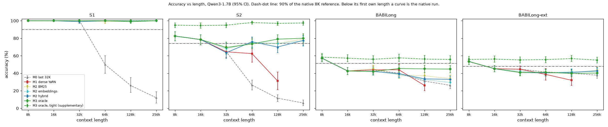

# A4 — Baselines: dense YaRN (E2), plain retrieval (E3), oracle (E3o)

Dates: 2026-11-17 to 2026-11-21. Machine: local workstation (RTX 3090, 24 GB).
Reader: Qwen3-1.7B (R0, zero-shot), greedy decoding, thinking off. Task families retained at Gate G0:
S1, S2, BABILong (qa1–qa5), BABILong-ext (qa6–qa10), plus the InfiniteBench tasks.

This step measures the three baselines every later method is compared against:

- **M1, dense YaRN (E2):** the whole document in the window, positions stretched with YaRN, no training.
  It answers "does the model simply work at 64K and 128K if we let it see everything?".
- **M2, plain retrieval (E3):** the document is cut into 128-token index units; BM25, embeddings, their
  fusion (hybrid), or hybrid + reranker pick units until 28,672 tokens are full; the kept units go back in
  document order. It is PCM without pages and without the graph.
- **M3, oracle (E3o):** the units that hold the gold evidence, padded with their neighbours up to the same
  budget. It separates selector failures (M3 far above M2) from reader failures (M3 itself low).

M0 (truncation) and the native reference come from A3 and are shown beside them.

Every number below is read from a file under `results/`:

| File | What it holds |
|---|---|
| `results/E2_dense/runs.jsonl` | M1, one row per example: 1,000 rows used |
| `results/E3_retrieval/runs.jsonl` | M2, four variants: 22,400 rows used |
| `results/E3o_oracle/runs.jsonl` | M3 and the tight oracle: 13,600 rows used |
| `results/E0_a4budget/runs.jsonl` | native S2 multi-value at the A4 answer budget (D-040): 300 rows |
| `results/A4_baselines/summary.json`, `tables.md`, `figures/` | every table and figure here, computed from the files above and A3's E0 and E1 by `scripts/a4_summary.py` |
| `results/A4_baselines/evidence_position_kv_retrieval.json`, `evidence_position_S2_multikey.json` | where the evidence sits in the prompt and how many distractors were kept (`scripts/a4_evidence_position.py`, section 8) |

**Code commit.** Every row used was measured on clean commit `ff31198`. The pilot rows run before it (on
`bc356a1` and `2359dc0`) belong to method configurations replaced by D-040 and are left out by the summary
(20 rows of E2, 100 of E3, 40 of E3o; listed in `tables.md`). The measurement code under `pcm/` is the same
in all three commits; only the run script, the configuration and the summary changed. Sixty E3 answers were
taken over from such pilot rows because their prompt was identical, token for token, with the same answer
budget (section 9).

## 1. Outcome

| Question | Answer |
|---|---|
| Does dense YaRN hold to 128K? | **Only on S1.** S1: 100% at 64K and 128K. S2: 62.5% at 64K, 31.2% at 128K (reference 82.5). BABILong: 44.0% and 26.0% (reference 57.2). At 128K the reader copies the haystack instead of answering |
| Does plain retrieval hold to 256K? | **On S1 only.** S1: 99–100% at every length. S2: 70.0–79.0% at 64K–256K but 63.5–68.5% at 32K. BABILong: falls from 42.0–45.0% at 32K to 29.4–34.0% at 256K |
| ECL90 (largest length with ≥ 90% of the 8K reference at every length up to it) | S1: M0 32K, M1 128K (256K not run locally), M2 and M3 256K. S2: 16K for every method. BABILong: 8K for every method. BABILong-ext: none (D-032) |
| Evidence recall at budget (hybrid, 256K) | S1 1.00, S2 1.00, BABILong 0.55, BABILong-ext 0.61; InfiniteBench passkey and number_string 1.00, kv_retrieval 0.52 |
| Selector or reader? | S1: neither fails. S2: **reader** (every needle kept, yet 63.5–80% with the full budget; on multi-key the reader is misled by the distractor needles kept with the gold one, on multi-value by the filler). BABILong: **both**: the oracle beats hybrid by 5.8 to 11.8 points from 64K on, and the oracle itself (≈ 45%) stays below the 51.5% threshold. BABILong-ext: **reader** (oracle = hybrid) |
| The strongest single finding | The **tight oracle** (gold units plus one neighbour each side, 0.4K–6.7K tokens) holds the native 8K accuracy at every length on every family (S2 94.5–98.0%, BABILong 55.8–58.4%). The same evidence inside 28,672 tokens of its own neighbourhood loses 11 to 25 points: on S2 multi-key through the distractor needles kept with it, on S2 multi-value and BABILong through the filler. On this reader, what is kept around the evidence costs as much as the evidence that is missed |
| Cost | M1: 21 s per example at 64K (11.4 GiB), 75 s at 128K (19.4 GiB); E2 took 13.98 GPU-hours. M2 hybrid: 5.9–6.1 s per example at every length, 9.0 GiB, ingest 7.5 s per 256K document. M3: 5.7–5.9 s, 6.8 GiB |

## 2. What was run

| Experiment | Method (config name) | Lengths | N per cell | Tasks |
|---|---|---|---|---|
| E2 | M1 dense YaRN (`m1-yarn-1.7B`) | 64K (factor 2), 128K (factor 4) | 40 for S1, S2, BABILong qa1–qa5; 30 for BABILong-ext and InfiniteBench | S1, S2 multi-key, S2 multi-value, BABILong qa1–qa10, InfiniteBench passkey and number_string |
| E3 | M2: BM25, embeddings, hybrid, hybrid + reranker (`m2-*-1.7B`) | 32K, 64K, 128K, 256K; InfiniteBench as is | 100 | the same, plus kv_retrieval and longbook_choice_eng |
| E3o | M3 oracle (`m3-oracle-1.7B`); tight oracle (`m3-oracle-tight-1.7B`, supplementary) | 32K–256K; the tight oracle also at 8K and 16K | 100 | as E3, without longbook_choice_eng (it has no evidence spans) |
| E0_a4budget | native, A4 answer budget (`native-1.7B-a4budget`) | 8K, 16K, 32K | 100 | S2 multi-value |

Settings fixed in `configs/a4_baselines.yaml` before the runs, with the reasons in `DEVIATIONS.md`:

- **Index units** (D-035): 128 tokens, each boundary moved to the nearest sentence end within ±32 tokens.
  The same units serve every unit method; A5's pages are built from them.
- **Retrieval** (D-035): BM25 Okapi (k1 1.5, b 0.75, ε 0.25) over the units; Qwen3-Embedding-0.6B with the
  model card's instruction on the query only; hybrid = reciprocal-rank fusion (k = 60) of the two;
  the reranker (Qwen3-Reranker-0.6B) re-orders the top 64 units of hybrid. Units are added in rank order while
  they fit 28,672 tokens, then put back in document order, with `\n[...]\n` between non-adjacent spans.
  Embeddings are cached per document (section 4.7 rule 10), so the four variants ingest once.
- **Reranker** (D-036): the budget holds about 224 units, so re-ordering the top 64 cannot change the kept
  set. Hybrid + reranker therefore gives the reader the same prompt as hybrid on every example; the stored
  answer is reused, and what the variant adds is measured as recall at smaller unit counts (section 5).
- **Oracle** (D-037): gold units are the units that overlap an evidence item; for BABILong that is every
  located fact sentence, because the data does not mark which facts support the answer. Padding takes the
  nearest neighbours first. The tight oracle keeps one neighbour on each side only and is reported as
  supplementary, not as the specification's M3.
- **Dense YaRN** (D-038): factor = the smallest of 2, 4, 8, 16 covering the longest prompt of the split;
  N chosen before the run from the pilot so that E2 stays within 16 GPU-hours: the largest N of
  100, 80, 60, 50, 40, 30 that fits was 40 (projected 13.95 h, `results/E2_dense/n_plan.json`). E2 examples
  are the first N of the cells the other methods use, so every paired comparison is on identical examples.
  InfiniteBench kv_retrieval does not fit at factor 4 on 24 GB and longbook_choice_eng has no
  answer-span evidence for the oracle; M1 runs passkey and number_string only.
- **Answer budgets** (D-033, D-040): InfiniteBench passkey and number_string 64 tokens, kv_retrieval 128;
  S1 and S2 multi-key 64, S2 multi-value 128; BABILong its official 20. The native S2 multi-value runs were
  repeated at 128 tokens: 0 of 300 scores changed (266 answers identical, 34 the same answer continued;
  `summary.json`, `checks.budget_rerun_vs_a3`), so the S2 reference stays 82.5%.
- **Decisions on A3's open points**: ECL90 floor unchanged, BABILong-ext reported without ECL90 (D-032);
  S3 and S4 stay out (D-034), so H2 will be tested on BABILong qa2 and qa3 and H5 is untested locally.

## 3. Accuracy versus length

Below a method's first own length the curve is the native run, because the method changes nothing there:
M0 and M1 run natively when the prompt fits, M2 and M3 keep the whole document when it fits the budget.
Cells give accuracy in % with the 95% bootstrap interval; n per task is 100 unless marked.

**S1** (single needle). Reference 100.0; ECL threshold 90.0.

| Method | 32K | 64K | 128K | 256K |
|---|---|---|---|---|
| M0 last 32K | 100.0 (native) | 50.0 [40.0, 60.0] | 26.0 [18.0, 35.0] | 12.0 [6.0, 19.0] |
| M1 dense YaRN | 100.0 (native) | 100.0 [100.0, 100.0] (n=40) | 100.0 [100.0, 100.0] (n=40) | not run (does not fit) |
| M2 BM25 | 100.0 [100.0, 100.0] | 99.0 [97.0, 100.0] | 100.0 [100.0, 100.0] | 100.0 [100.0, 100.0] |
| M2 embeddings | 100.0 [100.0, 100.0] | 100.0 [100.0, 100.0] | 100.0 [100.0, 100.0] | 100.0 [100.0, 100.0] |
| M2 hybrid (= hybrid + reranker) | 99.0 [97.0, 100.0] | 100.0 [100.0, 100.0] | 100.0 [100.0, 100.0] | 100.0 [100.0, 100.0] |
| M3 oracle | 100.0 [100.0, 100.0] | 100.0 [100.0, 100.0] | 99.0 [97.0, 100.0] | 100.0 [100.0, 100.0] |
| Tight oracle | 100.0 [100.0, 100.0] | 100.0 [100.0, 100.0] | 100.0 [100.0, 100.0] | 100.0 [100.0, 100.0] |

**S2** (multi-key and multi-value, mean of the two tasks). Reference 82.5 [77.0, 87.5]; threshold 74.25.
Native: 78.5 at 16K, 64.5 at 32K.

| Method | 32K | 64K | 128K | 256K |
|---|---|---|---|---|
| M0 last 32K | 64.5 (native) | 26.5 [21.0, 32.0] | 11.5 [7.5, 15.5] | 6.0 [3.0, 9.5] |
| M1 dense YaRN | 64.5 (native) | 62.5 [52.5, 72.5] (n=40) | 31.2 [21.2, 41.2] (n=40) | not run |
| M2 BM25 | 68.5 [62.0, 74.5] | 74.0 [68.0, 80.0] | 74.0 [68.0, 80.0] | 79.0 [73.0, 84.5] |
| M2 embeddings | 68.0 [61.5, 74.5] | 75.0 [69.0, 81.0] | 74.0 [68.0, 80.0] | 77.0 [71.0, 82.5] |
| M2 hybrid (= hybrid + reranker) | 63.5 [57.0, 70.0] | 76.0 [70.0, 81.5] | 70.0 [63.5, 76.0] | 77.5 [71.5, 83.0] |
| M3 oracle | 69.5 [63.5, 75.5] | 73.5 [68.0, 79.0] | 79.0 [73.5, 84.0] | 80.0 [75.0, 85.0] |
| Tight oracle | 95.0 [92.0, 97.5] | 98.0 [96.0, 99.5] | 97.0 [94.5, 99.0] | 97.5 [95.0, 99.5] |

Per task (`summary.json`, `cells`): on S2 multi-key hybrid scores 75/86/76/84% at 32K/64K/128K/256K and the
oracle 84/94/94/98%; on S2 multi-value hybrid scores 52/66/64/71% and the oracle 55/53/64/62%.
The tight oracle is at 95.0% at 8K and 94.5% at 16K, where the native reader scores 82.5 and 78.5.

**BABILong** (qa1–qa5). Reference 57.2 [53.2, 61.2]; threshold 51.48. Native: 42.6 at 16K, 43.9 at 32K.

| Method | 32K | 64K | 128K | 256K |
|---|---|---|---|---|
| M0 last 32K | 43.9 (native) | 40.0 [35.8, 44.2] | 31.0 [27.0, 35.0] | 26.2 [22.4, 30.0] |
| M1 dense YaRN | 43.9 (native) | 44.0 [37.5, 50.5] (n=40) | 26.0 [20.0, 32.0] (n=40) | not run |
| M2 BM25 | 45.0 [41.0, 49.0] | 38.2 [34.2, 42.2] | 37.0 [33.2, 40.8] | 34.0 [30.4, 37.8] |
| M2 embeddings | 42.4 [38.4, 46.6] | 38.6 [34.6, 42.6] | 32.8 [29.0, 36.6] | 29.4 [25.6, 33.2] |
| M2 hybrid (= hybrid + reranker) | 42.0 [38.0, 46.0] | 39.6 [35.6, 43.6] | 33.6 [30.0, 37.4] | 33.0 [29.2, 36.8] |
| M3 oracle | 42.0 [38.0, 46.0] | 45.4 [41.2, 49.6] | 45.0 [40.8, 49.2] | 44.8 [40.6, 48.8] |
| Tight oracle | 56.0 [52.0, 60.0] | 57.6 [53.4, 61.8] | 56.2 [52.0, 60.4] | 55.8 [51.6, 60.0] |

The tight oracle is at 58.4% at 8K and 57.2% at 16K.

**BABILong-ext** (qa6–qa10; no ECL90, D-032). Reference 53.4 [50.0, 56.8]; 90% of it 48.06.

| Method | 32K | 64K | 128K | 256K |
|---|---|---|---|---|
| M0 last 32K | 44.6 (native) | 41.4 [37.6, 45.0] | 40.0 [36.4, 43.8] | 37.8 [34.2, 41.6] |
| M1 dense YaRN | 44.6 (native) | 38.7 [32.0, 45.3] (n=30) | 32.0 [26.0, 38.7] (n=30) | not run |
| M2 BM25 | 41.4 [37.8, 45.2] | 41.2 [37.6, 44.8] | 41.0 [37.4, 44.6] | 43.2 [39.6, 47.0] |
| M2 embeddings | 42.2 [38.6, 45.8] | 40.4 [36.6, 44.0] | 41.6 [37.8, 45.2] | 42.0 [38.4, 45.8] |
| M2 hybrid (= hybrid + reranker) | 40.8 [37.2, 44.4] | 40.4 [36.8, 44.0] | 40.8 [37.0, 44.6] | 42.8 [39.2, 46.4] |
| M3 oracle | 40.8 [37.0, 44.4] | 41.0 [37.2, 44.8] | 39.8 [36.2, 43.4] | 40.2 [36.6, 43.8] |
| Tight oracle | 55.2 [51.8, 58.6] | 55.6 [52.0, 59.0] | 56.8 [53.4, 60.4] | 55.0 [51.6, 58.4] |

qa7 scores 0% for every method under the official scorer (D-028); the whole-word score is in `tables.md`.

### Paired differences (points, 95% CI, same examples)

| Comparison | Family | 32K | 64K | 128K | 256K |
|---|---|---|---|---|---|
| M3 oracle − M2 hybrid | S2 | +6.0 [−0.5, +12.5] | −2.5 [−9.5, +4.0] | **+9.0 [+1.0, +17.0]** | +2.5 [−5.0, +10.0] |
| | BABILong | +0.0 [−2.8, +3.0] | **+5.8 [+1.6, +10.0]** | **+11.4 [+6.6, +16.0]** | **+11.8 [+7.2, +16.4]** |
| | BABILong-ext | +0.0 [−2.2, +2.2] | +0.6 [−2.2, +3.6] | −1.0 [−4.2, +2.2] | −2.6 [−6.2, +1.0] |
| Tight oracle − M3 oracle | S2 | **+25.5** [+18.5, +32.5] | **+24.5** [+18.5, +31.0] | **+18.0** [+12.5, +24.0] | **+17.5** [+12.0, +23.5] |
| | BABILong | **+14.0** [+9.6, +18.4] | **+12.2** [+7.6, +16.8] | **+11.2** [+6.6, +16.0] | **+11.0** [+6.2, +15.8] |
| | BABILong-ext | **+14.4** [+9.6, +19.2] | **+14.6** [+10.0, +19.2] | **+17.0** [+12.4, +21.6] | **+14.8** [+10.4, +19.2] |
| M2 hybrid − M0 last 32K | S1 | −1.0 [−3.0, +0.0] | **+50.0** | **+74.0** | **+88.0** |
| | S2 | −1.0 [−7.0, +5.0] | **+49.5** | **+58.5** | **+71.5** |
| | BABILong | −1.8 [−5.2, +1.4] | −0.4 [−5.0, +4.2] | +2.6 [−2.0, +7.4] | **+6.8 [+1.8, +11.8]** |
| | BABILong-ext | **−3.8 [−6.9, −0.8]** | −1.0 [−4.6, +2.6] | +0.8 [−2.8, +4.2] | **+5.0 [+1.4, +8.6]** |
| M2 hybrid − M1 dense YaRN (n = 40 or 30 per task) | S2 | | +8.8 [−5.0, +22.5] | **+40.0 [+26.2, +52.5]** | |
| | BABILong | | −0.5 [−7.5, +6.5] | **+9.5 [+2.5, +16.5]** | |
| | BABILong-ext | | +2.7 [−4.7, +10.0] | +7.3 [+0.0, +14.7] | |
| M1 dense YaRN − M0 last 32K | S1 | | **+50.0** [+35.0, +65.0] | **+77.5** [+65.0, +90.0] | |
| | S2 | | **+35.0** [+20.0, +50.0] | **+21.2** [+8.8, +33.8] | |
| | BABILong | | +3.0 [−4.5, +10.5] | −3.0 [−10.5, +4.5] | |

Bold: the interval excludes 0. Between the retrieval variants, only one difference excludes 0: hybrid is
3.0 points below BM25 on BABILong at 32K [−5.6, −0.4]. Everything else (hybrid against BM25 and against
embeddings, on every family and length) is within its CI of zero; all pairs are in `tables.md`.

## 4. ECL90

| Method | S1 | S2 | BABILong | BABILong-ext (ratio only, not an ECL90) |
|---|---|---|---|---|
| M0 last 32K | 32K | 16K | 8K | 8K |
| M0 first + last 16K | 32K | 16K | 8K | 8K |
| M1 dense YaRN | 128K (256K not measured) | 16K | 8K | 8K |
| M2 BM25, embeddings, hybrid, hybrid + reranker | 256K | 16K | 8K | 8K |
| M3 oracle | 256K | 16K | 8K | 8K |
| Tight oracle (supplementary) | 256K | 256K | 256K | 256K |

Why S2 and BABILong stop where they do, for every method except the tight oracle:

- **BABILong stops at 8K because the native reader is at 42.6% at 16K**, below the threshold of 51.48.
  Every method is the native run at 16K (the document fits the window), so no method can have an ECL90
  above 8K on BABILong, whatever it does at longer lengths.
- **S2 stops at 16K because every method is below 74.25% at 32K**: the native run (64.5%), which M0 and M1 are
  at that length, and M2 and M3, which select 28,672 of the document's ~32,000 tokens (63.5–69.5%).
  At 64K–256K, M2 and M3 are at or near the threshold (70.0–80.0%).

This bears directly on H1 (ECL90 ≥ 256K on S1, S2 and BABILong, all three needed, D-032), and is taken up in
section 10.

## 5. Evidence recall at budget (M2)

Share of evidence items whose units are all among the kept units (family means over tasks):

| Variant | Family | 32K | 64K | 128K | 256K |
|---|---|---|---|---|---|
| BM25 | S1 / S2 | 1.00 / 1.00 | 1.00 / 1.00 | 1.00 / 1.00 | 1.00 / 1.00 |
| embeddings | S1 / S2 | 1.00 / 1.00 | 1.00 / 1.00 | 1.00 / 1.00 | 1.00 / 0.996 |
| hybrid | S1 / S2 | 1.00 / 1.00 | 1.00 / 1.00 | 1.00 / 1.00 | 1.00 / 1.00 |
| BM25 | BABILong | 0.980 | 0.739 | 0.608 | 0.534 |
| embeddings | BABILong | 0.981 | 0.757 | 0.572 | 0.459 |
| hybrid | BABILong | 0.981 | 0.773 | 0.627 | 0.551 |
| BM25 | BABILong-ext | 0.981 | 0.762 | 0.644 | 0.582 |
| embeddings | BABILong-ext | 0.983 | 0.792 | 0.599 | 0.484 |
| hybrid | BABILong-ext | 0.988 | 0.829 | 0.680 | 0.608 |

Unit precision (gold units among kept units) is 0.0045 on S1, 0.011 on S2 and 0.015–0.084 on the BABILong
families: the evidence is a few hundred to a few thousand tokens inside 28,672.

**Recall if fewer units had been kept** (hybrid; BABILong at 256K): 0.294 at 8 units, 0.371 at 16, 0.428 at 32,
0.472 at 64, 0.508 at 128, 0.551 at 224. With the reranker re-ordering the top 64: 0.373 at 8, 0.416 at 16,
0.444 at 32, the same from 64 on. On S1 and S2, BM25 and hybrid hold 99.8–100% of the evidence within their top 8
units at every length; embeddings 94.9% on S2 at 256K. So the reranker does not change E3's prompts (D-036), but it
lifts the head of the ranking, which matters once the budget is small (A5 sweeps budgets down to 4,096).

**BABILong recall counts every fact in the story**, not only the facts the answer needs (the data does not
mark them; D-037). A recall of 0.55 can therefore hold the supporting facts or miss them. The same
reason makes the pooled split "accuracy when all evidence was kept / when some was missing" misleading:
at 128K and 256K the "all kept" pool is mostly qa4 (two facts per story, always complete, 15–18% accuracy),
the "missing" pool holds qa1, qa2, qa3 and qa5, among them qa5 (18 gold units on average, 63–72% accuracy). Per task
(`summary.json`, `cells`), the split shows no consistent direction.

**InfiniteBench kv_retrieval is the exception among single-evidence tasks**: recall 0.69 (BM25), 0.51
(embeddings), 0.52 (hybrid). Its context is a JSON object of random UUID pairs. The embedder cannot tell
UUIDs apart, and BM25 matches only the query key's hex groups: a median of 3 of the 1,321 units score above
zero (section 8). When the key and its value fall in two units, the value's unit has no matching term.

## 6. Selector or reader, by family

**S1: neither fails.** Every M2 variant keeps the needle at every length (recall 1.00) and scores 99–100%,
as does the oracle. Only truncation fails (12% at 256K), and dense YaRN holds to 128K (100%, n = 40).
S1 does not separate the methods; it shows the plumbing (units, fusion, expansion) loses nothing.

**S2: a reader problem.** Every needle is kept by every M2 variant at every length (recall 1.00, one
exception of 3 examples), yet M2 scores 63.5–79.0% and the oracle 69.5–80.0%, against 82.5% at 8K. The oracle
is above hybrid by more than its CI only at 128K (+9.0 [+1.0, +17.0]). The tight oracle, which keeps the same
needles with almost nothing around them, scores 94.5–98.0% at every length, 17.5 to 25.5 points above the
oracle. So the reader has the evidence and still fails when 28K tokens of other text come with it; for S2 the
other text includes the three distractor needles of the multi-key task, which share the gold key's adjective or
noun and are scored as wrong when named.

What the reader trips on differs between the two S2 tasks (`evidence_position_S2_multikey.json`):

- *Multi-key: the distractor needles.* Every M2 variant keeps all three distractors at every length (they share
  words with the question, so they rank high). The oracle pads around the gold needle only, so it keeps fewer of
  them as the document grows: 2.68 on average at 32K, 1.17 at 64K, 0.66 at 128K, 0.35 at 256K. The oracle
  answered every example in which it kept no distractor (23 of 23 at 64K, 47 of 47 at 128K, 67 of 67 at 256K),
  inside the same 28K tokens of filler, and 80% of those with all three kept at 32K (57 of 71). So the oracle's rise
  with length (84% to 98%) is the distractors leaving its window, and M2 (75–86%, all distractors kept) sits where
  the oracle sits when it keeps them.
- *Multi-value: the filler.* There are no distractors; all four needles are evidence. The oracle stays at 53–64%
  while the tight oracle scores 89–96%: with four values to list, 28K tokens of filler around them cost 30 to 43
  points. Why hybrid rises from 52% at 32K to 71% at 256K on this task was not analysed.

**BABILong: both.** At 32K the selector keeps almost every fact (recall 0.98) and M2 ≈ M3 ≈ native 32K
(42.0–45.0%): the loss from the 8K reference (57.2%) is the reader's. From 64K the selector loses facts
(recall 0.77, 0.63, 0.55 for hybrid at 64K, 128K, 256K) and the oracle pulls ahead of hybrid by 5.8, 11.4 and
11.8 points, each excluding 0: a selector problem on top. The gap is largest on the multi-fact tasks: qa2 hybrid
14% against oracle 39% at 128K, 14% against 33% at 256K (per task, `summary.json`). But even the oracle stays at
42.0–45.4%, below the 51.48 threshold, while the tight oracle holds 55.8–57.6%. Perfect selection with a full
budget would not reach the threshold; the budget itself costs 11 to 14 points.

**BABILong-ext: a reader problem.** The oracle is not better than hybrid at any length (differences −2.6 to
+0.6, none excluding 0), although hybrid keeps only 61% of the facts at 256K; the tight oracle is 14.4 to 17.0
points above the oracle. These tasks have high chance rates (qa6 and qa9 yes/no answers, qa7 counts scored by a
defective official scorer, D-028), and accuracy does not follow the kept facts. M2 hybrid is 3.8 points below
truncation at 32K [−6.9, −0.8] and 5.0 above it at 256K [+1.4, +8.6].

## 7. InfiniteBench (one length per document, 90K–190K tokens; no native reference)

| Method | passkey | number_string | kv_retrieval | longbook_choice_eng |
|---|---|---|---|---|
| M0 last 32K (A3, budget rows) | 27.0 [19.0, 36.0] | 27.0 [19.0, 36.0] | 6.0 [2.0, 11.0] | – |
| M1 dense YaRN (n = 30) | 13.3 [3.3, 26.7] | 40.0 [23.3, 56.7] | does not fit | – |
| M2 BM25 | 100.0 | 100.0 | 33.0 [24.0, 42.0], recall 0.69 | 49.0 [39.0, 59.0] |
| M2 embeddings | 100.0 | 100.0 | 17.0 [10.0, 25.0], recall 0.51 | 49.0 [39.0, 59.0] |
| M2 hybrid (= hybrid + reranker) | 100.0 | 100.0 | 18.0 [11.0, 26.0], recall 0.52 | 51.0 [41.0, 61.0] |
| M3 oracle | 100.0 | 100.0 | 21.0 [13.0, 29.0] | no evidence spans |
| Tight oracle | 100.0 | 100.0 | 55.0 [45.0, 65.0] | no evidence spans |

Under dense YaRN at factor 4 (prompts of about 125K tokens), 26 of 30 passkey answers and 17 of 30
number_string answers reached the 64-token budget without the number (`format_at_budget` in `summary.json`);
the predictions in `runs.jsonl` repeat the haystack's filler sentences ("The grass is green. The sky is
blue. ..."). The same happens on BABILong at 128K: qa1 has 29 format errors out of 40, answers naming places from
the haystack ("the city jail") instead of a bAbI location. Dense YaRN without training does not read 128K on
this reader; it copies.

longbook_choice_eng (four options, chance 25%) is at 49–51% for every retrieval variant.

## 8. Two results that looked too good, explained

The project rule treats a result above the oracle, or above the native short-context accuracy, as a bug
until explained. Two appeared.

**(a) The tight oracle is above the native 8K reference on S2** (95.0% at 8K against 82.5%; flagged by
`checks.above_native_reference` at every length). It is not a method: it is handed the gold needles plus one
neighbouring unit on each side, 906–959 tokens of context on S2, where the native 8K prompt has about 8,000
tokens including the three distractor needles. Its prompts contain nothing a method could not, in principle,
select; they show what the reader does with clean evidence. The answer cannot enter from elsewhere: the
generator checks that each value occurs exactly once in the document, inside its needle (A2).

**(b) BM25 is above the oracle on kv_retrieval** (33.0% against 21.0%). `scripts/a4_evidence_position.py`
re-cut the 100 documents and read the kept units back from each row
(`results/A4_baselines/evidence_position_kv_retrieval.json`):

- BM25 gives a non-zero score to a median of 3 units of 1,321 (at most 10). All other units tie at zero, the
  ties fall back to document order, and the budget fills with the document's first 222 units (median). The
  kept text is therefore the start of the JSON object plus the few matching units, and the gold pair sits at
  the very end of the prompt: median position 0.99 of the kept text, a median of 128 kept tokens after it,
  right before the question.
- The oracle centres the gold pair in 28K tokens of neighbouring pairs (median position 0.50, 14,208 tokens
  after it). Hybrid and embeddings also place it near the middle (0.51).
- Where the gold pair was kept, BM25 answers 45% of the time (31 of 69), the oracle 21% (21 of 100), hybrid
  35% (18 of 52). With the gold pair and one neighbour each side only, the reader answers 55%.

So the reader finds a UUID pair more often when it is close to the question, and BM25's degenerate ranking
happens to put it there. This is consistent with the "lost in the middle" effect; the position bins are too
small (3 to 53 rows) to measure the curve itself. It is not a retrieval quality, and it does not carry over:
on every task with words in it BM25 ranks normally.

## 9. Integrity checks (`summary.json`, `checks`)

| Check | Result |
|---|---|
| Oracle rows without all evidence kept | 0 of 13,600 |
| Retrieval above the oracle (hybrid, CI excluding 0) | none |
| Reused answers whose source row has a different prompt hash, prediction or example | 0 of 5,977 (60 sources are pilot rows of replaced configurations, with the same prompt and budget) |
| Hybrid + reranker against hybrid | 5,600 of 5,600 pairs: same units, same prompt, same score (D-036) |
| Native S2 multi-value at the A4 budget against A3 | 0 of 300 scores changed |
| Every row used on one clean commit | yes, `ff31198` |

## 10. Cost

Means over the cells of a method at a length (`tables.md`, "Cost"). Seconds per example exclude ingest;
first token = prefill of the whole prompt.

| Method | Length | Prompt tokens | s per example | First token s | Selection ms | Peak VRAM GiB |
|---|---|---|---|---|---|---|
| M1 dense YaRN | 64K | 62,935 | 21.1 | 19.9 | – | 11.4 |
| M1 dense YaRN | 128K | 125,889 | 74.9 | 71.8 | – | 19.4 |
| M2 BM25 | 256K | 29,506 | 6.2 | 5.6 | 202 | 7.9 |
| M2 embeddings | 256K | 29,402 | 6.0 | 5.4 | 69 | 7.9 |
| M2 hybrid | 32K / 64K / 128K / 256K | 28,800–29,479 | 5.9 / 6.0 / 6.1 / 6.1 | 5.4–5.5 | 113 / 129 / 183 / 270 | 9.0 |
| M2 hybrid + reranker | any | as hybrid | answer reused | – | + 467–523 (rerank) | 6.7–6.8 |
| M3 oracle | 32K–256K | 28,733–28,824 | 5.7–5.9 | 5.2–5.3 | 0.6–1.6 | 6.8 |
| Tight oracle | 32K–256K | 3,529–4,034 | 0.8–0.9 | 0.4–0.5 | 0.5–1.6 | 6.6–6.8 |

Ingest (embedding every unit, once per document, cached): 1.06 s per 32K document, 1.92 s at 64K, 3.84 s at
128K, 7.49 s at 256K, 29,000–34,000 tokens per second. Peak VRAM of hybrid includes the embedder
(1.1 GiB). M2's cost per question does not grow with document length beyond selection (0.1 to 0.3 s); M1's
grows from 21 s at 64K to 75 s at 128K and does not fit at 256K.

E2 took **13.98 GPU-hours** for 1,000 examples (cap 16). **Memory note.** In 32 of the 1,000 E2 rows, all in
BABILong cells at 128K, the PyTorch allocator held more memory than the card has (up to 30.4 GiB reserved;
`summary.json`, `e2.reserved_above_device`), while the memory actually in use never exceeded 19.4 GiB.
These are the examples longer than any earlier one in their cell: the allocator kept the blocks of the shorter
examples and asked for a new, larger one, and the Windows driver backed the excess with system memory or the
allocator released its cache and retried. The out-of-memory warnings seen on the console during E2 are
consistent with this. No row failed (status counts: 1,000 ok), and scores do not depend on where memory sits;
those rows took 77–83 s against 69–72 s for the others in their cells.

## 11. What it means, and what is uncertain

**For H1.** The baselines leave room: dense YaRN fails beyond 64K on S2 and BABILong, and plain retrieval
already reaches 77.5–79.0% on S2 and 100% on S1 at 256K. But **H1, as defined, cannot pass on BABILong for this
reader whatever PCM does above 32K.** ECL90 requires 90% of the 8K reference at every length up to L, the
native reader scores 42.6% at 16K (threshold 51.48), and the specification bypasses PCM when the document fits
the window (section 4.3), so PCM's BABILong curve equals the native one at 16K. The same holds for S2 at 32K if
PCM keeps the whole document there. The tight oracle shows the obstacle is not the reader's ability: with the
evidence alone it holds 55.8–58.4% on BABILong and 94.5–98.0% on S2 from 8K to 256K. **Open for the owner:**
whether PCM may select (keep less than the whole document) when the document fits the window. That would
change the bypass rule of section 4.3 after seeing results, in the direction that helps H1; I recommend
keeping H1 as defined and reporting beside it, labelled as such, the ECL90 computed from PCM's own curve
from 16K, so that the reader's own short-context decline and PCM's long-context behaviour are both visible.
A5 does not depend on this decision (E4 runs at 128K and 256K).

**For A5.**

- *Budget.* On every family the same evidence scores 11–25 points higher with 0.4K–6.7K tokens of context than
  with 28,672 (tight oracle against oracle). E4's budget sweep (4,096 to 28,672) tests whether a selector can
  use this: smaller budgets cut filler but also recall, and the reranker's better head (BABILong 256K: 0.373
  against 0.294 at 8 units) is what a small budget relies on. A smaller budget will not help S2 multi-key,
  whose distractor needles rank as high as the gold one.
- *Multi-fact selection (H2).* BABILong qa2 at 128K–256K: hybrid 14% against oracle 33–39%. That gap is what the
  graph targets.
- *Gate G1* (recall ≥ 0.9 on single-evidence tasks at 256K): S1, S2, passkey and number_string are at
  1.00 already. kv_retrieval is at 0.52 (hybrid) and would fail G1 as things stand. A key and its value cut into
  two units is one cause; pages of several units, or SEQ edges, keep them together, which A5 measures.

**What is uncertain.**

- M1 rests on 40 examples per task in the H1 families and 30 elsewhere; its CIs are wider (±10 points on S2).
- BABILong recall counts every fact, not the supporting ones, so recall understates or overstates what the
  answer needs; no per-example label of supporting facts exists in the data.
- The kv_retrieval position effect is shown with small bins; the explanation is consistent with the data but
  not a controlled test.
- The tight oracle is supplementary and its padding (one unit each side) was fixed before the runs (D-037),
  not tuned; it is an upper reference, not a method.
- One data seed; synthetic final numbers at 256K use 300 examples only in A8.

## 12. What was built in A4

| File | What it is |
|---|---|
| `pcm/chunking.py` | index units of 128 tokens snapped to sentence ends (pages follow in A5) |
| `pcm/index/bm25.py` | BM25 Okapi over units, checked against rank_bm25 |
| `pcm/index/embed.py` | Qwen3-Embedding-0.6B: last-token pooling, query instruction, normalized vectors (reproduces the model card's example scores) |
| `pcm/index/rerank.py` | Qwen3-Reranker-0.6B, score = logit(yes) − logit(no) (reproduces the card's example) |
| `pcm/index/ingest.py` | per-document index cache keyed by a hash of the token ids |
| `pcm/index/select.py` | ranking, reciprocal-rank fusion, reranking of the head, budget fill, oracle order, unit bitmaps |
| `pcm/expand.py` | text expansion in document order with gap markers |
| `pcm/eval/runner.py` | methods `dense_yarn`, `retrieve`, `oracle`; answer reuse for identical prompts |
| `configs/a4_baselines.yaml`, `scripts/run_a4.py` | the experiments, N plan, pilot and projection |
| `scripts/a4_summary.py`, `scripts/a4_evidence_position.py` | the tables, figures and checks of this report |
| `tests/test_index.py`, `tests/test_a4_methods.py` | unit tests for the above, and GPU checks of the embedder and reranker against their model cards |

Decisions and departures: D-032 to D-040 in `DEVIATIONS.md`.
