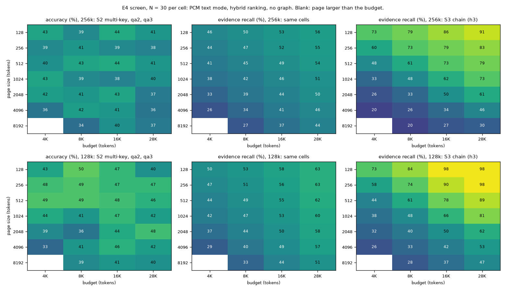
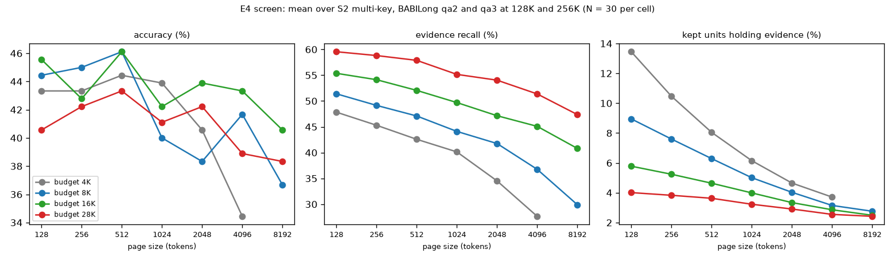
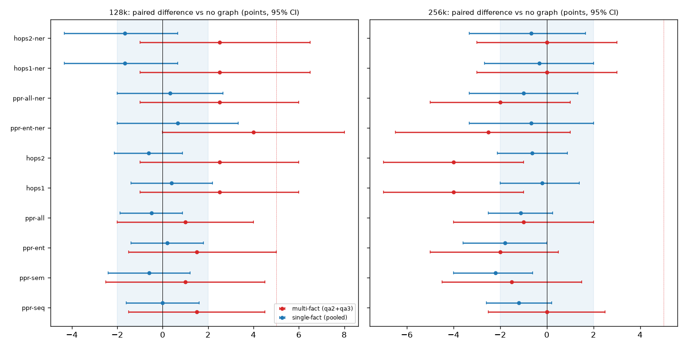

# A5 — Pillars 1 and 2: pages and budget (E4), the graph (E5)

Dates: 2026-11-21 to 2026-11-25. Machine: local workstation (RTX 3090, 24 GB).
Reader: Qwen3-1.7B (R0, zero-shot), greedy decoding, thinking off. Task families retained at Gate G0:
S1, S2, BABILong (qa1–qa5), BABILong-ext (qa6–qa10), plus the four InfiniteBench tasks.

This step measures the two retrieval pillars of PCM in text mode (specification, sections 4.3, 4.4 and 4.7):

- **Pages (E4).** The document is cut into 128-token index units, as in A4. A page is a run of P/128
  consecutive units. Pages are ranked by their best unit under the hybrid ranking (BM25 and embeddings fused by
  reciprocal rank). The first floor(B/P) pages are kept, put back in document order with a visible gap marker
  between non-adjacent pages, and given to the reader with the question (D-041, D-042). E4 asks which page size P
  and budget B work best.
- **Graph (E5).** At the best E4 setting, the unit ranking is changed by a graph over the units before pages are
  chosen. Two traversals were tested: personalised PageRank (PPR) from the top 16 units over sequence (SEQ),
  semantic (SEM) and entity (ENT) edges, and entity hops from those 16 units. Entities came from the
  specification's default extractor or from spaCy NER (D-043, D-044). E5 asks whether the graph helps multi-fact
  questions (hypothesis H2).

Every number below is read from a file under `results/`:

| File | What it holds |
|---|---|
| `results/E4_pages/runs.jsonl` | E4, one row per example: 14,940 rows (screen, final stage, and an earlier smoke pilot) |
| `results/E4_pages/best_settings.json`, `e5_setting.json` | the two choices made by rules fixed before the runs, each written once |
| `results/E5_graph/runs.jsonl` | E5: 30,600 rows |
| `results/E5_graph/ingest_entities_spacy.jsonl` | the spaCy entity precompute, one line per document (copied from the run's log) |
| `results/A5_pillars12/summary.json`, `tables.md`, `figures/` | every table and figure here, computed from the files above by `scripts/a5_summary.py`; A4's M2 and M3 rows for comparison; ingest times from the index cache's log |

**Code commit.** The method code is the same for every row used:
- E4: 40 smoke-pilot rows on `7eb8edd`, 6,800 rows on `f738a37` (the screen and the final stage's pilot), and 8,100 rows on `68fdc99` (the final stage).
- E5: all 30,600 rows on `68fdc99`.
- What changed between these commits: `f738a37` changed only an option of the entity precompute script, and `68fdc99` added only D-045 to DEVIATIONS.md.

No row failed. The longest prompt was 30,665 tokens in E4 and 8,718 in E5, both inside the 32,768-token window.

## 1. Outcome

- **Best setting: page 512, budget 8,192 (16 pages).**
  - It tied first in the screen, which is noisy: all 27 settings scored 34–46% with N = 30.
  - In the final stage (N = 100) it beat the two other candidates on S2, BABILong and BABILong-ext at 128K and 256K; S1 is 100% for all three.
  - Against plain retrieval with a 28,672-token budget (A4's M2 hybrid), it gains 6.8 to 14.0 points on S2, BABILong and BABILong-ext. All six paired CIs exclude 0.
  - It keeps less of the evidence than M2, but the prompt is 8,426 tokens instead of 29,479 at 256K.
- **The budget acts mainly through prompt length.**
  - A larger budget raises evidence recall at every page size.
  - Yet budget 16,384 lost 3.5–8.2 points to 8,192 at the same page size.
  - The native reader loses accuracy between 8K and 16K tokens too (A3).
- **Page size moves recall much more than accuracy.**
  - Evidence recall falls steadily as pages get larger.
  - Accuracy is flat for pages of 128–512 tokens and drops 6–10 points for pages of 1,024 tokens and more at small budgets.
- **H2 fails.** No graph variant gains on the multi-fact tasks (BABILong qa2 + qa3) at either 128K or 256K.
  - The best gain is +4.0 [0.0, +8.0] points at 128K, with spaCy entities.
  - Entity hops lose 4.0 [−7.0, −1.0] at 256K.
  - The graph changes the kept pages in about half the examples, so it is active, but evidence recall does not rise.
  - `configs/pcm_text.yaml` therefore has no graph.
- **Gate G1 passes.** Evidence recall at 256K is 1.000 on S1 and on S2 multi-key, for every setting and every graph variant.
- **Cost at 256K.** A cold index build costs 7.7 s per document for the embeddings (4.0 MiB), plus 0.45 s and 5.5 MiB for the default entities. Selection at query time takes 0.28 s.

## 2. What was run

| Stage | Settings | Tasks | Lengths | N |
|---|---|---|---|---|
| E4 screen | 27 (page, budget) pairs: page ∈ {128, …, 8192}, budget ∈ {4096, 8192, 16384, 28672}, page ≤ budget | S2 multi-key, BABILong qa2, qa3 (accuracy); S3 chain h3 (evidence recall only, no reader) | 128K, 256K | 30 |
| E4 final | the best three of the screen | every retained task (S1, S2 ×2, qa1–qa10), and InfiniteBench at its own length | 128K, 256K | 100 |
| E5 | no graph; PPR over SEQ, SEM, ENT or all three; entity hops H = 1 or 2; the ENT-using variants also with spaCy entities | S1, S2, qa1–qa5, InfiniteBench (all variants); qa6–qa10 (no graph, PPR-all, hops2); spaCy variants on qa1–qa5 only | 128K, 256K; no graph, PPR-all and hops2 also at 32K and 64K | 100 |
| E5, S3 chain | no graph, PPR-all, hops2 | S3 h2, h3, h4 (evidence recall only) | 128K, 256K | 100 |

The rules were fixed in `configs/a5_pillars.yaml` before the runs they govern:
- The final stage's three settings come from mean screen accuracy, with ties broken by evidence recall, then the smaller budget, then the smaller page.
- E5's setting is the final setting with the highest mean accuracy over S1, S2 and BABILong at 128K and 256K.
- How H2 is read (D-045) was fixed after the screen and before any E5 row.

**Reused answers.** Where two methods build the identical prompt, the answer is reused (exact by prompt hash). For example, E5's no-graph setting is E4's final setting.

## 3. E4 screen: page size × budget

The tables below average the screen's six accuracy cells (S2 multi-key, qa2 and qa3, at 128K and 256K), with 180 examples per setting. Per-task tables are in `tables.md`.

Accuracy (%):

| page \ budget | 4096 | 8192 | 16384 | 28672 |
|---|---|---|---|---|
| 128 | 43.3 | 44.4 | 45.6 | 40.6 |
| 256 | 43.3 | 45.0 | 42.8 | 42.2 |
| 512 | 44.4 | **46.1** | **46.1** | 43.3 |
| 1024 | 43.9 | 40.0 | 42.2 | 41.1 |
| 2048 | 40.6 | 38.3 | 43.9 | 42.2 |
| 4096 | 34.4 | 41.7 | 43.3 | 38.9 |
| 8192 | | 36.7 | 40.6 | 38.3 |

Evidence recall (share of evidence items inside the kept pages):

| page \ budget | 4096 | 8192 | 16384 | 28672 |
|---|---|---|---|---|
| 128 | 0.478 | 0.514 | 0.547 | 0.596 |
| 256 | 0.453 | 0.491 | 0.541 | 0.588 |
| 512 | 0.426 | 0.465 | 0.518 | 0.579 |
| 1024 | 0.401 | 0.441 | 0.497 | 0.552 |
| 2048 | 0.345 | 0.418 | 0.471 | 0.540 |
| 4096 | 0.277 | 0.368 | 0.451 | 0.514 |
| 8192 | | 0.299 | 0.408 | 0.474 |

S3 chain h3 (recall only, mean of 128K and 256K):

| page \ budget | 4096 | 8192 | 16384 | 28672 |
|---|---|---|---|---|
| 128 | 0.733 | 0.817 | 0.917 | 0.945 |
| 512 | 0.461 | 0.611 | 0.755 | 0.839 |
| 2048 | 0.289 | 0.367 | 0.500 | 0.617 |
| 8192 | | 0.239 | 0.317 | 0.383 |

**Choosing the best three settings.**
- The rule picked page 512 / budget 16,384, page 512 / 8,192 and page 128 / 16,384. The first two tie at 46.1%; recall broke the tie.
- With N = 30 per cell the ranking is weak. Against page 512 at the same budget (paired, 180 pairs), only a few differences have a CI that excludes 0:
  - page 4096 at budget 4,096: −10.0 [−16.7, −3.3];
  - pages 1024, 2048 and 8192 at budget 8,192: −6.1 [−11.1, −1.1], −7.8 [−13.9, −1.7] and −9.4 [−15.6, −3.3].
  - Pages 128 and 256 are within −3.3 to −0.6 points of page 512 at every budget, and none of those CIs excludes 0.
- This is why the final stage tests three settings on every task with N = 100.

## 4. How accuracy and recall move with page size, and why

**Recall falls as pages grow, at every budget.**
- At budget 8,192, mean recall goes from 0.514 (page 128) to 0.299 (page 8192). On the S3 chain it goes from 0.817 to 0.239.
- The mechanism is the number of places the selection can reach. A budget B holds B/P pages, and each page counts as one hit wherever its best unit is.
- When the evidence is scattered (BABILong's facts are single sentences spread through the haystack; S3's links are separate needles), a fact outside the chosen places is lost. Larger pages mean fewer places.
- The extra tokens a larger page brings around each hit are mostly filler. The share of kept units that hold any evidence falls from 0.089 (page 128) to 0.028 (page 8192) at budget 8,192.
- Smaller pages also cut the text into more pieces: 55.0 gaps per prompt at page 128 against 13.3 at page 512 (budget 8,192).

**Accuracy follows recall only where recall is short of what the question needs.**
- **S2 multi-key:**
  - Recall is 1.000 for every page up to 1,024 at every budget, and accuracy sits at 82–93%.
  - Recall falls only when one or two very large pages hold the whole budget: page 4096 at budget 4,096 has recall 0.717 and accuracy 71.7%.
- **BABILong qa2 and qa3:**
  - Recall over all facts of the story (D-037) rises as pages shrink: qa3 at budget 8,192 goes from 0.071 (page 8192) to 0.281 (page 128).
  - Accuracy does not move with it: qa2 stays at 8–17% and qa3 at 20–35% across the grid.
  - At these budgets most stories are still incomplete in the prompt.
  - The reader also fails often when the evidence is there: A4's tight oracle, which holds every fact, reaches only 55.8% on BABILong at 256K.
- **What the screen supports.** Pages of 128–512 tokens are equivalent within the screen's noise. Pages of 1,024 tokens and more cost accuracy at budgets up to 8,192, where they leave too few distinct places.

**More budget means more recall but not more accuracy.**
- At page 512, recall rises from 0.426 (budget 4,096) to 0.579 (28,672), and accuracy stays at 41–46%.
- The final stage (section 5) shows that budget 16,384 is worse than 8,192 at the same page size on every family.
- The reader's own accuracy falls between 8K and 16K tokens of prompt. Native BABILong drops from 57.2% at 8K to 42.6% at 16K (A3). On qa4 alone it drops from 50% to 13% (A3), and in E4's final stage qa4 scores 41/44% at budget 8,192 against 21/14% at 16,384 (128K/256K).
- Adding pages adds some evidence, but it costs the reader more than it gains, for this 1.7B reader.

## 5. E4 final: the three settings on every task (N = 100 per task)

Family accuracy, % [95% CI]. Below the line, A4's rows on the same examples:

| method | S1 256K | S1 128K | S2 256K | S2 128K | BABILong 256K | BABILong 128K | BABILong-ext 256K | BABILong-ext 128K |
|---|---|---|---|---|---|---|---|---|
| PCM page 512, budget 8,192 | 100.0 | 100.0 | **87.0** [82.0, 91.5] | **84.0** [79.0, 89.0] | **43.2** [39.2, 47.0] | **40.4** [36.4, 44.2] | **51.2** [47.6, 54.8] | **53.0** [49.6, 56.4] |
| PCM page 512, budget 16,384 | 100.0 | 100.0 | 79.0 [73.5, 84.5] | 80.5 [75.0, 86.0] | 35.6 [31.8, 39.2] | 36.2 [32.4, 40.0] | 45.4 [41.8, 49.0] | 44.8 [41.2, 48.4] |
| PCM page 128, budget 16,384 | 100.0 | 100.0 | 77.5 [72.0, 83.0] | 78.0 [72.0, 83.5] | 33.8 [30.0, 37.6] | 35.6 [31.8, 39.4] | 44.0 [40.4, 47.6] | 45.0 [41.4, 48.8] |
| A4 M2 hybrid (units, 28,672) | 100.0 | 100.0 | 77.5 [71.5, 83.0] | 70.0 [63.5, 76.0] | 33.0 [29.2, 36.8] | 33.6 [30.0, 37.4] | 42.8 [39.2, 46.4] | 40.8 [37.0, 44.6] |
| A4 M3 oracle (padded to 28,672) | 100.0 | 99.0 | 80.0 [75.0, 85.0] | 79.0 [73.5, 84.0] | 44.8 [40.6, 48.8] | 45.0 [40.8, 49.2] | 40.2 [36.6, 43.8] | 39.8 [36.2, 43.4] |
| A4 M3 tight oracle (evidence ±1 unit) | 100.0 | 100.0 | 97.5 [95.0, 99.5] | 97.0 [94.5, 99.0] | 55.8 [51.6, 60.0] | 56.2 [52.0, 60.4] | 55.0 [51.6, 58.4] | 56.8 [53.4, 60.4] |

Family evidence recall:

| method | BABILong 256K | BABILong 128K | BABILong-ext 256K | BABILong-ext 128K |
|---|---|---|---|---|
| PCM page 512, budget 8,192 | 0.397 | 0.442 | 0.437 | 0.492 |
| PCM page 512, budget 16,384 | 0.464 | 0.523 | 0.501 | 0.567 |
| PCM page 128, budget 16,384 | 0.508 | 0.563 | 0.556 | 0.607 |
| A4 M2 hybrid (28,672) | 0.551 | 0.627 | 0.608 | 0.680 |

S1 and S2 recall is 1.000 for all of them.

Paired differences, points [95% CI], same examples:

| comparison | S2 256K | S2 128K | BABILong 256K | BABILong 128K | BABILong-ext 256K | BABILong-ext 128K |
|---|---|---|---|---|---|---|
| page 512 / 16,384 − page 512 / 8,192 | −8.0 [−13.5, −2.5] | −3.5 [−9.5, +2.5] | −7.6 [−11.6, −3.6] | −4.2 [−8.2, −0.2] | −5.8 [−9.0, −2.6] | −8.2 [−11.8, −4.6] |
| page 128 / 16,384 − page 512 / 8,192 | −9.5 [−15.5, −3.0] | −6.0 [−12.0, +0.0] | −9.4 [−13.8, −5.0] | −4.8 [−9.2, −0.6] | −7.2 [−10.8, −3.6] | −8.0 [−11.8, −4.0] |
| page 512 / 8,192 − A4 M2 hybrid | +9.5 [+2.5, +16.5] | +14.0 [+6.0, +22.0] | +10.2 [+5.6, +14.8] | +6.8 [+2.2, +11.4] | +8.4 [+3.8, +13.0] | +12.2 [+7.4, +17.0] |
| page 512 / 8,192 − A4 M3 oracle | +7.0 [+0.0, +14.0] | +5.0 [−2.0, +12.0] | −1.6 [−6.6, +3.2] | −4.6 [−9.4, +0.2] | +11.0 [+6.6, +15.6] | +13.2 [+8.8, +17.4] |
| page 512 / 8,192 − A4 tight oracle | −10.5 [−16.0, −5.5] | −13.0 [−18.5, −7.5] | −12.6 [−17.2, −8.0] | −15.8 [−20.6, −11.0] | −3.8 [−7.6, +0.0] | −3.8 [−7.4, −0.2] |

**E5's setting.**
- By its rule, E5's setting is page 512 / budget 8,192: score 75.8, against 71.9 and 70.8 for the other two.
- The family scores the rule used are in `e5_setting.json`.

**InfiniteBench (each document at its own length, 90K–190K tokens).**
- Page 512 / 8,192:
  - passkey 100.0;
  - number_string 100.0;
  - kv_retrieval 27.0 [19.0, 36.0], evidence recall 0.480;
  - longbook_choice_eng 50.0 [40.0, 60.0].
- For comparison, kv_retrieval scores 9.0 at page 512 / 16,384, and in A4 M2 hybrid scored 18.0 (recall 0.52) and the tight oracle 55.0.

**Cost at 256K.** Page 512 / 8,192 takes 1.65 s per example, with 8,426 prompt tokens and a peak of 5.4 GiB. The budget-16,384 settings take 2.97–3.08 s with 16,664–17,073 tokens. A4's M2 hybrid took 6.1 s per example at 256K, with 29,479 prompt tokens.

## 6. Results that look too good, explained

**PCM above A4's M3 oracle.**
- PCM is above M3 on BABILong-ext (+11.0 and +13.2) and on S2 at 256K (+7.0 [0.0, +14.0]).
- PCM's selection never sees the gold evidence. The ranking uses BM25 and embeddings of the question; evidence spans are read only after the pages are chosen, to compute recall and ranks.
- The two methods differ in prompt length. M3 pads the gold units with their neighbours up to 28,672 tokens, while PCM's prompt is 8,426 tokens on average.
- A4 already showed that the same evidence in 28,672 tokens loses 11–25 points against the tight oracle, which holds only the evidence ±1 unit.
- The tight oracle is the ceiling that matters, and PCM is below it on every family at both lengths (−3.8 to −15.8).

**PCM on S2 at 256K against the native 8K reference.**
- PCM scores 87.0 [82.0, 91.5] at 256K, against the native 8K reference of 82.5 [77.0, 87.5] (A3/A4).
- The comparison is unpaired, because the 8K documents differ, and the intervals overlap. This is no evidence that PCM beats the native reader. It is recorded as within noise.
- BABILong-ext at 128K (53.0) sits just under its native reference (53.4).

## 7. E5: the graph ablation, and H2

**How H2 is read (D-045).**
- Each variant is compared with the no-graph setting on the same examples, at 128K and 256K separately.
- **Multi-fact part:** BABILong qa2 + qa3 pooled, 200 pairs. It needs a gain of at least +5 points with the 95% CI above 0.
- **Single-fact part:** the single-fact tasks the variant ran, pooled. It needs a point estimate within ±2 points.
- A variant holds H2 if both parts pass at both lengths.

| variant | entities | length | multi-fact (qa2+qa3), points | single-fact pooled, points (tasks) | secondary multi-fact (S2 mv, qa7, qa8) | holds |
|---|---|---|---|---|---|---|
| PPR, SEQ | – | 128K | +1.5 [−1.5, +4.5] | +0.0 [−1.6, +1.6] (5) | +4.0 [−1.0, +10.0] | no |
| | | 256K | +0.0 [−2.5, +2.5] | −1.2 [−2.6, +0.2] (5) | −2.0 [−5.0, +0.0] | |
| PPR, SEM | – | 128K | +1.0 [−2.5, +4.5] | −0.6 [−2.4, +1.2] (5) | +1.0 [−5.0, +7.0] | no |
| | | 256K | −1.5 [−4.5, +1.5] | **−2.2** [−4.0, −0.6] (5) | −3.0 [−7.0, +0.0] | |
| PPR, ENT | default | 128K | +1.5 [−1.5, +5.0] | +0.2 [−1.4, +1.8] (5) | +1.0 [−3.0, +5.0] | no |
| | | 256K | −2.0 [−5.0, +0.5] | −1.8 [−3.6, +0.0] (5) | −1.0 [−5.0, +3.0] | |
| PPR, all edges | default | 128K | +1.0 [−2.0, +4.0] | −0.5 [−1.9, +0.9] (8) | −0.7 [−3.3, +2.0] | no |
| | | 256K | −1.0 [−4.0, +2.0] | −1.1 [−2.5, +0.2] (8) | −1.0 [−2.3, +0.0] | |
| hops, H = 1 | default | 128K | +2.5 [−1.0, +6.0] | +0.4 [−1.4, +2.2] (5) | +0.0 [−6.0, +6.0] | no |
| | | 256K | **−4.0** [−7.0, −1.0] | −0.2 [−2.0, +1.4] (5) | −1.0 [−5.0, +3.0] | |
| hops, H = 2 | default | 128K | +2.5 [−1.0, +6.0] | −0.6 [−2.1, +0.9] (8) | −1.0 [−4.0, +1.7] | no |
| | | 256K | **−4.0** [−7.0, −1.0] | −0.6 [−2.1, +0.9] (8) | −0.3 [−2.0, +1.3] | |
| PPR, ENT | spaCy | 128K | +4.0 [+0.0, +8.0] | +0.7 [−2.0, +3.3] (3) | – | no |
| | | 256K | −2.5 [−6.5, +1.0] | −0.7 [−3.3, +2.0] (3) | – | |
| PPR, all edges | spaCy | 128K | +2.5 [−1.0, +6.0] | +0.3 [−2.0, +2.7] (3) | – | no |
| | | 256K | −2.0 [−5.0, +1.0] | −1.0 [−3.3, +1.3] (3) | – | |
| hops, H = 1 | spaCy | 128K | +2.5 [−1.0, +6.5] | −1.7 [−4.3, +0.7] (3) | – | no |
| | | 256K | +0.0 [−3.0, +3.0] | −0.3 [−2.7, +2.0] (3) | – | |
| hops, H = 2 | spaCy | 128K | +2.5 [−1.0, +6.5] | −1.7 [−4.3, +0.7] (3) | – | no |
| | | 256K | +0.0 [−3.0, +3.0] | −0.7 [−3.3, +1.7] (3) | – | |

Notes on the table:
- Single-fact tasks:
  - variants run on h1 only: S1, S2 multi-key, qa1, qa4, qa5;
  - PPR-all and hops2: those plus qa6, qa9 and qa10;
  - spaCy variants: qa1, qa4, qa5.
- Bold marks a difference whose CI excludes 0.

**H2 is not supported.**
- No variant passes the multi-fact part at any length.
- The single-fact part passes everywhere except PPR-SEM at 256K.
- Across lengths, with no graph, PPR-all and hops2 at 32K to 256K on every family, the graph's paired differences lie between −2.5 and +2.0 points (table in `tables.md`).
- On the S3 chain, which tests evidence recall only, PPR-all and hops2 change recall by −1.0 to 0.0 points.

**Why the graph does not help: what was measured.**

| variant | kept units changed vs no graph, 128K | 256K | top-16 seeds moved (256K) | no question entity found, qa2 / qa3 (256K) |
|---|---|---|---|---|
| PPR, SEQ | 467 / 800 | 422 / 800 | 10.1 | – |
| PPR, SEM | 459 / 800 | 422 / 800 | 14.0 | – |
| PPR, ENT | 466 / 800 | 421 / 800 | 13.6 | – |
| PPR, all edges | 803 / 1300 | 708 / 1300 | 13.9 | – |
| hops, H = 1 | 484 / 800 | 446 / 800 | – | 0.54 / 0.66 |
| hops, H = 2 | 853 / 1300 | 757 / 1300 | – | 0.54 / 0.66 |
| hops, H = 1 or 2, spaCy | 319 / 500 | 298 / 500 | – | 1.00 / 1.00 |

- **The graph is active.**
  - It changes the kept pages in about half of the examples.
  - PPR replaces about 14 of the 16 top-ranked units.
- **Evidence recall does not rise.** Pooled over each H2 part, recall moves by −1.4 to +0.5 points against no graph, for every variant at both lengths. The units the graph brings in are no more often evidence than the ones it pushes out.
- **The questions that need a chain rarely name an entity.**
  - qa2 and qa3 questions name an object ("where is the football?"). The chain runs from that object to the person who moved it and from that person to a place.
  - The default extractor finds no entity in 54% (qa2) and 66% (qa3) of these questions; spaCy finds none in any of them.
  - Entity hops then start only from the seed units' entities.
- **One reading, not tested here.** With 16 pages to fill, the hybrid ranking already reaches the units that share the question's words. The graph's neighbours of those units (adjacent filler, semantically similar sentences, units sharing a name) are not where the missing facts are.
- **Scope of the test.** It covers one setting, page 512 / 8,192. A larger budget gives the graph more room. With 200 pooled pairs the multi-fact CI is about ±3–4 points wide, so a +5 effect would have been visible.

## 8. Gate G1: evidence recall ≥ 0.9 on single-evidence tasks at 256K

| setting | S1 | S2 multi-key | passkey | number_string | kv_retrieval | G1 |
|---|---|---|---|---|---|---|
| page 512 / 8,192 (the `pcm_text.yaml` setting) | 1.000 (n 100) | 1.000 (n 100) | 1.000 | 1.000 | 0.480 | **pass** |
| page 512 / 16,384 | 1.000 | 1.000 | 1.000 | 1.000 | 0.520 | pass |
| page 128 / 16,384 | 1.000 | 1.000 | 1.000 | 1.000 | 0.460 | pass |
| every E5 graph variant at page 512 / 8,192 | 1.000 | 1.000 | 1.000 | 1.000 | 0.480–0.550 | pass |

**Gate G1 passes.**
- At 256K every S1 and S2 multi-key example has its needle inside the kept pages, at every setting.
- The InfiniteBench single-evidence tasks are shown beside the gate, as configured, because their documents are 90K–190K tokens, not 256K:
  - passkey and number_string are complete;
  - kv_retrieval keeps its key in about half of the examples, as A4's M2 hybrid did (recall 0.52).
- BABILong is not a single-evidence task under D-037, so it is not in the gate.

## 9. Ingest time and index size at 256K (per document)

| | synthetic (600 documents) | BABILong (1,000 documents) |
|---|---|---|
| tokens / index units | 261,617 / 2,044 | 248,952 / 1,945 |
| embeddings (Qwen3-Embedding-0.6B, GPU) | 7.74 s (7.39–8.17), 33,800 tokens/s | 7.33 s (6.77–7.83), 33,970 tokens/s |
| SEM edges (k = 5, cos ≥ 0.5) | 0.017 s | 0.011 s |
| default entities + ENT edges | 0.45 s | 0.43 s |
| spaCy entities + ENT edges (CPU, 500 documents) | – | 38.6 s (max 43.5) |
| stored embeddings (float16, with unit bounds) | 4.0 MiB, 16.0 bytes/token | 3.8 MiB, 16.0 bytes/token |
| stored SEM edges | 0.23 MiB, 0.9 bytes/token | 0.22 MiB, 0.9 bytes/token |
| stored default entities + ENT edges | 5.5 MiB, 22.0 bytes/token | 5.1 MiB, 21.6 bytes/token |
| stored spaCy entities + ENT edges | – | 1.7 MiB, 7.1 bytes/token |

**What is built when.**
- BM25 is rebuilt from the cached units at query time (D-035).
- Selection at 256K takes 0.28 s per example: BM25, the query embedding, fusion, the graph and the page fill.
- Before that, 1.16 s goes to tokenising, cutting and loading the cached index.
- The graph's own query-time cost is 0.013 s for PPR over all edges and 0.002 s for two entity hops.

**What the index costs at 256K.**
- Without a graph, as fixed: about 7.7 s of GPU per document once and 4 MiB on disk.
- The default entity graph would add 0.45 s and 5.5 MiB; its vocabulary and incidence lists outweigh the embeddings.

## 10. `configs/pcm_text.yaml`

The file holds the full method configuration under the key `pcm_text`. It equals E5's no-graph setting, whose method hash `a9f9fa050cff` matches the A5 rows.

| value | from the data |
|---|---|
| page 512 | Tied first in the screen. Pages of 128–512 tokens are equivalent within noise (sections 3–4). Page 512 was the best of the three final settings on every family; the larger page holds more of the local context per hit and needs 4× fewer stitched boundaries than page 128, which matters in KV mode (A6). |
| budget 8,192 | Beat 16,384 by 3.5–8.2 points on every family at both lengths (5 of 6 CIs exclude 0); half the prompt and about half the time per example (1.65 s against 2.97 s). |
| no graph | H2 fails. No variant gains on multi-fact questions, and none raises evidence recall (section 7). |
| unit 128 / snap 32, hybrid ranking, gap marker | Unchanged from A4 (D-035) and D-041; not varied in A5. |

## 11. Integrity checks

- **Failures:** none. Every one of the 14,940 E4 and 30,600 E5 rows has status ok.
- **Code:** identical across the three commits used (see the head of this report).
- **Screen cells:** counted on their first 30 examples only. The final stage later added rows 30–99 to the three settings it kept, and those rows are left out of the screen tables. The summary reproduces the screen ranking written in `best_settings.json` (46.1, 46.1, 45.6).
- **Rule files:** `best_settings.json` and `e5_setting.json` were each written once, by their rules, before the stage that uses them.
- **Window:** every prompt fits it (max 30,665 tokens).
- **Reused answers:** only between identical prompts (same prompt hash). E5's no-graph rows are E4's final rows answered again from the stored answers.

## 12. What it means, and what is uncertain

**Pillar 1 (pages and budget).**
- For this reader, the short prompt is the win. PCM text mode at 8,192 tokens beats plain retrieval at 28,672 tokens by 7–14 points while keeping less of the evidence.
- The tight oracle shows how much is still lost: 10–16 points on S2 and BABILong. Some of the loss is selection: recall is 0.40–0.44 on BABILong, and A4 put the oracle − hybrid gap at 11–12 points at 128K and 256K. Some is the reader, which fails nearly half of BABILong even with every fact (tight oracle 55.8–56.2%).

**Pillar 2 (graph).**
- As specified and implemented here, the graph does not help. H2 fails.
- The result does not depend on the entity extractor: spaCy entities do no better than the default extractor.
- It may depend on the budget and on the task design, since BABILong's chains run through common nouns.

**Gate G1 passes.** Selection does not need fixing before A6.

**Uncertain.**
- The screen's N = 30 cannot separate pages of 128–512 tokens.
- Only three settings were run at N = 100, so a better budget between 4,096 and 8,192, or a smaller page at 8,192, is not excluded.
- Every number is for Qwen3-1.7B. A stronger reader may profit more from extra budget, so the budget's harm may not carry over.

**For H1 (A8's question), for orientation only.** PCM text mode scores 40.4–50.4% on BABILong from 32K to 256K, while 90% of the native 8K reference is 51.5%.

## 13. What was built in A5

| file | what |
|---|---|
| `pcm/chunking.py` | pages as runs of units: `units_per_page`, `page_of_unit`, `page_bounds` |
| `pcm/index/select.py` | page order (a page ranks at its best unit), page fill, units of pages, evidence page ranks |
| `pcm/index/graph.py` | SEQ, SEM and ENT edges; default and spaCy entity extractors; PPR on the GPU (torch sparse); entity hops; per-document graph cache |
| `pcm/eval/runner.py` | `PCMText` (method `pcm`): hybrid ranking, graph, pages, text expansion; selection-only rows; answers reused across experiments by prompt hash |
| `configs/a5_pillars.yaml`, `scripts/run_a5.py` | the E4/E5 configuration, the stage rules, and the resumable runner with pilot and projection |
| `scripts/a5_ingest_entities.py` | spaCy entities and ENT edges computed on the CPU before E5 |
| `scripts/a5_summary.py` | every number, table and figure of this report |
| `tests/test_pages_graph.py` | 21 tests: pages, fill, graph edges, PPR, hops, cache, stage cells and choice rules |
| `configs/pcm_text.yaml` | PCM text mode as fixed by A5 |

**Decisions.**
- D-041 (pages and fill).
- D-042 (screen design).
- D-043 (graph).
- D-044 (E5 plan).
- D-045 (how H2 is read).
