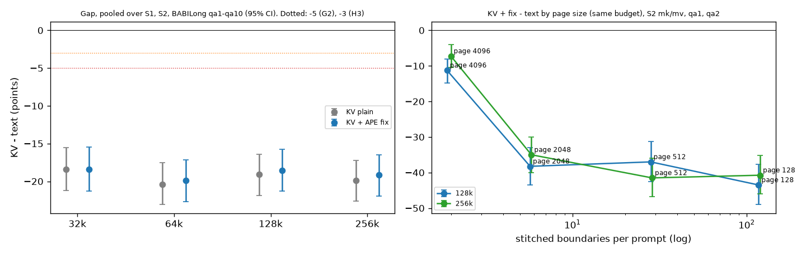
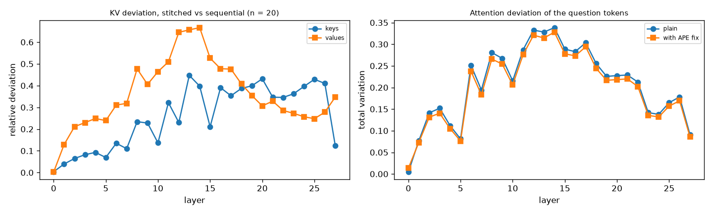

# A6 — Pillar 3, mechanics: KV page store and stitching (E6), Gate G2

Dates: 2026-11-22 to 2026-11-27. Machine: local workstation (RTX 3090, 24 GB).
Reader: Qwen3-1.7B (R0, zero-shot), greedy decoding, thinking off. Page selection: `configs/pcm_text.yaml` (A5):
pages of 512 tokens, budget 8,192 (16 pages), hybrid ranking, no graph.

PCM can hand the reader the selected pages in two ways (specification, section 4.5):

- **Text mode**: the pages' text goes into the prompt and the reader encodes it at query time (about 8,400 tokens per
  question here).
- **KV mode**: each page's key/value cache is computed once, at ingest, as a continuation of a shared prefix P (the chat
  text before the document). At query time the selected pages' caches are put back in document order after P, their keys
  rotated to their new positions ("re-basing"), and only the question is encoded. The reader then sees exactly the same
  tokens at the same positions as in text mode; what differs is that each page was encoded without seeing the other
  pages.

A6 asks whether KV mode can replace text mode (H3), and whether it comes within 5 points of text mode with the best
training-free fix (Gate G2). The fix tested is APE-style: keys of the context divided by a temperature T, and log S added
to the question's attention scores on the context.

Every number below is read from a file under `results/`:

| File | What it holds |
|---|---|
| `results/E6_kv_tune/runs.jsonl` | the fix's tuning grid on the synthetic train split: 1,080 rows |
| `results/E6_kv/ape_choice.json` | the (T, S) chosen by the rule fixed before tuning |
| `results/E6_kv/runs.jsonl` | E6: 21,600 rows (text, KV, KV + fix at four lengths; four page sizes) |
| `results/E6_kv/deviation.jsonl` | KV and attention deviation, 20 examples |
| `results/E6_kv/store_bench.jsonl` | the whole-document page store at 256K, 2 documents |
| `results/A6_kv/summary.json`, `tables.md`, `figures/` | every table and figure here, from the files above (and, for text-mode timings of reused answers, the A5 rows that produced them) by `scripts/a6_summary.py` |

**Code commit.** Tuning rows: `919e46c`. E6, deviation and store rows: `40712b2` (the same KV code; the commits between
add only results, D-051 and the summary script). No row failed. Decisions: D-046 (KV mode), D-047 (fix and tuning),
D-048 (E6 design and deviation measures), D-051 (how G2 and H3 are read, fixed before any E6 test row).

**Re-basing check (A1).** As in every KV report: the literal T2 test of A1 still fails its absolute threshold (D-009);
the relative criterion adopted in D-017 passes, and is what re-basing is trusted on. In A6, stitching was also checked end
to end: with a page as large as the budget (one stitched page), KV mode gave exactly text mode's answer on 10 of 10 S2
multi-key examples at 128K (a check run outside the results, reported here for the record, not as a result).

## 1. Outcome

- **Gate G2 fails.** With the best training-free fix, KV mode is **18.4 to 19.9 points below text mode** (pooled over the
  13 retained tasks, 1,300 paired examples per length, every CI excluding 0). The threshold was −5. **Text mode stays the
  default; KV mode waits for the fusion adapter (R2) in Phase B**, as the specification's G2 row says.
- **H3 fails.** The prefill condition is met many times over (25 tokens prefilled at query time against 8,388–8,426: about
  340× fewer), but the accuracy condition (within 3 points) is not.
- **The fix barely helps.** Tuned on the train split, the rule chose T = 1.0, S = 0.9; it changes the gap by 0 to +0.7
  points. Every temperature below 0.9 destroys the model (train accuracy 0–4%).
- **The failure is task-specific.** Single-needle tasks survive (S1: 97–100% against 100%; InfiniteBench passkey and
  number_string: 100% in both modes). Tasks that must tell needles apart or gather several collapse: S2 multi-key drops
  from 87–89% to 26–36%, S2 multi-value from 76–87% to 0–1%, BABILong qa4 from 41–47% to 4–12%, kv_retrieval from 27% to
  4–5%.
- **Fewer stitched boundaries help only at the extreme.** At page 4,096 (about 2 boundaries) the gap shrinks to −7 and −11
  points, but text mode itself falls to 33–36% there (two large pages miss evidence). From 6 to 120 boundaries the gap is
  −35 to −44 points with no trend.
- **KV mode is fast at query time:** time to first token 0.14 s against 0.87–1.14 s in text mode, expansion 42–44 ms.
  But a whole 256K-document store is 28 GiB (8 GiB on the GPU, 20 GiB on disk), and reading a query's pages back from it
  (1.5–1.6 s) is slower than recomputing them from text (0.9–1.0 s).

## 2. What was run

| Step | What | Size |
|---|---|---|
| Tuning (D-047) | KV mode with T ∈ {1.0, 0.9, 0.8, 0.7} × S ∈ {1.0, 0.9, 0.8} on the synthetic **train** split (seed 1000): S1, S2 multi-key, S2 multi-value at 128K | 30 examples per task and setting |
| E6 (a)–(c) | text, KV plain, KV + the chosen fix, on the same pages | 13 retained tasks × 32K, 64K, 128K, 256K, plus 4 InfiniteBench tasks; N = 100 |
| E6 (d) | text and KV + fix at page sizes 128, 2,048 and 4,096 (512 is (a)–(c)), same budget | S2 multi-key, S2 multi-value, BABILong qa1, qa2 at 128K and 256K; N = 100 |
| Deviation (D-048) | stitched against sequential caches of the same tokens, per layer | first 5 examples of S2 mk, S2 mv, qa1, qa2 at 128K |
| Store | every page of a 256K document in the page store (GPU up to 8 GiB, then numpy files) | 2 documents |

Text-mode answers for prompts identical to A5's were reused from A5 (exact by prompt hash); their timings come from the
A5 rows that produced them.

## 3. Tuning the fix (train split, 128K, mean of S1, S2 mk, S2 mv, %)

| T \ S | 1.0 | 0.9 | 0.8 |
|---|---|---|---|
| 1.0 | 40.0 | **41.1** | 41.1 |
| 0.9 | 37.8 | 40.0 | 41.1 |
| 0.8 | 0.0 | 2.2 | 4.4 |
| 0.7 | 0.0 | 0.0 | 0.0 |

Three settings tie at 41.1; the rule (smaller change from T = 1, S = 1 first) picks T = 1.0, S = 0.9. The difference from
plain KV mode is one example in 90. On the train split S1 is 100% in KV mode, S2 multi-key 23% and S2 multi-value 0%.

## 4. KV against text: Gate G2 and H3 (D-051)

Gap = KV accuracy − text accuracy on the same examples, pooled over S1, S2 ×2, BABILong qa1–qa10 (1,300 pairs per
length), points [95% CI]:

| mode | 32K | 64K | 128K | 256K |
|---|---|---|---|---|
| text accuracy | 58.7 | 58.8 | 56.5 | 57.4 |
| KV plain | 40.3; **−18.4** [−21.2, −15.5] | 38.5; **−20.4** [−23.1, −17.5] | 37.5; **−19.1** [−21.8, −16.4] | 37.5; **−19.9** [−22.6, −17.2] |
| KV + fix (T 1.0, S 0.9) | 40.3; **−18.4** [−21.3, −15.5] | 38.9; **−19.9** [−22.7, −17.2] | 38.0; **−18.5** [−21.3, −15.8] | 38.2; **−19.2** [−21.9, −16.5] |

**Gate G2: FAIL.** The rule (D-051) needs the gap's estimate ≥ −5.0 at every length; it is −18.4 to −19.9 with the fix.
**H3: FAIL** (needs ≥ −3.0, and ≥ 10× fewer prefilled tokens; the second part holds at 340×).

By family (KV + fix − text, points [95% CI]; text accuracy beside):

| family | 32K | 64K | 128K | 256K |
|---|---|---|---|---|
| S1 | −2.0 [−5.0, 0.0]; 100.0 | −1.0 [−3.0, 0.0]; 100.0 | −2.0 [−5.0, 0.0]; 100.0 | −3.0 [−7.0, 0.0]; 100.0 |
| S2 | −65.5 [−72.5, −58.0]; 82.0 | −74.0 [−80.0, −67.5]; 87.0 | −66.0 [−73.0, −58.5]; 84.0 | −71.5 [−78.0, −65.0]; 87.0 |
| BABILong (qa1–5) | −15.6 [−20.4, −10.8]; 50.4 | −16.0 [−20.4, −11.8]; 47.4 | −13.4 [−17.6, −9.2]; 40.4 | −13.8 [−17.8, −9.6]; 43.2 |
| BABILong-ext (qa6–10) | −5.6 [−9.6, −1.6]; 49.4 | −6.0 [−10.2, −1.8]; 50.8 | −8.0 [−12.0, −3.8]; 53.0 | −6.8 [−10.8, −2.8]; 51.2 |

InfiniteBench (own length, KV + fix): passkey 100 / 100, number_string 100 / 100, kv_retrieval 27.0 → 5.0 (−22.0
[−31.0, −14.0]), longbook_choice_eng 50.0 → 42.0 (−8.0 [−17.0, +1.0]).

Per task (text / KV / KV + fix, %), 256K: S1 100/97/97; S2 multi-key 89/31/31; S2 multi-value 85/0/0; qa1 63/43/43;
qa2 9/6/6; qa3 29/21/21; qa4 44/6/10; qa5 71/66/67; qa6 77/63/64; qa7 3/0/0; qa8 37/24/26; qa9 80/73/74; qa10 59/57/58.
All lengths are in `tables.md`. The only tasks where KV mode is not behind are qa10 (at 32K and 64K, +4 to +7 points,
within noise at N = 100) and qa2 at 128K (14 against 11).

## 5. Gap against the number of stitched pages

**(d) Page size, same budget and selection rule** (S2 mk, S2 mv, qa1, qa2 pooled; 400 pairs per cell):

| page | length | stitched boundaries | text | KV + fix | gap [95% CI] |
|---|---|---|---|---|---|
| 128 | 128K | 117.1 | 59.5 | 16.0 | −43.5 [−49.0, −37.8] |
| 128 | 256K | 119.4 | 58.0 | 17.2 | −40.8 [−46.0, −35.2] |
| 512 | 128K | 28.1 | 58.8 | 21.8 | −37.0 [−42.5, −31.2] |
| 512 | 256K | 28.6 | 61.5 | 20.0 | −41.5 [−46.8, −36.0] |
| 2,048 | 128K | 5.7 | 58.8 | 20.5 | −38.2 [−43.5, −33.0] |
| 2,048 | 256K | 5.8 | 57.5 | 22.5 | −35.0 [−40.0, −30.0] |
| 4,096 | 128K | 1.9 | 35.8 | 24.5 | −11.2 [−14.8, −8.0] |
| 4,096 | 256K | 2.0 | 33.0 | 25.8 | −7.2 [−10.5, −4.0] |

The KV accuracy itself hardly moves (16–26%) as the boundaries drop from 120 to 2; what changes at page 4,096 is that
text mode falls too, because two large pages often miss the evidence. So fewer boundaries do not rescue KV mode: from 6
boundaries upward the gap has no trend, and the narrow gap at page 4,096 comes from text mode getting worse. (Boundaries
count gap markers as segments: 16 pages with up to 15 gaps give up to 30 boundaries.)

Within the main comparison, by stitched boundaries per prompt (all lengths, KV + fix): 21–25 boundaries −15.3
[−18.1, −12.4] (n 1,159); 26–30 boundaries −20.1 [−21.6, −18.5] (n 4,026). This is observational: prompts with fewer gaps
are those whose pages touch, which also differ in content.

## 6. Why: deviation of stitched from sequential caches (20 examples at 128K, 16 pages, 29 segments)

| layer | 0 | 1 | 3 | 6 | 8 | 12 | 14 | 20 | 25 | 27 |
|---|---|---|---|---|---|---|---|---|---|---|
| K deviation (relative) | 0.004 | 0.039 | 0.082 | 0.135 | 0.234 | 0.230 | 0.398 | 0.431 | 0.429 | 0.123 |
| V deviation (relative) | 0.003 | 0.129 | 0.230 | 0.310 | 0.477 | 0.645 | 0.667 | 0.307 | 0.248 | 0.348 |
| attention deviation (TV), plain | 0.005 | 0.077 | 0.152 | 0.251 | 0.281 | 0.333 | 0.338 | 0.228 | 0.165 | 0.091 |
| attention deviation (TV), with fix | 0.013 | 0.073 | 0.141 | 0.238 | 0.266 | 0.321 | 0.328 | 0.218 | 0.157 | 0.086 |

All 28 layers are in `tables.md`. Layer 0 is nearly identical (each page's first-layer keys and values depend only on
its own tokens and position). From layer 1 on, every token of a stitched page was computed without the pages before it,
and the error grows with depth: values deviate by up to two-thirds of their norm in the middle layers (12–14), keys by up
to 0.45 (layers 13–26). The question's attention distributions differ by a total variation of 0.25–0.34 in the
middle layers. At the first answer token, the next-token distributions differ by KL 1.80 nats and agree on the top token
in 65% of the 20 examples; with the fix, KL 1.72 and 80%. The fix lowers the attention deviation in every layer but layer
0, by about 3–7% of its value, which is too little to change answers.

This matches the failure pattern in section 4: when a needle is alone (S1), its page carries the answer in its own
tokens and the question finds it; when the reader must compare a needle with look-alike needles in other pages (S2
multi-key: in the train-split answers inspected, the reader gave a number other than the queried key's) or collect values from several pages (S2 multi-value: one or two
of four values, often with invented numbers), the representations, computed without each other, do not support it.

## 7. Speed and memory per example (mean over the 13 retained tasks)

| mode | length | tokens prefilled at query time | time to first token, s | expansion, ms | page encoding at ingest, s | stitched boundaries | peak VRAM, GiB |
|---|---|---|---|---|---|---|---|
| text | 32K | 8,388 | 0.868 | – | – | – | 5.41 |
| text | 128K | 8,421 | 0.949 | – | – | – | 5.40 |
| text | 256K | 8,426 | 1.138 | – | – | – | 5.40 |
| KV + fix | 32K | 25 | 0.139 | 43.3 | 1.38 | 25.0 | 7.25 |
| KV + fix | 128K | 25 | 0.138 | 42.4 | 1.53 | 27.9 | 7.20 |
| KV + fix | 256K | 25 | 0.142 | 43.8 | 1.74 | 28.4 | 7.25 |

Time to first token: text mode = prefill of the whole prompt; KV mode = expansion (reading the pages, re-basing,
stitching) plus prefill of the question (D-051 (6)). Selection is the same in both modes and left out. Page encoding is
ingest: in E6 only the pages each example keeps were encoded (D-046 (3)). 64K and InfiniteBench rows are in `tables.md`.

**Whole-document store at 256K** (every page encoded; GPU up to 8 GiB, then numpy files):

| document | pages | ingest, s | tokens/s | GPU GiB | disk GiB | disk write, s | selected pages on disk | expansion from the store, ms | recompute the same tokens, ms |
|---|---|---|---|---|---|---|---|---|---|
| S2 multi-key 256K #0 | 511 | 105.0 | 2,491 | 7.99 | 19.96 | 57.1 | 12 of 16 | 1,546 | 877 |
| BABILong qa1 256K #0 | 499 | 96.5 | 2,648 | 7.99 | 19.30 | 48.8 | 11 of 16 | 1,589 | 1,029 |

A bf16 store of a 256K document does not fit beside the model on this card (28 GiB), so most pages live on disk, and
reading 16 pages from disk takes longer than re-encoding their 8K tokens. This is the ceiling A7's codecs address.

## 8. What it means, and what is uncertain

- **Gate G2 fails; this is the owner's decision point.** As the specification lays out: text mode is the default, and KV
  mode is reported as a negative result for training-free stitching, pending the fusion adapter (R2) in Phase B. The
  numbers that a fix must recover are in section 4: about 19 points overall, 66–74 points on S2.
- **H3 fails** on accuracy; its efficiency side would have held by a wide margin (340× fewer prefilled tokens, 6–8× faster
  first token).
- The APE-style fix as specified (key temperature and a context scale) does not address what goes wrong: the deviation is
  in the pages' own hidden states, not in how much attention the question gives them.
- **Uncertain.** The fix was tuned on synthetic tasks only (S1, S2), at one length; a BABILong-tuned setting is not
  excluded, but no setting moved S2 by more than a few examples and every T < 0.9 collapsed. The deviation measures are on
  20 examples at one length. All of this is for Qwen3-1.7B; a larger reader may tolerate stitching better.
- **Consequence for A7.** Because G2 failed, A7's Part 3 (task accuracy per codec in KV mode) is replaced by Part 1's
  fidelity measures, as the A7 prompt prescribes (D-050 (6)).

## 9. What was built in A6

| file | what |
|---|---|
| `pcm/eval/runner.py` (`PCMKV`, method `pcm_kv`) | KV mode end to end: shared prefix and gap-marker caches, per-page encoding, page store, stitching, question prefill, generation with the fix |
| `pcm/store/pages.py` | page store: GPU while it fits, then numpy files (bf16 bits), read back bit for bit |
| `pcm/store/kv.py` | `stitch` with one re-basing rotation per layer (equal bit for bit to page-by-page), `scale_keys` |
| `pcm/expand.py` | `kv_layout`, `expand_kv` (KV mode's token sequence equals text mode's) |
| `pcm/prefill.py` | explicit 4D additive mask (`bias_mask`) for the +log S bias; transformers 5.19 passes a 4D mask to SDPA unchanged (tested) |
| `pcm/eval/kv_fidelity.py` | KV deviation, attention deviation (eager pass), next-token KL and top-1 agreement |
| `configs/a6_kv.yaml`, `scripts/run_a6.py` | tuning, E6, deviation and store stages, resumable, with pilot and projection |
| `scripts/a6_summary.py` | every number, table and figure of this report |
| `tests/test_kv_mode.py` | 13 tests (mask, page store, stitching, layout, fix on the GPU) |
