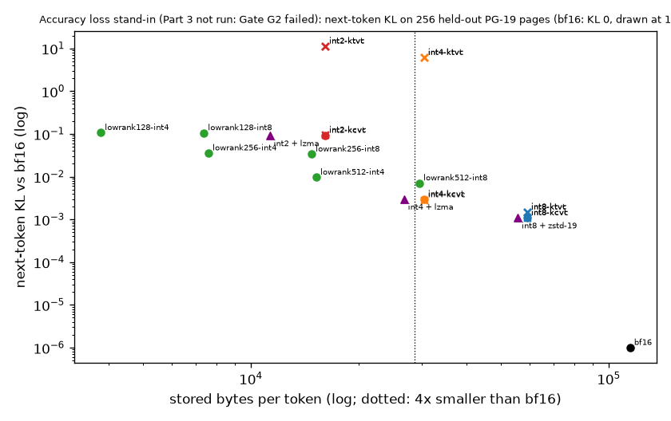

# A7 — Pillar 3, the store: compaction (E7)

Dates: 2026-11-25 to 2026-11-27. Machine: local workstation (RTX 3090, 24 GB). Reader: Qwen3-1.7B, bf16.

KV mode keeps every page's key/value cache. In bf16 that is 114,688 bytes per token, 28 GiB for a 256K-token document:
more than the card holds beside the model (A6, section 7). A7 measures how far the store can be compacted
(specification, section 4.6), and with which codecs:

- **Uniform quantization** to 8, 4 or 2 bits, with keys and values grouped per channel or per token. KIVI's layout is
  keys per channel, values per token.
- **Low rank:** a PCA basis per layer, keeping r of the 1,024 dimensions, with quantized coefficients.
- **Lossless coders** (zstd, LZ4, LZMA, DEFLATE, PPMd) on raw bf16 bytes and on the quantized codes.
- **Text:** keep only the token ids and recompute the cache when the page is needed.

Hypothesis H4: a codec gives at least 4× reduction at no more than 1 point of accuracy loss; lossless coders alone on raw
bf16 KV were expected below 1.15×.

Every number below is read from a file under `results/`:

| File | What it holds |
|---|---|
| `results/E7_codecs/pages.json`, `basis.json` | the PG-19 page lists and the fitted low-rank bases (explained variance; the basis file itself, 118 MB, is in the git-ignored cache, identified by its SHA-256) |
| `results/E7_codecs/part1.jsonl` | Part 1: 20 codecs on 256 held-out pages (5,120 rows) |
| `results/E7_codecs/timing.jsonl` | encode and decode times per page, on an otherwise idle GPU (640 rows) |
| `results/E7_codecs/part2.jsonl` | Part 2: lossless coders (112 rows) |
| `results/E7_codecs/part4.jsonl` | Part 4: a 256K document's store, expansion latency, VRAM |
| `results/E7_codecs/coder_choice.json`, `lowrank_choice.json` | the two choices made by rules fixed before the runs |
| `results/A7_codecs/summary.json`, `tables.md`, `figures/pareto.png` | every table and figure here, by `scripts/a7_summary.py` |

**Code commits.** Part 1 and timing `2522827`, Part 2 `4f26a19`, Part 4 `ab1881b`. The codec code is the same in all
three: the commits between them change only the run script's choice of coders and the timing stage. No row failed.
Decisions: D-049 (codecs, pages, measures) and D-050 (Part 3).

## 1. Outcome

- **Part 3 (task accuracy per codec) was not run, because Gate G2 failed in A6.** As the prompt says, Part 1's fidelity
  measures stand in for accuracy loss: next-token KL and top-1 agreement against the bf16 cache. **H4's "at most 1 point"
  therefore cannot be tested here.** What follows answers H4 on fidelity only.
- **The best 4× option is int4 (KIVI) plus any fast lossless coder.**
  - int4 alone is 3.76× smaller. Its float16 scales cost 0.25 bit per element, which keeps it just under 4×.
  - Its fidelity is the best of any codec at or near 4×: next-token KL 0.0030, the same top-1 token 97.4% of the time.
  - A lossless coder on its payload takes it to 4.24–4.29× (zstd-3: 4.26×) and changes nothing decoded.
  - Past 4×, low-rank 512 + int4 gives 7.5× at KL 0.0097 (top-1 95.5%). int2 gives 7.1× at KL 0.092 (top-1 86%).
- **Keys must be quantized per channel.**
  - Per-token keys destroy the model: int4 gives KL 6.1 and top-1 13%; int2 gives KL 11.4.
  - For values, per token and per channel are nearly equivalent.
- **Lossless coders alone on raw bf16 KV beat the expected 1.15×.**
  - zstd-3 1.28×, LZMA 1.39×; LZ4 adds nothing (1.01×).
  - Splitting the bf16 bytes into two byte planes first raises this to 1.17–1.49× (zstd-19: 1.49×).
  - This is still far from the 4× that quantization gives, and slow: zstd-19 compresses at 2 MB/s.
- **Part 4, a 256K document (7.45 GiB with int4):**
  - The int4, int2 and low-rank stores fit on the 24 GiB card beside the model and a 32K window. bf16 (28 GiB) and int8
    (14.4 GiB) do not.
  - Decompressing a full budget of 28,672 tokens takes 1.1 s with int4, against 5.4 s to recompute it from text.
- **Default codec:** int4 (KIVI) in `configs/pcm_kv.yaml`. Text mode stays PCM's default mode (A6, Gate G2).

## 2. Setup (D-049)

- **Pages and prefix:** pages of 1,024 tokens from PG-19 books, each encoded after a 43-token shared prefix P, exactly as
  KV mode encodes pages.
- **Calibration:** 64 windows from 36 validation books (65,536 tokens), used to fit the low-rank bases.
- **Held-out pages:** 256 windows, each a page plus the next 256 tokens of the book, from 83 test books. The two sets of
  books are disjoint. No benchmark document or question was used to fit anything.
- **Low rank:** keys are stored after RoPE, so each key is first rotated back to position 0. One basis then serves every
  position.
- **Explained variance** (mean over layers, worst layer in brackets):

  | | r = 128 | r = 256 | r = 512 |
  |---|---|---|---|
  | keys | 0.901 [0.786] | 0.956 [0.886] | 0.990 [0.966] |
  | values | 0.707 [0.526] | 0.844 [0.701] | 0.951 [0.886] |

  Keys are far more compressible than values.
- **Size accounting:** sizes count everything stored, codes and the quantization parameters (float16 minimum and step per
  group of 128 values). Bases are counted once per store.

## 3. Part 1: storage and fidelity (256 held-out pages)

**What the columns are:**
- **KL and top-1:** for each page, the next 256 tokens of the book were fed after P + the decoded page. The table gives
  the KL from the bf16 distributions and the share of positions with the same top token (mean, 95% CI over pages).
- **Relative error:** ‖decoded − bf16‖ / ‖bf16‖ over all layers.
- **Encode and decode times:** per 1,024-token page, median over 32 pages of 5 repeats each, on an idle GPU.

| codec | bytes/token | ratio | encode ms | decode ms | rel. error K | rel. error V | next-token KL | top-1 agreement |
|---|---|---|---|---|---|---|---|---|
| bf16 | 114,688 | 1.00 | 0.4 | 0.3 | 0 | 0 | 0 | 1.000 |
| int8 (KIVI: kcvt) | 59,136 | 1.94 | 32.9 | 14.2 | 0.0018 | 0.0065 | 0.00110 [0.00108, 0.00111] | 0.984 [0.983, 0.985] |
| int8 kcvc | 59,136 | 1.94 | 33.4 | 18.6 | 0.0018 | 0.0066 | 0.00109 [0.00107, 0.00111] | 0.985 |
| int8 ktvc / ktvt | 59,136 | 1.94 | 32.5–32.9 | 9.9–14.3 | 0.0140 | 0.0065–0.0066 | 0.00147–0.00150 | 0.981–0.982 |
| **int4 (KIVI: kcvt)** | 30,464 | 3.76 | 33.2 | 14.6 | 0.0322 | 0.1061 | **0.00300** [0.00288, 0.00314] | **0.974** [0.973, 0.976] |
| int4 kcvc | 30,464 | 3.76 | 33.7 | 18.9 | 0.0322 | 0.1096 | 0.00286 [0.00275, 0.00297] | 0.974 |
| int4 ktvc / ktvt (keys per token) | 30,464 | 3.76 | 33.0–33.2 | 10.3–14.6 | 0.2383 | 0.106–0.110 | 6.14–6.15 | 0.128 |
| lowrank512-int8 | 29,568 | 3.88 | 78.0 | 59.2 | 0.0308 | 0.2052 | 0.00709 [0.00679, 0.00741] | 0.961 |
| int2 (KIVI: kcvt) | 16,128 | 7.11 | 33.7 | 14.8 | 0.1629 | 0.5326 | 0.0919 [0.0884, 0.0954] | 0.862 |
| int2 kcvc | 16,128 | 7.11 | 34.0 | 19.1 | 0.1629 | 0.5516 | 0.0951 | 0.858 |
| int2 ktvc / ktvt | 16,128 | 7.11 | 33.2–33.6 | 10.5–14.8 | 1.2374 | 0.53–0.55 | 11.31–11.39 | 0.04 |
| **lowrank512-int4** | 15,232 | 7.53 | 77.6 | 60.8 | 0.0429 | 0.2313 | **0.00967** [0.00927, 0.01010] | 0.955 |
| lowrank256-int8 | 14,784 | 7.76 | 78.6 | 59.7 | 0.0644 | 0.3625 | 0.0337 | 0.920 |
| lowrank256-int4 | 7,616 | 15.06 | 78.1 | 60.4 | 0.0708 | 0.3765 | 0.0358 | 0.917 |
| lowrank128-int8 | 7,392 | 15.52 | 78.2 | 59.7 | 0.0963 | 0.5084 | 0.1061 | 0.867 |
| lowrank128-int4 | 3,808 | 30.12 | 77.7 | 60.3 | 0.1004 | 0.5170 | 0.1072 | 0.866 |
| text (token ids) | 4 | 28,672 | 0.1 | 87.5 (re-encode) | 0 | 0 | 0 | 1.000 |

**Shared bases** (stored once per store): 58.8 MB at r = 512, 29.5 MB at r = 256, 14.8 MB at r = 128. All granularities
and CIs are in `tables.md`.

**Granularity.**
- **Keys:** the key vectors carry a few channels of very large magnitude (A1: values up to 480). Per-token quantization
  stretches every token's range over those channels and wipes out the rest, so key error jumps 7–8× and the model breaks.
- **Values** have no such channels; per token and per channel differ by 1–4% in error.
- KIVI's pairing (keys per channel, values per token) is the right one; keys and values both per channel is equivalent
  within noise.

**Low rank against quantization at the same size.**
- lowrank512-int8 (3.88×) is worse than int4 (3.76×): KL 0.0071 against 0.0030. Its value error is twice int4's,
  because values need more than 512 of 1,024 dimensions.
- At about 7.5×, low rank wins clearly: lowrank512-int4 has KL 0.0097, against int2's 0.092.

**The "best low-rank setting" (rule fixed before Part 1):** the smallest low-rank codec whose KL is at most int4's.
- No low-rank codec qualified, so the rule fell back to the lowest KL: **lowrank512-int8**.
- Part 4 uses this setting. Part 3, which would also have used it, was not run.

## 4. Part 2: lossless coders

Ratio, with compress / decompress MB/s in brackets. KV data come from 4 held-out pages. Each page is 117 MB of raw bf16,
or the stored payload of KIVI int8/int4/int2 (packed codes and float16 parameters). Ids and text come from the 262K-token
Part 4 document. All coders run single-threaded.

| data | MB | zstd-3 | zstd-19 | LZ4 | LZMA | DEFLATE | PPMd |
|---|---|---|---|---|---|---|---|
| bf16, raw | 469.8 | 1.277 (420 / 611) | 1.291 (3 / 288) | 1.008 (1,209 / 1,941) | 1.395 (2 / 29) | 1.254 (12 / 205) | not usable |
| bf16, byte planes | 469.8 | 1.402 (140 / 530) | **1.487** (2 / 1,049) | 1.174 (502 / 1,589) | 1.473 (2 / 97) | 1.419 (8 / 375) | not usable |
| int8 payload | 242.2 | 1.061 (282 / 804) | 1.063 (4 / 739) | 1.009 | 1.061 (3 / 22) | 1.059 | not usable |
| int4 payload | 124.8 | 1.132 (385 / 683) | 1.132 (4 / 625) | 1.010 | 1.138 (3 / 23) | 1.127 (21 / 211) | not usable |
| int2 payload | 66.1 | 1.376 (144 / 745) | 1.385 (3 / 593) | 1.014 | 1.430 (2 / 27) | 1.342 (15 / 188) | not usable |
| token ids (uint32) | 1.0 | 2.558 | 2.955 | 1.688 | 3.322 | 2.460 | 3.612 (5 / 8) |
| text (UTF-8) | 1.1 | 2.715 | 3.170 | 1.599 | 3.221 | 2.627 | 3.949 (5 / 9) |

What each stage becomes, in bytes per token and ratio against bf16:

| stage | alone | + zstd-3 | + best coder |
|---|---|---|---|
| bf16 | 114,688 (1.00×) | 89,825 (1.28×) | 77,149 (1.49×, byte planes + zstd-19) |
| int8 | 59,136 (1.94×) | 55,755 (2.06×) | 55,621 (2.06×, zstd-19) |
| int4 | 30,464 (3.76×) | 26,913 (**4.26×**) | 26,758 (4.29×, LZMA) |
| int2 | 16,128 (7.11×) | 11,725 (9.78×) | 11,281 (10.17×, LZMA) |
| text (token ids) | 4 | 1.56 | 1.11 (PPMd) |

**Why raw bf16 compresses better than expected.** Each bf16 number has a high byte (sign and 7 exponent bits) and a low
byte (1 exponent bit, 7 mantissa bits). KV values sit in a narrow range of exponents, so the high bytes repeat and the
low bytes look random. Splitting the bytes into planes lets the coder see the repetitive half on its own, hence
1.4–1.49×. Every round trip was verified byte for byte, so this is not a measurement slip. Quantization removes exactly
that redundancy:
- int8 codes compress by only 6%, int4 by 13%.
- int2 compresses by 34–43%, because 2-bit codes take few distinct values per byte.

**Coder for "int4 + lossless" (rule fixed before Part 2):** the highest ratio among coders that decompress at ≥ 200 MB/s.
It picked zstd-19 over zstd-3 by 1.1321 to 1.1320, with 100× slower compression (4 against 385 MB/s). In practice zstd-3
gives the same store.

**PPMd** (`pyppmd` 1.3.1) is not usable on KV data on this machine (D-049).
- Its PPMd8 path rejects its own output above 64 KiB.
- Its PPMd7 path crashed the interpreter on a 30 MB stream, decoded one of eight 4 MiB blocks short and wrong, and raised
  errors on 1 MiB blocks.
- It is reported only for token ids and text, where every round trip was verified; there it compresses best (3.6× and
  3.9×) but runs at 5–9 MB/s.

## 5. Part 3: task accuracy

Not run. **Gate G2 failed** (A6: KV mode 18–20 points below text mode with the best training-free fix), and the prompt
says to give Part 1's fidelity measures instead (D-050 (6)). The next-token KL and top-1 agreement above are that
substitute, and the Pareto plot (section 7) uses KL in place of accuracy loss. A KL of 0.003 (int4) is small against the
KL of 1.7–1.8 nats between stitched and sequential caches measured in A6. So in KV mode, compaction is not where the
accuracy goes; stitching is.

## 6. Part 4: the ceiling, a 256K-token document

**Document:** S2 multi-key 256K test example 0, 261,618 tokens, 511 pages of 512 tokens (as `configs/pcm_text.yaml`
cuts it). Store size per codec, and whether the whole store fits on the card beside the model and an active window:
- **Weights:** 3.20 GiB.
- **32K window:** 3.50 GiB in bf16.
- **Card:** 24.0 GiB.
- **What was measured:** every page held on the GPU, a full budget of pages decoded and stitched, the question prefilled
  and 8 tokens generated.

| codec | store GiB | bytes/token | store + weights + window, arithmetic | measured on the card (peak allocated / reserved GiB) |
|---|---|---|---|---|
| bf16 | 27.94 | 114,688 | 34.6 GiB | does not fit (not attempted) |
| int8 | 14.44 | 59,248 | 21.1 GiB | **does not fit** (25.0 / 28.1) |
| int4 | 7.45 | 30,576 | 14.2 GiB | **fits** (17.7 / 21.9) |
| lowrank512-int8 | 7.23 (+58.8 MB bases) | 29,905 | 14.0 GiB | fits (17.4 / 20.5) |
| int4 + zstd-19 | 6.60 | 27,080 | – | (CPU store; not placed on the GPU) |
| int2 | 3.96 | 16,240 | 10.7 GiB | fits (14.1 / 17.3) |
| text (token ids) | 0.001 | 4 | – | – |

Bytes per token are slightly above Part 1's because pages here are about 512 tokens, cut at sentence ends, so their last
group of 128 tokens is often partial.

**The int8 fit criterion was set after seeing the run.**
- By arithmetic int8 fits (21.1 GiB), and the test completed without an out-of-memory error.
- But its peak was 25.0 GiB allocated and 28.1 GiB reserved, more than the card has. On Windows the driver spills the
  excess into system memory, as in A4, so it ran without fitting.
- The criterion: a store fits only if peak reserved memory stays within the card's 24 GiB.

**Expansion of a full budget:** 56 pages, 28,672 tokens, spread over the document so every boundary has a gap marker;
median of 3 runs. Decoding and stitching:

| store | ms |
|---|---|
| bf16 (already on the GPU; the store itself does not fit) | 152 |
| int2 | 1,081 |
| int4 | 1,127 |
| int8 | 1,170 |
| lowrank512-int8 | 3,288 |
| int4 + zstd-19 (decompressed on the CPU) | 3,293 |
| text, each page re-encoded after P | 4,929 |
| text mode, the same 28,672 tokens prefilled as one prompt | 5,430 |

Decompressing int4 is about 5× faster than recomputing from text. The lossless coder triples int4's expansion time for an
11% smaller store. Building the whole store with every codec took 2,045 s; most of it is zstd-19 at 4 MB/s.

## 7. Pareto plot and the answer to H4

The x-axis is stored bytes per token; the y-axis is next-token KL, standing in for accuracy loss (Part 3 not run).
- **Circles:** KIVI-granularity quantization and low rank.
- **Crosses:** per-token keys.
- **Triangles:** KIVI codes + the best lossless coder. Their KL equals the codes' own, since the coder is lossless.
- **Dotted line:** 4× smaller than bf16.

**H4: which codec gives at least 4× at no more than 1 point?**
- On accuracy: not testable, because Part 3 was not run.
- On fidelity:
  - **int4 (KIVI) + a lossless coder** (4.24–4.29×; zstd-3 4.26×) is the 4× codec with the smallest loss measured:
    KL 0.0030, top-1 agreement 97.4%.
  - Beyond that, **lowrank512-int4** (7.5×, KL 0.0097, top-1 95.5%) dominates int2 (7.1×, KL 0.092).
  - Whether either costs at most 1 point of task accuracy is open until KV mode itself works (R2, Phase B).
- int4 alone, at 3.76×, misses 4× only because of its quantization parameters.

**What lossless coders add at each stage:**
- **raw bf16:** 1.25–1.40×, or 1.17–1.49× with byte planes. This is above the expected 1.15× but nowhere near 4×.
- **int8:** +6%.
- **int4:** +13%, which is what carries it over 4×.
- **int2:** +34–43%.
- **text:** 2.5–3.9×. Text never needed compressing: 4 bytes per token, about 1 MiB per 256K document.

**Default codec.** `configs/pcm_kv.yaml` sets **int4 (KIVI)**, chosen from these results:
- the smallest loss of any codec whose 256K store fits on the card;
- 1.1 s expansion.

A lossless coder is left off, because it adds 11% compression at three times the expansion time. KV mode itself is not
the default (A6).

## 8. What is uncertain

- **No task accuracy per codec** (G2). KL on PG-19 continuations is a proxy. It ranks codecs, but cannot say how many
  points a KL of 0.003 or 0.01 costs on the benchmarks.
- **Small samples:**
  - Part 2's KV ratios come from 4 pages (470 MB). Their spread across the 4 pages is small (zstd-3 on raw bf16: 1.276–1.278; zstd-19 on byte planes: 1.485–1.488), but these are 4 pages from 4 books.
  - The low-rank bases come from 65,536 tokens of 36 books. A larger calibration set might lift the low-rank codecs.
- **Timings** are for this GPU and CPU. The CPU coders are single-threaded.
- **Two choices made after the data are stated as such:** the on-card fit criterion (section 6) and the default codec
  (section 7). The rules for the best coder and the best low-rank setting were fixed before their parts ran.

## 9. What was built in A7

| file | what |
|---|---|
| `pcm/store/codecs.py` | one interface for every codec (encode, decode, stored bytes, shared bytes): bf16, uniform int8/int4/int2 at four granularities with bit packing, low rank with keys rotated to position 0 and a fitted basis, lossless coders (zstd, LZ4, LZMA, DEFLATE, PPMd) with byte planes, text |
| `pcm/eval/runner.py` | KV mode takes a store codec (`kv.codec`); with none, bf16 as before |
| `configs/a7_codecs.yaml`, `scripts/run_a7.py` | page lists, basis fit, Parts 1–4 and the timing pass, resumable |
| `scripts/a7_summary.py` | every number, table and figure of this report |
| `tests/test_codecs.py` | 24 tests: packing, error bounds, sizes, rotation, low rank, lossless round trips, text |
| `configs/pcm_kv.yaml` | P-KV: pages of `pcm_text.yaml`, the tuned fix, the default codec |
