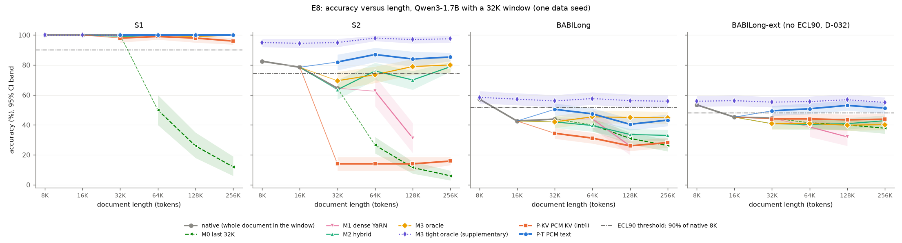

# A8 — Integrated local result (E8), Gate G3

Dates: 2026-11-27. Machine: local workstation (RTX 3090, 24 GB, 16 GB RAM, Windows 10).
Reader: Qwen3-1.7B (R0, zero-shot), greedy decoding, thinking off. One data seed (seed 0).

E8 puts every method of the project side by side on the same examples, at 32K, 64K, 128K and 256K tokens, on every task
family retained at Gate G0 (S1, S2, BABILong qa1–qa5, BABILong-ext qa6–qa10) and on InfiniteBench:

| ID | Method | Configuration |
|---|---|---|
| M0 | truncation: the last 32K tokens | `configs/a3_floor.yaml`, `m0-tail-1.7B` |
| M1 | dense attention, training-free YaRN (factor from the measured length); up to 128K, the longest that fits the card | `configs/a4_baselines.yaml`, `m1-yarn-1.7B` |
| M2 | plain retrieval: 128-token units, hybrid BM25 + embeddings, 28,672-token budget, text expansion | `m2-hybrid-1.7B` |
| M3 | oracle: the gold evidence units padded with their neighbours to 28,672 tokens (the tight oracle, one neighbour each side, beside it as a ceiling) | `m3-oracle-1.7B`, `m3-oracle-tight-1.7B` |
| P-T | PCM, text mode: 512-token pages, 8,192-token budget, hybrid ranking, no graph, document order | `configs/pcm_text.yaml` |
| P-KV | PCM, KV mode: the same pages from an int4 store (keys per channel, values per token), re-based and stitched, with the tuned fix (T 1.0, S 0.9) | `configs/pcm_kv.yaml` |

PCM's default mode is text mode, since Gate G2 failed in A6; Gate G3 is read on P-T, with P-KV beside it (D-053).

Every number below is read from a file under `results/`:

| File | What it holds |
|---|---|
| `results/E8_local/runs.jsonl` | E8's new rows: 8,000 (P-KV everywhere; P-T and M2 at 256K on examples 0–299 of the synthetic tasks) |
| `results/E8_local/store_256k.jsonl` | the whole system at 256K on one card, 3 documents |
| `results/E0_floor`, `E0_a4budget`, `E1_truncation`, `E2_dense`, `E3_retrieval`, `E3o_oracle`, `E6_kv` | the earlier rows E8 uses unchanged (D-052) |
| `results/A8_local/summary.json`, `tables.md`, `figures/` | every table and figure here, by `scripts/a8_summary.py` |

**What is new and what is reused (D-052).** Where a method's configuration and examples are the same as in an earlier step,
its rows are used as they are: M0 (E1, with the native run at 32K), M1 (E2: 40 examples per task on S1, S2 and BABILong,
30 on BABILong-ext and InfiniteBench), M2 (E3), M3 (E3o), P-T (E6's text-mode rows, which reuse A5's answers). E8 adds:

- P-KV with the int4 store on the 13 retained tasks at four lengths, and on InfiniteBench: 5,600 rows, N = 100;
- N = 300 at 256K on S1, S2 multi-key and S2 multi-value for P-T, P-KV and M2. Examples 100–299 were generated with the
  same generator (`make_data.py --n 300`, decile = index mod 10). For P-T and M2, examples 0–99 at 256K were run again
  with the stored answers reused for identical prompts: **600 of 600 prompts matched the earlier ones**, so the
  current code builds exactly the prompts A4 and A5 measured.

M0 and M3 stay at N = 100 at 256K. Paired comparisons use the examples both series share.

**Commits.** E8 rows: all 8,000 on clean commit `2fbab6d`, status ok, none failed or skipped (pilot included). Earlier rows,
one commit per series: M1, M2 (0–99), M3 on `ff31198`; P-T (E6) on `40712b2`; M0 on the A3 commits `207e80e`,
`6db01c5`, `db85c90`. **Re-basing check (A1):** the literal T2 test still fails its absolute threshold (D-009); the
relative criterion of D-017 passes and is what KV mode rests on.

## 1. Outcome

- **Gate G3 FAILS** on its first condition. H1 at 128K needs PCM's ECL90 ≥ 128K on S1, S2 and BABILong (D-053). P-T
  reaches **256K on S1 and S2** but only **8K on BABILong**: the reader itself falls from 57.2% at 8K to 42.6% at 16K, and
  P-T stays at 40.4–50.4% from 32K to 256K, all below the 51.5% the ratio needs.
- **The second condition passes.** PCM runs at 256K inside 24 GB: 1,900 P-T rows at 256K, none failed, peak 7.5 GiB
  allocated and 12.8 GiB reserved. The whole system, with a 7.4 GiB int4 KV store of the full document on the card,
  peaks at 14.5 GiB allocated and 17.3 GiB reserved.
- **H1 fails** (it needs 256K on all three families).
- **Against dense YaRN at 128K**, P-T is +55.0 points on S2, +19.0 on BABILong and +24.0 on BABILong-ext (paired, n = 40
  or 30 per task, every interval excludes 0); on S1 both are at 100%.
- **Against plain retrieval**, P-T gains at every length on S2, BABILong and BABILong-ext (+6.5 to +18.5 points; all 12
  intervals exclude 0).
- **P-KV stays 18.8–20.2 points below P-T** (13 tasks, the same 100 examples per task as A6), as A6 found with the
  bf16 store. The int4 store costs 0.2–1.6 points against bf16 in KV mode.
- **H5 is untested locally**: the reader fails the aggregation tasks at 8K (S4 count 5%), so they were never retained.

## 2. Accuracy versus length

Below a method's first own length the curve is the native run (the whole document fits the window). Cells are % with
95% intervals; N = 100 per task unless marked (M1: 40 or 30; P-T, P-KV and M2 at 256K on S1 and S2: 300).

**S1** (native 8K: 100.0; threshold 90.0)

| method | 32K | 64K | 128K | 256K |
|---|---|---|---|---|
| M0 last 32K | 100.0 (native) | 50.0 [40.0, 60.0] | 26.0 [18.0, 35.0] | 12.0 [6.0, 19.0] |
| M1 dense YaRN | 100.0 (native) | 100.0 (n 40) | 100.0 (n 40) | does not fit |
| M2 hybrid | 99.0 [97.0, 100.0] | 100.0 | 100.0 | 100.0 (n 300) |
| M3 oracle | 100.0 | 100.0 | 99.0 [97.0, 100.0] | 100.0 |
| P-T | 100.0 | 100.0 | 100.0 | 100.0 (n 300) |
| P-KV | 98.0 [95.0, 100.0] | 99.0 [97.0, 100.0] | 98.0 [95.0, 100.0] | 96.0 [93.7, 98.0] (n 300) |

**S2** (multi-key and multi-value; native 8K: 82.5 [77.0, 87.5]; threshold 74.25; native 78.5 at 16K, 64.5 at 32K)

| method | 32K | 64K | 128K | 256K |
|---|---|---|---|---|
| M0 last 32K | 64.5 (native) | 26.5 [21.0, 32.0] | 11.5 [7.5, 15.5] | 6.0 [3.0, 9.5] |
| M1 dense YaRN | 64.5 (native) | 62.5 [52.5, 72.5] (n 40) | 31.2 [21.2, 41.2] (n 40) | does not fit |
| M2 hybrid | 63.5 [57.0, 70.0] | 76.0 [70.0, 81.5] | 70.0 [63.5, 76.0] | 78.8 [75.5, 82.0] (n 300) |
| M3 oracle | 69.5 [63.5, 75.5] | 73.5 [68.0, 79.0] | 79.0 [73.5, 84.0] | 80.0 [75.0, 85.0] |
| tight oracle | 95.0 [92.0, 97.5] | 98.0 [96.0, 99.5] | 97.0 [94.5, 99.0] | 97.5 [95.0, 99.5] |
| **P-T** | **82.0** [76.5, 87.0] | **87.0** [82.0, 91.5] | **84.0** [79.0, 89.0] | **85.3** [82.5, 88.2] (n 300) |
| P-KV | 14.0 [9.5, 18.5] | 14.0 [9.5, 18.5] | 14.0 [9.5, 18.5] | 15.8 [13.2, 18.5] (n 300) |

(P-KV's equal S2 cells are 28/100 on multi-key and 0/100 on multi-value at each of the three lengths.)

**BABILong** qa1–qa5 (native 8K: 57.2 [53.2, 61.2]; threshold 51.48; native 42.6 at 16K, 43.9 at 32K)

| method | 32K | 64K | 128K | 256K |
|---|---|---|---|---|
| M0 last 32K | 43.9 (native) | 40.0 [35.8, 44.2] | 31.0 [27.0, 35.0] | 26.2 [22.4, 30.0] |
| M1 dense YaRN | 43.9 (native) | 44.0 [37.5, 50.5] (n 40) | 26.0 [20.0, 32.0] (n 40) | does not fit |
| M2 hybrid | 42.0 [38.0, 46.0] | 39.6 [35.6, 43.6] | 33.6 [30.0, 37.4] | 33.0 [29.2, 36.8] |
| M3 oracle | 42.0 [38.0, 46.0] | 45.4 [41.2, 49.6] | 45.0 [40.8, 49.2] | 44.8 [40.6, 48.8] |
| tight oracle | 56.0 [52.0, 60.0] | 57.6 [53.4, 61.8] | 56.2 [52.0, 60.4] | 55.8 [51.6, 60.0] |
| **P-T** | **50.4** [46.4, 54.4] | **47.4** [43.6, 51.2] | **40.4** [36.4, 44.2] | **43.2** [39.2, 47.0] |
| P-KV | 34.4 [30.8, 38.0] | 31.2 [27.6, 34.8] | 26.0 [22.6, 29.4] | 28.2 [24.8, 31.6] |

**BABILong-ext** qa6–qa10 (native 8K: 53.4 [50.0, 56.8]; no ECL90: its floor is out of reach, D-032)

| method | 32K | 64K | 128K | 256K |
|---|---|---|---|---|
| M0 last 32K | 44.6 (native) | 41.4 [37.6, 45.0] | 40.0 [36.4, 43.8] | 37.8 [34.2, 41.6] |
| M1 dense YaRN | 44.6 (native) | 38.7 [32.0, 45.3] (n 30) | 32.0 [26.0, 38.7] (n 30) | does not fit |
| M2 hybrid | 40.8 [37.2, 44.4] | 40.4 [36.8, 44.0] | 40.8 [37.0, 44.6] | 42.8 [39.2, 46.4] |
| M3 oracle | 40.8 [37.0, 44.4] | 41.0 [37.2, 44.8] | 39.8 [36.2, 43.4] | 40.2 [36.6, 43.8] |
| **P-T** | **49.4** [46.0, 52.8] | **50.8** [47.2, 54.4] | **53.0** [49.6, 56.4] | **51.2** [47.6, 54.8] |
| P-KV | 44.0 [40.4, 47.6] | 44.0 [40.2, 47.6] | 43.4 [39.8, 47.0] | 43.8 [40.2, 47.4] |

**InfiniteBench** (each document at its own length, about 90K–190K tokens; 100 examples; M1 30, two tasks only)

| method | passkey | number_string | kv_retrieval | longbook_choice_eng |
|---|---|---|---|---|
| M0 last 32K | 27.0 [19.0, 36.0] | 27.0 [19.0, 36.0] | 6.0 [2.0, 11.0] | – |
| M1 dense YaRN | 13.3 [3.3, 26.7] | 40.0 [23.3, 56.7] | does not fit | – |
| M2 hybrid | 100.0 | 100.0 | 18.0 [11.0, 26.0] | 51.0 [41.0, 61.0] |
| M3 oracle | 100.0 | 100.0 | 21.0 [13.0, 29.0] | no evidence spans |
| P-T | 100.0 | 100.0 | 27.0 [19.0, 36.0] | 50.0 [40.0, 60.0] |
| P-KV | 100.0 | 100.0 | 3.0 [0.0, 7.0] | 45.0 [35.0, 55.0] |

**Paired differences for P-T** (points, 95% CI; same examples):

| pair | family | 32K | 64K | 128K | 256K |
|---|---|---|---|---|---|
| P-T − M1 | S2 | +17.5 [+9.5, +25.5] | +23.8 [+11.2, +36.2] | **+55.0** [+42.5, +67.5] | – |
| | BABILong | +6.6 [+1.8, +11.3] | +10.0 [+2.0, +18.0] | **+19.0** [+11.5, +26.5] | – |
| | BABILong-ext | +4.6 [+0.6, +8.7] | +10.0 [+2.7, +17.3] | **+24.0** [+16.0, +32.0] | – |
| P-T − M2 | S2 | +18.5 [+11.0, +26.0] | +11.0 [+4.0, +18.0] | +14.0 [+6.0, +22.0] | +6.5 [+2.5, +10.3] |
| | BABILong | +8.4 [+3.8, +13.0] | +7.8 [+2.8, +12.8] | +6.8 [+2.2, +11.4] | +10.2 [+5.6, +14.8] |
| | BABILong-ext | +8.6 [+4.2, +13.0] | +10.4 [+6.2, +14.8] | +12.2 [+7.4, +17.0] | +8.4 [+3.8, +13.0] |
| P-T − M3 | S2 | +12.5 [+5.0, +20.0] | +13.5 [+5.5, +21.5] | +5.0 [−2.0, +12.0] | +7.0 [+0.0, +14.0] |
| | BABILong | +8.4 [+3.8, +13.0] | +2.0 [−3.0, +7.2] | −4.6 [−9.4, +0.2] | −1.6 [−6.6, +3.2] |
| P-T − tight oracle | S2 | −13.0 [−18.5, −7.5] | −11.0 [−16.0, −6.0] | −13.0 [−18.5, −7.5] | −10.5 [−16.0, −5.5] |
| | BABILong | −5.6 [−10.0, −1.2] | −10.2 [−14.8, −5.6] | −15.8 [−20.6, −11.0] | −12.6 [−17.2, −8.0] |
| P-T − M0 | S2 | +17.5 [+9.5, +25.5] | +60.5 [+52.0, +68.5] | +72.5 [+65.0, +79.0] | +81.0 [+75.0, +86.5] |
| | BABILong | +6.6 [+1.8, +11.3] | +7.4 [+2.4, +12.2] | +9.4 [+4.4, +14.2] | +17.0 [+11.8, +22.4] |

All families and pairs are in `tables.md`. P-T above the plain oracle on S2 is the effect A4 and A5 explained: the
oracle pads the evidence to 28,672 tokens, P-T's prompt is 8,400 tokens; P-T is below the tight oracle everywhere.

## 3. ECL90, and H1 at 128K against dense YaRN

ECL90 (section 5.4): the largest length up to which accuracy stays ≥ 90% of the native 8K accuracy at every length and
above the floor. Reading of D-053: at 8K and 16K every method is the native run; from 32K, the method's own rows.

| method | S1 | S2 | BABILong | BABILong-ext |
|---|---|---|---|---|
| M0 last 32K | 32K | 16K | 8K | none (D-032) |
| M1 dense YaRN | 128K (256K not run) | 16K | 8K | none |
| M2 hybrid | 256K | 16K | 8K | none |
| M3 oracle | 256K | 16K | 8K | none |
| tight oracle (supplementary) | 256K | 256K | 256K | none |
| **P-T** | **256K** | **256K** | **8K** | none |
| P-KV | 256K | 16K | 8K | none |

Readings beside it, which do not decide (D-053 (4)):

- If PCM is the native run at 32K too (the synthetic documents fit the window there, within 160 tokens), P-T's S2 ECL90
  is 16K (native 64.5% at 32K) and its BABILong ECL90 stays 8K.
- On PCM's own curve from 32K alone, S1 and S2 hold to 256K, and BABILong fails at the first length (50.4% < 51.48).

**H1 at 128K (Gate G3, first condition): FAIL.** P-T holds S1 and S2 to 256K, where dense YaRN holds S1 to 128K and S2 only
to 16K. On BABILong no method holds past 8K, because the native reader is already at 42.6% at 16K, and P-T itself stays
below the threshold at every length (40.4–50.4%). Two of the three families pass; H1 needs all three.

**H1 at 256K: FAIL**, for the same reason.

On S2, the one family where the two methods part, P-T's claim against dense YaRN is clear: 84.0% against 31.2% at 128K,
+55.0 [+42.5, +67.5] points on the same 40 examples per task, with 8,400 prompt tokens against 125,900.

## 4. The table at 256K

| | M0 last 32K | M2 hybrid | M3 oracle | **P-T** | P-KV (int4) |
|---|---|---|---|---|---|
| S1 accuracy (n) | 12.0 (100) | 100.0 (300) | 100.0 (100) | **100.0** (300) | 96.0 (300) |
| S2 accuracy (n) | 6.0 (200) | 78.8 [75.5, 82.0] (600) | 80.0 [75.0, 85.0] (200) | **85.3** [82.5, 88.2] (600) | 15.8 [13.2, 18.5] (600) |
| BABILong accuracy (n 500) | 26.2 [22.4, 30.0] | 33.0 [29.2, 36.8] | 44.8 [40.6, 48.8] | **43.2** [39.2, 47.0] | 28.2 [24.8, 31.6] |
| BABILong-ext accuracy (n 500) | 37.8 [34.2, 41.6] | 42.8 [39.2, 46.4] | 40.2 [36.6, 43.8] | **51.2** [47.6, 54.8] | 43.8 [40.2, 47.4] |
| evidence recall, S1 / S2 | 0.12 / 0.13 | 1.00 / 1.00 | 1.00 / 1.00 | 1.00 / 1.00 | 1.00 / 1.00 |
| evidence recall, BABILong / -ext | 0.12 / 0.13 | 0.55 / 0.61 | 1.00 / 1.00 | 0.40 / 0.44 | 0.40 / 0.44 |
| prompt tokens (mean) | 32,747 | 29,456 | 28,824 | 8,398 | 8,398 (25 prefilled at query time) |
| peak VRAM per question, allocated / reserved (GiB) | 7.3 / 7.7 | 9.0 / 13.0 | 6.8 / 7.8 | 7.5 / 12.8 | 7.5 / 13.4 |
| store | – | token ids 1.0 MiB + index 4.0 MiB | – | token ids 1.0 MiB + index 4.0 MiB | int4 KV 7.39 GiB + token ids + index |
| ingest per document | – | 7.6 s (index) | – | 7.6 s (index) | 7.6 s (index) + 88.7 s (every page into the int4 store) |
| seconds per question | 6.8 | 6.6 | 5.7 | **1.9** | 3.4 (pages encoded per question); 1.8 from a full store |

Notes:

- **Ingest** of the index: mean over the 2,220 documents above 200K tokens in the index cache's log (7.59 s, 33,800 tokens/s).
  The KV store's 88.7 s is the store check's mean over 3 documents (74.9–105.2 s).
- **Seconds per question** exclude ingest; for reused answers the timings are those of the row that produced the answer.
  P-KV's E8 rows encode the 16 kept pages at query time (2.2 s of the 3.4 s), so that only kept pages are ever encoded;
  with the whole document already in the store (the store check), a question takes 1.17–2.71 s (mean 1.76) in KV mode
  and 1.57–1.90 s (mean 1.70) in text mode.
- **Peak VRAM:** the rows include the embedder (1.1 GiB) and the reader (3.2 GiB); "reserved" is what the allocator held,
  which is what has to fit on the card.

**The whole system at 256K on one card** (`store_256k.jsonl`; S1, S2 multi-key and BABILong qa1, example 0 each). In one
process: reader and embedder loaded (4.3 GiB), index built cold (7.5–8.0 s), every page encoded into the int4 store on the
GPU (7.27–7.45 GiB), then the question answered from the store in KV mode and from the token ids in text mode:

| document | KV store | peak allocated | peak reserved | KV answer = E8 row | text answer = text row |
|---|---|---|---|---|---|
| S1 256K #0 | 7.45 GiB, 86.1 s | 14.6 GiB | 16.8 GiB | yes | yes |
| S2 multi-key 256K #0 | 7.45 GiB, 105.2 s | 14.5 GiB | 17.3 GiB | yes | yes |
| BABILong qa1 256K #0 | 7.27 GiB, 74.9 s | 14.4 GiB | 16.9 GiB | yes | yes |

The answers from the whole store equal those of E8's rows, which encode only the kept pages: a page's cache does not
depend on the other pages, as designed.

## 5. H5: aggregation

**H5 is untested locally, and E8 has nothing to say about it.** The aggregation tasks (S4) failed the reader's floor at
Gate G0 and were never retained (D-034), so no method was run on them past A3. The only rows are A3's (`h5` in
`summary.json`):

| task | 8K | 16K | 32K | 64K (M0) | 128K (M0) | 256K (M0) |
|---|---|---|---|---|---|---|
| S4 count (native, then last 32K) | 5.0 [1.0, 10.0] | 3.0 [0.0, 7.0] | 0.0 | 0.0 | 0.0 | 0.0 |
| S4 most frequent (native, then last 32K) | 52.0 [42.0, 62.0] | 46.0 [36.0, 56.0] | 41.0 [31.0, 51.0] | 39.0 [30.0, 49.0] | 41.0 [31.0, 51.0] | 41.0 [32.0, 51.0] |

The reader cannot count markers even in 8K tokens, so a select-and-expand method cannot be judged on counting with it.
"Most frequent" survives truncation because a sample of the markers has the same mode (A3), so it is not a task that
needs every page. Testing H5 needs a stronger reader or a redesigned task.

## 6. Ten informative PCM failures, with their cause

Every P-T error at 256K (and InfiniteBench) was given a cause from the row (`failures` in `summary.json`):

- **missed page:** an evidence item the answer needs was not in the 16 kept pages. For S1, S2 and InfiniteBench the
  evidence spans are exact. For BABILong qa1 and qa2, the supporting facts were found by replaying the bAbI story (qa1:
  the person's last move; qa2: the object's last pick-up or drop and the holder's move), which reproduces the gold answer
  on all 128 failures it was applied to.
- **reader error:** everything the answer needs was kept. "Stale fact" marks a qa1 answer that names an earlier
  location of the person.
- **facts missing (cause undetermined):** BABILong tasks without a replay (qa3–qa10), where some of the story's facts
  were not kept. The data does not say which facts the answer needs, so these are missed pages or reader errors.
- **stitching:** P-KV wrong where P-T is right on the same example. The pages are identical in every such pair.
- **wrong order:** never. Pages are always put back in document order.

Counts (P-T errors, and P-KV-only errors as "stitching"):

| family | missed page | reader error | facts missing, undetermined | stitching (P-KV only) |
|---|---|---|---|---|
| S1 | 0 | 0 | – | 12 |
| S2 | 0 | 88 | – | 426 |
| BABILong | 103 | 57 + 7 stale | 117 | 101 |
| BABILong-ext | – | 7 | 237 | 67 |
| InfiniteBench | 52 | 21 + 50 (longbook, no spans) | – | 39 |

The ten examples: groups ordered by size, the first example of each.

| # | example | cause | what happened |
|---|---|---|---|
| 1 | S2 multi-key 256K #0 | stitching | P-T answers 2902040 (right); P-KV answers 2445070, the number of the look-alike key "ivory-falcon" (the gold key is "ivory-marlin"); same 16 pages, 30 stitched boundaries |
| 2 | BABILong qa6 256K #3 | facts missing, undetermined | "Is Daniel in the hallway?": answers "no" (gold "yes"); 3 of 4 facts kept |
| 3 | BABILong qa3 256K #0 | facts missing, undetermined | "Where was the football before the garden?": answers "the house" (gold "kitchen"; "house" is not a bAbI place); 1 fact in 10 kept |
| 4 | BABILong qa1 256K #1 | missed page | "Where is Sandra?": answers "hallway" (gold "kitchen"); the page with "Sandra moved to the kitchen." ranked 18th, 16 kept |
| 5 | BABILong qa1 256K #3 | stitching | "Where is John?": P-T answers "kitchen" (right), P-KV "unknown"; same pages, 26 boundaries |
| 6 | S2 multi-key 256K #9 | reader error | needle on the top-ranked page; answers 1603314, a look-alike key's number |
| 7 | BABILong qa6 256K #0 | stitching | "Is John in the hallway?": P-T "yes" (right), P-KV "no"; 29 boundaries |
| 8 | BABILong qa1 256K #5 | reader error | "Where is John?": the fact "John moved to the office." is on the 14th page, kept; the answer is "Johannesburg", a word from the PG-19 haystack |
| 9 | InfiniteBench kv_retrieval #0 | missed page | the page holding the queried key ranked 49th, 16 kept; the reader answers a different UUID |
| 10 | InfiniteBench longbook_choice_eng #0 | reader error (no evidence spans) | multiple-choice question on a novel; picks D, gold is "Walking Georgie" |

What these show:

- **S2 errors are distractor confusion, not missed pages.** All 38 of P-T's S2 multi-key errors at 256K name the number of
  one of the three look-alike keys, as do 201 of P-KV's 206 (`s2_multikey_distractor`). Every needle was kept.
- **qa2 fails at selection, qa1 at reading** (`by_task`). Of 91 qa2 errors, 90 lost a supporting fact's page: the
  object's last pick-up and the holder's last move are two facts that share no word with the question. Of 37 qa1 errors,
  13 lost the person's last move and 24 had it in the window (7 of them answered with an older location of the person,
  others with words from the haystack). On qa4, 39 errors had every fact of the story kept.
- **Stitching is the largest single cause on S2 and BABILong**, consistent with A6.

## 7. Gate G3

| condition (D-053) | measured | result |
|---|---|---|
| H1 holds locally at 128K: P-T ECL90 ≥ 128K on S1, S2 and BABILong | S1 256K, S2 256K, **BABILong 8K** (dense YaRN: 128K, 16K, 8K) | **FAIL** |
| PCM runs at 256K inside 24 GB: every P-T row at 256K ok, peak reserved ≤ 24 GiB; store check inside the card | 1,900 rows ok, peak 7.5 GiB allocated / 12.8 GiB reserved; whole system with the int4 store 14.5 / 17.3 GiB | **PASS** |

**Gate G3 FAILS.** By the specification, the server is not rented yet, and the failing pillar is iterated locally.

The failing part is not PCM losing evidence that dense YaRN keeps. On BABILong every method, including the native reader at
16K and the plain oracle at every length, is below the 51.5% bar; only the tight oracle (the evidence with almost nothing
around it) holds it. What fails is the combination of this reader with any prompt longer than a few thousand tokens. The
decision on what to change (the reader, the BABILong reading of H1, or the selection's budget) is the owner's.

## 8. What remains for the rented machine (projections from measured seconds per example)

These are cost projections, not results. Each multiplies a seconds-per-example measured here by the number of examples
the item needs (`projection` in `summary.json`).

| item | basis (measured here) | projected GPU-hours |
|---|---|---|
| M1 dense YaRN at 256K, 13 tasks | 21.2 s at 64K and 75.3 s at 128K (×3.55 per doubling); extrapolated to 267 s at 256K. This growth rate is an assumption: 256K has not run anywhere | 29 h at N = 30, 48 h at N = 50, 97 h at N = 100 (one sequence over two cards: no speed-up from the second card) |
| Final grid, seeds 1 and 2 (synthetic tasks; BABILong has one fixed test set) | per-example seconds of each method at each length | M0 4.9, M2 7.1, M3 4.3, P-T 2.2, P-KV 3.7, M1 (64K, 128K, N = 40) 6.4, indexing the new documents 4.2: **32.8 h** on one card, about 16 h on two |
| PCM at 512K and 1M (13 tasks, N = 100) | P-T 1.9 s per question at 256K; indexing 33,800 tokens/s | about 18 h |
| Fusion adapter R2, learned router | training budgets are fixed by the specification (at most 12 GPU-hours for R2), not measured | ≤ 12 h + router |
| Scale check on 0.6B and 4B | not measured: the 4B reader has not run here | – |

## 9. What it means, and what is uncertain

- **What PCM does well on this reader.** With an 8,400-token prompt, P-T holds S1 at 100% and S2 at 82–87% from 32K to
  256K, around the reader's own 8K score of 82.5% (the differences are within noise), where dense YaRN drops to 31% at 128K and
  truncation to 6% at 256K. It beats plain retrieval with three times the prompt by 6.5–18.5 points everywhere, and it
  does so at 1.9 s per question and under 8 GiB allocated.
- **What it does not do.** It does not keep BABILong at 90% of the reader's 8K score. Neither does anything else, except
  the tight oracle. The tight oracle's 55.8–57.6% shows the reader *can* answer at every length when the evidence is all
  that is in the window. The gap between P-T and it (−5.6 to −15.8 points) is partly selection (90 of 91 qa2 errors
  are a missed supporting page) and partly reading with 8,000 tokens of other text around the evidence (24 of 37 qa1
  errors and 39 qa4 errors had the facts in the window).
- **KV mode stays a negative result** with the int4 store: the store fits and decodes fast, and the stitched pages still
  cost 19–20 points. Within KV mode, int4 against bf16 costs −0.5, −0.2, −1.6 and −0.8 points at 32K–256K (one interval,
  128K, excludes 0); the answer is unchanged on 88–90% of the examples. That is H4's "≤ 1 point" on three of four
  lengths, measured inside a mode that does not work. It is not a test of compaction in a working KV mode.
- **Uncertain.** One data seed. M1 rests on 40 (30) examples per task. The ECL90 reading at 32K was fixed before E8, but
  it matters for S2 (D-053 (4)). BABILong's failure causes for qa3–qa10 are undetermined. Every number is for Qwen3-1.7B.

## 10. What was built in A8

| file | what |
|---|---|
| `configs/a8_local.yaml` | E8's cells, the source of every series, and Gate G3's reading |
| `scripts/run_a8.py` | E8 cells (pilot, projection, resumable, exact reuse of identical prompts) and the 256K store check |
| `scripts/a8_summary.py` | every number, table and figure of this report, the failure causes and the projections |
| `tests/test_a8.py` | E8's method hashes equal the fixed configurations, cell ranges, KV mode with the int4 store end to end on the GPU |
| `DEVIATIONS.md` | D-052 (E8 design), D-053 (how H1 and Gate G3 are read), both before E8's rows |

Data: synthetic examples 100–299 at 256K for S1, S2 multi-key and S2 multi-value (`results/A2_tasks/synth_manifest.jsonl`).
